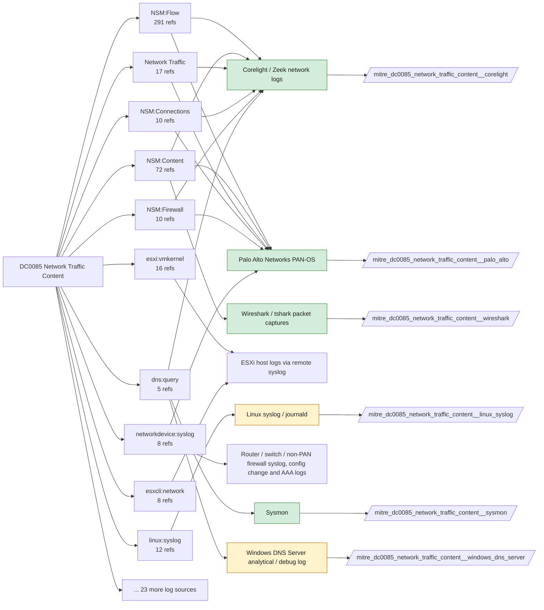

# DC0085 Network Traffic Content

[ATT&CK](https://attack.mitre.org/datacomponents/DC0085) · version 2.2 · modified 2026-11-03 · ATT&CK release 20.1

Status: **Live** · umbrella eventtype `mitre_dc0085_network_traffic_content`

> The full packet capture (PCAP) or session data that logs both protocol headers and payload content. This allows analysts to inspect command and control (C2) traffic, exfiltration, and other suspicious activity within network communications. Unlike metadata-based logs, full content analysis enables deeper protocol inspection, payload decoding, and forensic investigations.  *Data Collection Measures:*  - Network Packet Capture (Full Content Logging)     - Wireshark / tcpdump / tshark         - Full packet captures (PCAP files) for manual analysis or IDS correlation. `tcpdump -i eth0 -w capture.pcap`     - Zeek (formerly Bro)         - Extracts protocol headers and payload details into structured logs. `echo "redef Log::default_store = Log::ASCII;" > local.zeek | zeek -Cr capture.pcap local.zeek`     - Suricata / Snort (IDS/IPS with PCAP Logging)         - Deep packet inspection (DPI) with signature-based and behavioral analysis. `suricata -c /etc/suricata/suricata.yaml -i eth0 -l /var/log/suricata` - Host-Based Collection     - Sysmon Event ID 22 – DNS Query Logging, Captures DNS requests made by processes, useful for detecting C2 domains.     - Sysmon Event ID 3 – Network Connection Initiated, Logs process-to-network connection relationships.     - AuditD (Linux) – syscall=connect, Monitors outbound network requests from processes. `auditctl -a always,exit -F arch=b64 -S connect -k network_activity` - Cloud & SaaS Traffic Collection     - AWS VPC Flow Logs / Azure NSG Flow Logs / Google VPC Flow Logs, Captures metadata about inbound/outbound network traffic.     - Cloud IDS (AWS GuardDuty, Azure Sentinel, Google Chronicle), Detects malicious activity in cloud environments by analyzing network traffic patterns.

## Why this component matters

Protocol-level content: DNS names, HTTP URIs and user agents, TLS SNI and certificates, SMB file names, Kerberos tickets, SMTP. Corelight's protocol logs are the richest source; PAN-OS threat/URL logs add signature and category context; Sysmon EID 22 gives client-side DNS; Wireshark captures are for hunting.

ATT&CK v20.1 has **253 analytics** across **140 detection strategies** that read this component, covering **140 techniques**. Tactics most dependent on it: command-and-control (96), exfiltration (26), collection (25), credential-access (21).

Analytic references by platform: Linux 63, macOS 56, Windows 44, Network Devices 33, ESXi 26, PRE 14, IaaS 9, Containers 5, SaaS 2, Office Suite 1

## Where it comes from



## Requirements

Component specific:

- Corelight log set: dns, http, ssl, x509, files, smtp, ftp, ssh, rdp, smb_files, dce_rpc, kerberos, ntlm, ldap, notice, weird.
- PAN-OS URL filtering and Threat Prevention licenses are required for pan:threat url/vulnerability/virus subtypes; decryption logs need SSL decryption policies.
- Sysmon DnsQuery (EID 22) is often disabled for volume; enable it with exclusions for noisy resolvers.

Per feed (from `config/stack.yml` and `config/log_sources.yml`):

| Feed | Status | Sourcetypes | Constraint | Origin | TA / collector |
|---|---|---|---|---|---|
| `corelight` | live | `corelight_dce_rpc`, `corelight_dns`, `corelight_files`, `corelight_ftp`, `corelight_http`, `corelight_kerberos`, `corelight_ldap`, `corelight_notice`, `corelight_ntlm`, `corelight_rdp`, `corelight_smb_files`, `corelight_smtp`, `corelight_ssh`, `corelight_ssl`, `corelight_weird`, `corelight_x509` | `(whole feed)` | defaults | Corelight App for Splunk (corelight_<log>). For TA_zeek use prefix zeek: and suffix :json. |
| `palo_alto` | live | `pan:decryption`, `pan:threat` | `(whole feed)` | defaults | Splunk Add-on for Palo Alto Networks (pan:*) |
| `sysmon` | live | `XmlWinEventLog:Microsoft-Windows-Sysmon/Operational` | `EventCode IN (22)` | defaults | Splunk Add-on for Sysmon (TA-microsoft-sysmon) |
| `wineventlog` | live | `XmlWinEventLog:Microsoft-Windows-Windows Defender/Operational` | `Defender/Operational EventCode IN (1116, 1117)` | defaults | Splunk Add-on for Microsoft Windows (Splunk_TA_windows), XML rendering |
| `wireshark` | hunt-only | `wireshark:json` | `(whole feed)` | derived | None standard. tshark -T ek output (wireshark:json) or Splunk Stream for continuous capture. |
| `auditd` | ready (tick in stack.yml) | `linux:audit` | `type IN (SYSCALL) (syscall IN (recvfrom, recvmsg, sendmsg, sendto) OR SYSCALL IN (recvfrom, recvmsg, sendmsg, sendto))` | defaults | Splunk Add-on for Unix and Linux (linux:audit) or auditd -> auditbeat/syslog |
| `azure_resource` | ready (tick in stack.yml) | `mscs:azure:eventhub` | `(category=NetworkSecurityGroupFlowEvent OR category=FlowLogFlowEvent)` | derived | Splunk Add-on for Microsoft Cloud Services (mscs:azure:eventhub) |
| `ebpf` | ready (tick in stack.yml) | `falco` | `(whole feed)` | derived | Vendor specific (falco JSON, tetragon) |
| `edr_telemetry` | ready (tick in stack.yml) | `edr:telemetry` | `(whole feed)` | derived | Vendor specific |
| `iis` | ready (tick in stack.yml) | `ms:iis:auto` | `(whole feed)` | derived | Splunk Add-on for Microsoft IIS |
| `kubernetes_audit` | ready (tick in stack.yml) | `kube:container:ingress-nginx` | `(whole feed)` | derived | Splunk OpenTelemetry Collector for Kubernetes / Splunk Connect for Kubernetes |
| `linux_syslog` | ready (tick in stack.yml) | `access_combined` | `(whole feed)` | defaults | Splunk Add-on for Unix and Linux (syslog, linux_secure, linux_messages_syslog) |
| `windows_dns_server` | ready (tick in stack.yml) | `MSAD:NT6:DNS` | `(whole feed)` | derived | Splunk_TA_windows (MSAD:NT6:DNS) or Microsoft-Windows-DNS-Server/Analytical ETW |

Collection prerequisites:

- **corelight**: Sensor placement covering east-west (DC, server VLANs) and north-south; without internal taps the lateral-movement components are blind.
- **corelight**: Enable the log set above; files/pe/smb_* and ldap/kerberos/ntlm are what distinguish Corelight from flow data.
- **palo_alto**: Log forwarding profiles attached to every security rule (traffic start+end, threat, url, wildfire, data).
- **palo_alto**: System and Config logs forwarded from each firewall / Panorama; GlobalProtect logs enabled.
- **palo_alto**: URL filtering and Threat Prevention licensed for pan:threat subtypes url/vulnerability/virus/spyware.
- **sysmon**: Sysmon deployed with a maintained modular configuration (e.g. sysmon-modular or SwiftOnSecurity). Event IDs referenced by a data component only exist if the config includes that rule group (ProcessAccess=10, ImageLoad=7, DNS=22, FileDelete=23/26, ClipboardChange=24, ProcessTampering=25, FileBlock=27/28 are off in minimal configs).
- **sysmon**: Hashes configured (SHA256 at least, IMPHASH useful) for File/Process metadata components.
- **wineventlog**: Advanced Audit Policy configured (at minimum Process Creation, Logon, Account Management, Object Access, Policy Change, Privilege Use, Detailed Tracking). Without the matching subcategory the EventCodes below never fire.
- **wineventlog**: Include command line in process creation events enabled for 4688 (Computer Configuration > Administrative Templates > System > Audit Process Creation).
- **wineventlog**: PowerShell Script Block Logging (4104) and Module Logging (4103) enabled via GPO for the PowerShell/Operational channel.
- **wineventlog**: Object access events (4656/4663/4657/4660/4670) require SACLs on the files/keys of interest.
- **wineventlog**: Non-default channels (TaskScheduler, WMI-Activity, CodeIntegrity, Defender, Firewall, WinRM, SMBClient/Server...) must be listed as inputs in Splunk_TA_windows inputs.conf; several are disabled by default in Windows.
- **auditd**: audit rules for execve, connect, open/openat on sensitive paths, ptrace, module load, mount, setuid; a Neo23x0/auditd baseline or Florian Roth's rule set is a reasonable start.
- **auditd**: log_format = ENRICHED in auditd.conf so syscall names and uids resolve (otherwise syscall numbers are architecture dependent).
- **kubernetes_audit**: Audit policy at Metadata level minimum
- **kubernetes_audit**: RequestResponse for secrets/pods/exec; ship the audit log file from control-plane nodes.

Review notes: `corelight` has 17 ATT&CK reference(s) with no usable event filter (prose channel), constraint origin is *defaults*; `sysmon` has 2 ATT&CK reference(s) with no usable event filter (prose channel), constraint origin is *defaults*; `wineventlog` has 2 ATT&CK reference(s) with no usable event filter (prose channel), constraint origin is *defaults*; `ebpf` has 2 ATT&CK reference(s) with no usable event filter (prose channel), constraint origin is *derived*; `edr_telemetry` has 2 ATT&CK reference(s) with no usable event filter (prose channel), constraint origin is *derived*; `iis` has 4 ATT&CK reference(s) with no usable event filter (prose channel), constraint origin is *derived*; `kubernetes_audit` has 2 ATT&CK reference(s) with no usable event filter (prose channel), constraint origin is *derived*; `linux_syslog` has 14 ATT&CK reference(s) with no usable event filter (prose channel), constraint origin is *defaults*; `windows_dns_server` has 5 ATT&CK reference(s) with no usable event filter (prose channel), constraint origin is *derived*.

## Splunk

Eventtypes (literal constraints, see `dist/splunk/TA-mitre-attack-datacomponents/default/eventtypes.conf`):

```ini
[mitre_dc0085_network_traffic_content__corelight]
search = index=corelight sourcetype IN (corelight_dce_rpc, corelight_dns, corelight_files, corelight_ftp, corelight_http, corelight_kerberos, corelight_ldap, corelight_notice, corelight_ntlm, corelight_rdp, corelight_smb_files, corelight_smtp, corelight_ssh, corelight_ssl, corelight_weird, corelight_x509)

[mitre_dc0085_network_traffic_content__palo_alto]
search = index=pan_logs sourcetype IN ("pan:decryption", "pan:threat")

[mitre_dc0085_network_traffic_content__sysmon]
search = index=sysmon sourcetype=XmlWinEventLog:Microsoft-Windows-Sysmon/Operational EventCode IN (22)

[mitre_dc0085_network_traffic_content__wineventlog]
search = index=wineventlog sourcetype=XmlWinEventLog:Microsoft-Windows-Windows Defender/Operational EventCode IN (1116, 1117)

[mitre_dc0085_network_traffic_content__wireshark]
search = index=pcap sourcetype=wireshark:json
disabled = 1

[mitre_dc0085_network_traffic_content__auditd]
search = index=linux sourcetype=linux:audit type IN (SYSCALL) (syscall IN (recvfrom, recvmsg, sendmsg, sendto) OR SYSCALL IN (recvfrom, recvmsg, sendmsg, sendto))
disabled = 1

[mitre_dc0085_network_traffic_content__azure_resource]
search = index=azure sourcetype=mscs:azure:eventhub (category=NetworkSecurityGroupFlowEvent OR category=FlowLogFlowEvent)
disabled = 1

[mitre_dc0085_network_traffic_content__ebpf]
search = index=linux sourcetype=falco
disabled = 1

[mitre_dc0085_network_traffic_content__edr_telemetry]
search = index=edr sourcetype=edr:telemetry
disabled = 1

[mitre_dc0085_network_traffic_content__iis]
search = index=web sourcetype=ms:iis:auto
disabled = 1

[mitre_dc0085_network_traffic_content__kubernetes_audit]
search = index=k8s sourcetype=kube:container:ingress-nginx
disabled = 1

[mitre_dc0085_network_traffic_content__linux_syslog]
search = index=linux sourcetype=access_combined
disabled = 1

[mitre_dc0085_network_traffic_content__windows_dns_server]
search = index=wineventlog sourcetype=MSAD:NT6:DNS
disabled = 1

[mitre_dc0085_network_traffic_content]
search = eventtype=mitre_dc0085_network_traffic_content__corelight OR eventtype=mitre_dc0085_network_traffic_content__palo_alto OR eventtype=mitre_dc0085_network_traffic_content__sysmon OR eventtype=mitre_dc0085_network_traffic_content__wineventlog OR eventtype=mitre_dc0085_network_traffic_content__wireshark OR eventtype=mitre_dc0085_network_traffic_content__auditd OR eventtype=mitre_dc0085_network_traffic_content__azure_resource OR eventtype=mitre_dc0085_network_traffic_content__ebpf OR eventtype=mitre_dc0085_network_traffic_content__edr_telemetry OR eventtype=mitre_dc0085_network_traffic_content__iis OR eventtype=mitre_dc0085_network_traffic_content__kubernetes_audit OR eventtype=mitre_dc0085_network_traffic_content__linux_syslog OR eventtype=mitre_dc0085_network_traffic_content__windows_dns_server
```

Macros for analytics: `` `mitre_dc0085` `` (umbrella), `` `mitre_dc0085_corelight` ``, `` `mitre_dc0085_palo_alto` ``, `` `mitre_dc0085_sysmon` ``, `` `mitre_dc0085_wineventlog` ``, `` `mitre_dc0085_wireshark` ``, `` `mitre_dc0085_auditd` ``, `` `mitre_dc0085_azure_resource` ``, `` `mitre_dc0085_ebpf` ``, `` `mitre_dc0085_edr_telemetry` ``, `` `mitre_dc0085_iis` ``, `` `mitre_dc0085_kubernetes_audit` ``, `` `mitre_dc0085_linux_syslog` ``, `` `mitre_dc0085_windows_dns_server` ``, `` `mitre_dc0085_filter` `` (site exclusions).
CIM: `Web.Web` via `` `mitre_dc0085_dm` `` / `` `mitre_dc0085_dm_where` `` for `tstats`. CIM tags emitted for: `corelight`, `palo_alto`.

## Sigma

Generic logsource categories scoped by this component in `dist/sigma/pipelines/splunk_mitre_dc.yml`: product `windows`: `dns_query`; product `paloalto`: `proxy`.

## Dependents

Top techniques detected through this component (of 140):

| Technique | Name | Tactics | Analytics using this DC |
|---|---|---|---|
| [T1190](https://attack.mitre.org/techniques/T1190) | Exploit Public-Facing Application | initial-access | 6 |
| [T1048.003](https://attack.mitre.org/techniques/T1048/003) | Exfiltration Over Unencrypted Non-C2 Protocol | exfiltration | 5 |
| [T1095](https://attack.mitre.org/techniques/T1095) | Non-Application Layer Protocol | command-and-control | 5 |
| [T1001.001](https://attack.mitre.org/techniques/T1001/001) | Junk Data | command-and-control | 4 |
| [T1001.002](https://attack.mitre.org/techniques/T1001/002) | Steganography | command-and-control | 4 |
| [T1001.003](https://attack.mitre.org/techniques/T1001/003) | Protocol or Service Impersonation | command-and-control | 4 |
| [T1041](https://attack.mitre.org/techniques/T1041) | Exfiltration Over C2 Channel | exfiltration | 4 |
| [T1071.001](https://attack.mitre.org/techniques/T1071/001) | Web Protocols | command-and-control | 4 |
| [T1071.002](https://attack.mitre.org/techniques/T1071/002) | File Transfer Protocols | command-and-control | 4 |
| [T1071.004](https://attack.mitre.org/techniques/T1071/004) | DNS | command-and-control | 4 |
| [T1074.002](https://attack.mitre.org/techniques/T1074/002) | Remote Data Staging | collection | 4 |
| [T1090.004](https://attack.mitre.org/techniques/T1090/004) | Domain Fronting | command-and-control | 4 |
| [T1132](https://attack.mitre.org/techniques/T1132) | Data Encoding | command-and-control | 4 |
| [T1210](https://attack.mitre.org/techniques/T1210) | Exploitation of Remote Services | lateral-movement | 4 |
| [T1036.012](https://attack.mitre.org/techniques/T1036/012) | Browser Fingerprint | stealth | 3 |
| … | 125 more | | |

Full list: `lookups/mitre_attack_analytics.csv` filtered on `dc_ids` containing `DC0085`.
