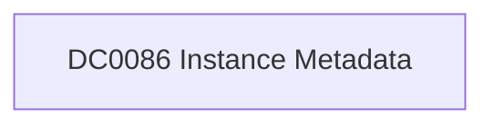

# DC0086 Instance Metadata

[ATT&CK](https://attack.mitre.org/datacomponents/DC0086) · version 2.0 · modified 2025-11-12 · ATT&CK release 20.1

Status: **Out of scope** for the current platform set

> Contextual data about an instance and activity around it such as name, type, or status

## Why this component matters

ATT&CK v20.1 has **3 analytics** across **3 detection strategies** that read this component, covering **3 techniques**. Tactics most dependent on it: defense-impairment (2), discovery (1).

Analytic references by platform: IaaS 3

## Where it comes from

## Requirements

Per feed (from `config/stack.yml` and `config/log_sources.yml`):

| Feed | Status | Sourcetypes | Constraint | Origin | TA / collector |
|---|---|---|---|---|---|

## Splunk

No eventtypes rendered: none of this component's log sources belong to an in-scope platform feed. See [gaps](../gaps.md).

## Sigma

No generic Sigma category maps to this component; rules use `product`/`service` logsources, which the pipeline maps to index and sourcetype.

## Dependents

Top techniques detected through this component (of 3):

| Technique | Name | Tactics | Analytics using this DC |
|---|---|---|---|
| [T1578.002](https://attack.mitre.org/techniques/T1578/002) | Create Cloud Instance | defense-impairment | 1 |
| [T1578.003](https://attack.mitre.org/techniques/T1578/003) | Delete Cloud Instance | defense-impairment | 1 |
| [T1580](https://attack.mitre.org/techniques/T1580) | Cloud Infrastructure Discovery | discovery | 1 |

Full list: `lookups/mitre_attack_analytics.csv` filtered on `dc_ids` containing `DC0086`.
