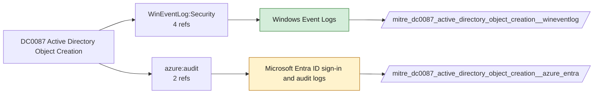

# DC0087 Active Directory Object Creation

[ATT&CK](https://attack.mitre.org/datacomponents/DC0087) · version 2.0 · modified 2025-11-12 · ATT&CK release 20.1

Status: **Live** · umbrella eventtype `mitre_dc0087_active_directory_object_creation`

> Creating new objects in AD, such as user accounts, groups, organizational units (OUs), or trust relationships. Logged as Event ID 5137. Examples:  - User Account Creation: New user account. - Group Creation: New security/distribution group. - OU Creation: New organizational unit. - Service Account Creation: New service account for automation or malicious tasks. - Trust Object Creation: Trust relationship with another domain.

## Why this component matters

New directory objects (5137) and replication partner additions (4928).

ATT&CK v20.1 has **4 analytics** across **3 detection strategies** that read this component, covering **3 techniques**. Tactics most dependent on it: persistence (3), privilege-escalation (3), defense-impairment (1).

Analytic references by platform: Windows 2, Identity Provider 1, IaaS 1

## Where it comes from



## Requirements

Per feed (from `config/stack.yml` and `config/log_sources.yml`):

| Feed | Status | Sourcetypes | Constraint | Origin | TA / collector |
|---|---|---|---|---|---|
| `wineventlog` | live | `XmlWinEventLog:Security` | `EventCode IN (4928, 5137)` | defaults | Splunk Add-on for Microsoft Windows (Splunk_TA_windows), XML rendering |
| `azure_entra` | ready (tick in stack.yml) | `azure:aad:audit` | `(whole feed)` | defaults | Splunk Add-on for Microsoft Azure (azure:aad:signin, azure:aad:audit) or Microsoft Cloud Services add-on via Event Hub |

Collection prerequisites:

- **wineventlog**: Advanced Audit Policy configured (at minimum Process Creation, Logon, Account Management, Object Access, Policy Change, Privilege Use, Detailed Tracking). Without the matching subcategory the EventCodes below never fire.
- **wineventlog**: Include command line in process creation events enabled for 4688 (Computer Configuration > Administrative Templates > System > Audit Process Creation).
- **wineventlog**: PowerShell Script Block Logging (4104) and Module Logging (4103) enabled via GPO for the PowerShell/Operational channel.
- **wineventlog**: Object access events (4656/4663/4657/4660/4670) require SACLs on the files/keys of interest.
- **wineventlog**: Non-default channels (TaskScheduler, WMI-Activity, CodeIntegrity, Defender, Firewall, WinRM, SMBClient/Server...) must be listed as inputs in Splunk_TA_windows inputs.conf; several are disabled by default in Windows.
- **azure_entra**: Diagnostic settings on the tenant streaming SignInLogs
- **azure_entra**: AuditLogs
- **azure_entra**: NonInteractiveUserSignInLogs
- **azure_entra**: ServicePrincipalSignInLogs to an Event Hub or direct Graph pull.

Review notes: `azure_entra` has 2 ATT&CK reference(s) with no usable event filter (prose channel), constraint origin is *defaults*.

## Splunk

Eventtypes (literal constraints, see `dist/splunk/TA-mitre-attack-datacomponents/default/eventtypes.conf`):

```ini
[mitre_dc0087_active_directory_object_creation__wineventlog]
search = index=wineventlog sourcetype=XmlWinEventLog:Security EventCode IN (4928, 5137)

[mitre_dc0087_active_directory_object_creation__azure_entra]
search = index=azure sourcetype=azure:aad:audit
disabled = 1

[mitre_dc0087_active_directory_object_creation]
search = eventtype=mitre_dc0087_active_directory_object_creation__wineventlog OR eventtype=mitre_dc0087_active_directory_object_creation__azure_entra
```

Macros for analytics: `` `mitre_dc0087` `` (umbrella), `` `mitre_dc0087_wineventlog` ``, `` `mitre_dc0087_azure_entra` ``, `` `mitre_dc0087_filter` `` (site exclusions).
CIM: `Change.All_Changes` via `` `mitre_dc0087_dm` `` / `` `mitre_dc0087_dm_where` `` for `tstats`. CIM tags emitted for: `wineventlog`.

## Sigma

No generic Sigma category maps to this component; rules use `product`/`service` logsources, which the pipeline maps to index and sourcetype.

## Dependents

Top techniques detected through this component (of 3):

| Technique | Name | Tactics | Analytics using this DC |
|---|---|---|---|
| [T1098.005](https://attack.mitre.org/techniques/T1098/005) | Device Registration | persistence, privilege-escalation | 2 |
| [T1098.001](https://attack.mitre.org/techniques/T1098/001) | Additional Cloud Credentials | persistence, privilege-escalation | 1 |
| [T1207](https://attack.mitre.org/techniques/T1207) | Rogue Domain Controller | defense-impairment | 1 |

Full list: `lookups/mitre_attack_analytics.csv` filtered on `dc_ids` containing `DC0087`.
