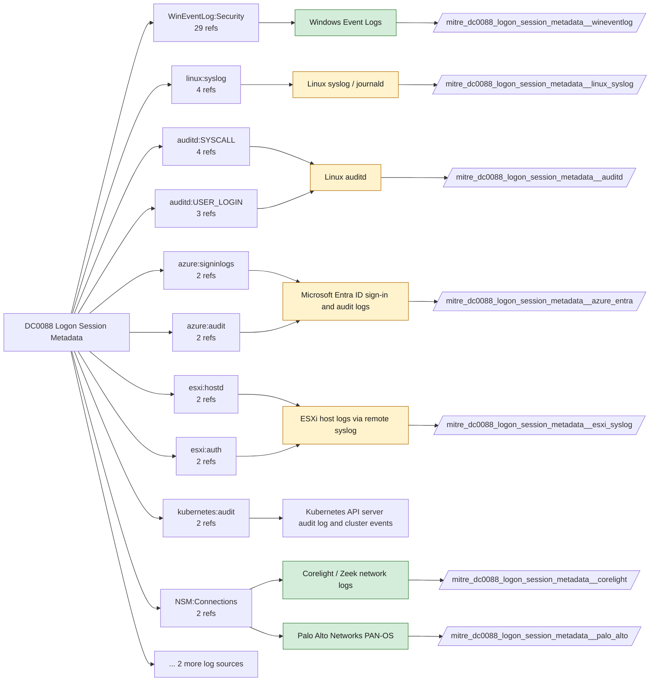

# DC0088 Logon Session Metadata

[ATT&CK](https://attack.mitre.org/datacomponents/DC0088) · version 2.0 · modified 2026-10-13 · ATT&CK release 20.1

Status: **Live** · umbrella eventtype `mitre_dc0088_logon_session_metadata`

> Contextual data about a logon session, such as username, logon type, access tokens (security context, user SIDs, logon identifiers, and logon SID), and any activity associated within it

## Why this component matters

Logon type, privileges (4672), session reconnects (4778/4779) and workstation lock events describe how a session is being used; GlobalProtect and Entra sign-in logs add device and location.

ATT&CK v20.1 has **47 analytics** across **30 detection strategies** that read this component, covering **30 techniques**. Tactics most dependent on it: privilege-escalation (20), initial-access (20), persistence (17), stealth (15).

Analytic references by platform: Windows 20, macOS 9, Linux 7, Identity Provider 3, SaaS 3, ESXi 2, Containers 1, Office Suite 1, IaaS 1

## Where it comes from



## Requirements

Per feed (from `config/stack.yml` and `config/log_sources.yml`):

| Feed | Status | Sourcetypes | Constraint | Origin | TA / collector |
|---|---|---|---|---|---|
| `corelight` | live | `corelight_ssh` | `(whole feed)` | derived | Corelight App for Splunk (corelight_<log>). For TA_zeek use prefix zeek: and suffix :json. |
| `palo_alto` | live | `pan:globalprotect` | `(whole feed)` | defaults | Splunk Add-on for Palo Alto Networks (pan:*) |
| `wineventlog` | live | `XmlWinEventLog:Security` | `EventCode IN (4624, 4634, 4647, 4672, 4778, 4779, 4800, 4801, 4802, 4803)` | defaults | Splunk Add-on for Microsoft Windows (Splunk_TA_windows), XML rendering |
| `auditd` | ready (tick in stack.yml) | `linux:audit` | `type IN (CRED_ACQ, CRED_DISP, USER_END, USER_LOGIN)` | defaults | Splunk Add-on for Unix and Linux (linux:audit) or auditd -> auditbeat/syslog |
| `azure_entra` | ready (tick in stack.yml) | `azure:aad:signin` | `(whole feed)` | defaults | Splunk Add-on for Microsoft Azure (azure:aad:signin, azure:aad:audit) or Microsoft Cloud Services add-on via Event Hub |
| `esxi_syslog` | ready (tick in stack.yml) | `vmware:esxlog:auth`, `vmware:esxlog:hostd` | `(whole feed)` | defaults | Splunk Add-on for VMware ESXi Logs (vmware:esxlog:<log>) |
| `linux_syslog` | ready (tick in stack.yml) | `linux_secure` | `(whole feed)` | defaults | Splunk Add-on for Unix and Linux (syslog, linux_secure, linux_messages_syslog) |

Collection prerequisites:

- **corelight**: Sensor placement covering east-west (DC, server VLANs) and north-south; without internal taps the lateral-movement components are blind.
- **corelight**: Enable the log set above; files/pe/smb_* and ldap/kerberos/ntlm are what distinguish Corelight from flow data.
- **palo_alto**: Log forwarding profiles attached to every security rule (traffic start+end, threat, url, wildfire, data).
- **palo_alto**: System and Config logs forwarded from each firewall / Panorama; GlobalProtect logs enabled.
- **palo_alto**: URL filtering and Threat Prevention licensed for pan:threat subtypes url/vulnerability/virus/spyware.
- **wineventlog**: Advanced Audit Policy configured (at minimum Process Creation, Logon, Account Management, Object Access, Policy Change, Privilege Use, Detailed Tracking). Without the matching subcategory the EventCodes below never fire.
- **wineventlog**: Include command line in process creation events enabled for 4688 (Computer Configuration > Administrative Templates > System > Audit Process Creation).
- **wineventlog**: PowerShell Script Block Logging (4104) and Module Logging (4103) enabled via GPO for the PowerShell/Operational channel.
- **wineventlog**: Object access events (4656/4663/4657/4660/4670) require SACLs on the files/keys of interest.
- **wineventlog**: Non-default channels (TaskScheduler, WMI-Activity, CodeIntegrity, Defender, Firewall, WinRM, SMBClient/Server...) must be listed as inputs in Splunk_TA_windows inputs.conf; several are disabled by default in Windows.
- **auditd**: audit rules for execve, connect, open/openat on sensitive paths, ptrace, module load, mount, setuid; a Neo23x0/auditd baseline or Florian Roth's rule set is a reasonable start.
- **auditd**: log_format = ENRICHED in auditd.conf so syscall names and uids resolve (otherwise syscall numbers are architecture dependent).
- **azure_entra**: Diagnostic settings on the tenant streaming SignInLogs
- **azure_entra**: AuditLogs
- **azure_entra**: NonInteractiveUserSignInLogs
- **azure_entra**: ServicePrincipalSignInLogs to an Event Hub or direct Graph pull.
- **esxi_syslog**: Syslog.global.logHost set on every host; ESXi Shell/SSH audit enabled; consider Syslog.global.auditRecord (ESXi 8).

Review notes: `azure_entra` has 4 ATT&CK reference(s) with no usable event filter (prose channel), constraint origin is *defaults*; `linux_syslog` has 6 ATT&CK reference(s) with no usable event filter (prose channel), constraint origin is *defaults*.

## Splunk

Eventtypes (literal constraints, see `dist/splunk/TA-mitre-attack-datacomponents/default/eventtypes.conf`):

```ini
[mitre_dc0088_logon_session_metadata__corelight]
search = index=corelight sourcetype=corelight_ssh

[mitre_dc0088_logon_session_metadata__palo_alto]
search = index=pan_logs sourcetype=pan:globalprotect

[mitre_dc0088_logon_session_metadata__wineventlog]
search = index=wineventlog sourcetype=XmlWinEventLog:Security EventCode IN (4624, 4634, 4647, 4672, 4778, 4779, 4800, 4801, 4802, 4803)

[mitre_dc0088_logon_session_metadata__auditd]
search = index=linux sourcetype=linux:audit type IN (CRED_ACQ, CRED_DISP, USER_END, USER_LOGIN)
disabled = 1

[mitre_dc0088_logon_session_metadata__azure_entra]
search = index=azure sourcetype=azure:aad:signin
disabled = 1

[mitre_dc0088_logon_session_metadata__esxi_syslog]
search = index=vmware sourcetype IN ("vmware:esxlog:auth", "vmware:esxlog:hostd")
disabled = 1

[mitre_dc0088_logon_session_metadata__linux_syslog]
search = index=linux sourcetype=linux_secure
disabled = 1

[mitre_dc0088_logon_session_metadata]
search = eventtype=mitre_dc0088_logon_session_metadata__corelight OR eventtype=mitre_dc0088_logon_session_metadata__palo_alto OR eventtype=mitre_dc0088_logon_session_metadata__wineventlog OR eventtype=mitre_dc0088_logon_session_metadata__auditd OR eventtype=mitre_dc0088_logon_session_metadata__azure_entra OR eventtype=mitre_dc0088_logon_session_metadata__esxi_syslog OR eventtype=mitre_dc0088_logon_session_metadata__linux_syslog
```

Macros for analytics: `` `mitre_dc0088` `` (umbrella), `` `mitre_dc0088_corelight` ``, `` `mitre_dc0088_palo_alto` ``, `` `mitre_dc0088_wineventlog` ``, `` `mitre_dc0088_auditd` ``, `` `mitre_dc0088_azure_entra` ``, `` `mitre_dc0088_esxi_syslog` ``, `` `mitre_dc0088_linux_syslog` ``, `` `mitre_dc0088_filter` `` (site exclusions).
CIM: `Authentication.Authentication` via `` `mitre_dc0088_dm` `` / `` `mitre_dc0088_dm_where` `` for `tstats`. CIM tags emitted for: `wineventlog`, `azure_entra`.

## Sigma

No generic Sigma category maps to this component; rules use `product`/`service` logsources, which the pipeline maps to index and sourcetype.

## Dependents

Top techniques detected through this component (of 30):

| Technique | Name | Tactics | Analytics using this DC |
|---|---|---|---|
| [T1199](https://attack.mitre.org/techniques/T1199) | Trusted Relationship | initial-access | 6 |
| [T1078.002](https://attack.mitre.org/techniques/T1078/002) | Domain Accounts | stealth, persistence, privilege-escalation, initial-access | 3 |
| [T1078.003](https://attack.mitre.org/techniques/T1078/003) | Local Accounts | stealth, persistence, privilege-escalation, initial-access | 3 |
| [T1078.004](https://attack.mitre.org/techniques/T1078/004) | Cloud Accounts | stealth, persistence, privilege-escalation, initial-access | 3 |
| [T1133](https://attack.mitre.org/techniques/T1133) | External Remote Services | persistence, initial-access | 3 |
| [T1021.004](https://attack.mitre.org/techniques/T1021/004) | SSH | lateral-movement | 2 |
| [T1491.002](https://attack.mitre.org/techniques/T1491/002) | External Defacement | impact | 2 |
| [T1558](https://attack.mitre.org/techniques/T1558) | Steal or Forge Kerberos Tickets | credential-access | 2 |
| [T1606.002](https://attack.mitre.org/techniques/T1606/002) | SAML Tokens | credential-access | 2 |
| [T1021.001](https://attack.mitre.org/techniques/T1021/001) | Remote Desktop Protocol | lateral-movement | 1 |
| [T1021.005](https://attack.mitre.org/techniques/T1021/005) | VNC | lateral-movement | 1 |
| [T1068](https://attack.mitre.org/techniques/T1068) | Exploitation for Privilege Escalation | privilege-escalation | 1 |
| [T1078](https://attack.mitre.org/techniques/T1078) | Valid Accounts | stealth, persistence, privilege-escalation, initial-access | 1 |
| [T1078.001](https://attack.mitre.org/techniques/T1078/001) | Default Accounts | stealth, persistence, privilege-escalation, initial-access | 1 |
| [T1134](https://attack.mitre.org/techniques/T1134) | Access Token Manipulation | stealth, privilege-escalation | 1 |
| … | 15 more | | |

Full list: `lookups/mitre_attack_analytics.csv` filtered on `dc_ids` containing `DC0088`.
