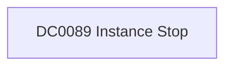

# DC0089 Instance Stop

[ATT&CK](https://attack.mitre.org/datacomponents/DC0089) · version 2.0 · modified 2025-10-21 · ATT&CK release 20.1

Status: **Out of scope** for the current platform set

> The deactivation or shutdown of a virtual machine instance within a cloud infrastructure. This action typically involves stopping a running instance, which halts its operation and releases certain associated resources, such as CPU and memory. Examples:   - Google Cloud Platform (GCP): `instance.stop` events recorded in GCP Audit Logs indicate the deactivation of an instance. - Amazon Web Services (AWS): `StopInstances` actions in AWS CloudTrail indicate EC2 instances being stopped. - Microsoft Azure: `Microsoft.Compute/virtualMachines/deallocate` or `stop` events in Azure Activity Logs represent a virtual machine being stopped or deallocated.

## Why this component matters

ATT&CK v20.1 has **4 analytics** across **4 detection strategies** that read this component, covering **4 techniques**. Tactics most dependent on it: defense-impairment (3), impact (1).

Analytic references by platform: IaaS 4

## Where it comes from

## Requirements

Per feed (from `config/stack.yml` and `config/log_sources.yml`):

| Feed | Status | Sourcetype or source | Constraint | Origin | TA / collector |
|---|---|---|---|---|---|

## Splunk

No eventtypes rendered: none of this component's log sources belong to an in-scope platform feed. See [gaps](../gaps.md).

## Sigma

No generic Sigma category maps to this component; rules use `product`/`service` logsources, which the pipeline maps to index and sourcetype.

## Dependents

Top techniques detected through this component (of 4):

| Technique | Name | Tactics | Analytics using this DC |
|---|---|---|---|
| [T1499.004](https://attack.mitre.org/techniques/T1499/004) | Application or System Exploitation | impact | 1 |
| [T1578](https://attack.mitre.org/techniques/T1578) | Modify Cloud Compute Infrastructure | defense-impairment | 1 |
| [T1578.003](https://attack.mitre.org/techniques/T1578/003) | Delete Cloud Instance | defense-impairment | 1 |
| [T1578.004](https://attack.mitre.org/techniques/T1578/004) | Revert Cloud Instance | defense-impairment | 1 |

Full list: `lookups/mitre_attack_analytics.csv` filtered on `dc_ids` containing `DC0089`.
