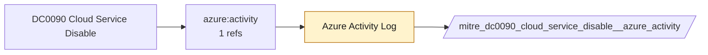

# DC0090 Cloud Service Disable

[ATT&CK](https://attack.mitre.org/datacomponents/DC0090) · version 2.0 · modified 2025-11-12 · ATT&CK release 20.1

Status: **Ready** (needs a feed you have not ticked) · umbrella eventtype `mitre_dc0090_cloud_service_disable`

> This data component refers to monitoring actions that deactivate or stop a cloud service in a cloud control plane. Examples include disabling essential logging services like AWS CloudTrail (`StopLogging` API call), Microsoft Azure Monitor Logs, or Google Cloud's Operations Suite (formerly Stackdriver). Disabling such services can hinder visibility into adversary activities within the cloud environment. Examples:   - AWS CloudTrail StopLogging: This action stops logging of API activity for a particular trail, effectively reducing the monitoring and visibility of AWS resources and activities. - Microsoft Azure Monitor Logs: Disabling these logs hinders the organization’s ability to detect anomalous activities and trace malicious actions. - Google Cloud Logging: Disabling cloud logging removes visibility into resource activity, preventing monitoring of service access or configuration changes. - SaaS Applications: Stopping logging removes visibility into user activities, such as email access or file downloads, enabling undetected malicious behavior.

## Why this component matters

ATT&CK v20.1 has **4 analytics** across **2 detection strategies** that read this component, covering **2 techniques**. Tactics most dependent on it: defense-impairment (3).

Analytic references by platform: IaaS 3, SaaS 1

## Where it comes from



## Requirements

Per feed (from `config/stack.yml` and `config/log_sources.yml`):

| Feed | Status | Sourcetype or source | Constraint | Origin | TA / collector |
|---|---|---|---|---|---|
| `azure_activity` | ready (tick in stack.yml) | sourcetype=`mscs:azure:audit` | `(whole feed)` | derived | Splunk Add-on for Microsoft Cloud Services (mscs:azure:audit) |

Collection prerequisites:

- **azure_activity**: Export Activity Log for every subscription to the Event Hub.

Review notes: `azure_activity` has 1 ATT&CK reference(s) with no usable event filter (prose channel), constraint origin is *derived*.

## Splunk

Eventtypes (literal constraints, see `dist/splunk/TA-mitre-attack-datacomponents/default/eventtypes.conf`):

```ini
[mitre_dc0090_cloud_service_disable__azure_activity]
search = index=azure sourcetype="mscs:azure:audit"
disabled = 1

[mitre_dc0090_cloud_service_disable]
search = eventtype=mitre_dc0090_cloud_service_disable__azure_activity
```

Macros for analytics: `` `mitre_dc0090` `` (umbrella), `` `mitre_dc0090_azure_activity` ``, `` `mitre_dc0090_filter` `` (site exclusions).
CIM: `Change.All_Changes` via `` `mitre_dc0090_dm` `` / `` `mitre_dc0090_dm_where` `` for `tstats`. CIM tags emitted for: `azure_activity`.

## Sigma

No generic Sigma category maps to this component; rules use `product`/`service` logsources, which the pipeline maps to index and sourcetype.

## Dependents

Top techniques detected through this component (of 2):

| Technique | Name | Tactics | Analytics using this DC |
|---|---|---|---|
| [T1685.002](https://attack.mitre.org/techniques/T1685/002) | Disable or Modify Cloud Log | defense-impairment | 3 |
| [T1687](https://attack.mitre.org/techniques/T1687) | Exploitation for Defense Impairment | defense-impairment | 2 |

Full list: `lookups/mitre_attack_analytics.csv` filtered on `dc_ids` containing `DC0090`.
