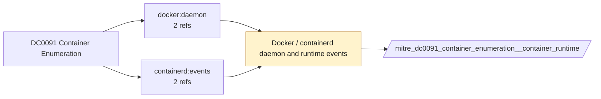

# DC0091 Container Enumeration

[ATT&CK](https://attack.mitre.org/datacomponents/DC0091) · version 2.0 · modified 2025-11-12 · ATT&CK release 20.1

Status: **Ready** (needs a feed you have not ticked) · umbrella eventtype `mitre_dc0091_container_enumeration`

> "Container Enumeration" data component captures events and actions related to listing and identifying active or available containers within a containerized environment. This includes information about running, stopped, or configured containers, such as their names, IDs, statuses, or associated images. Monitoring this activity is crucial for detecting unauthorized discovery or reconnaissance efforts. Examples:   - Docker Example: `docker ps`, `docker ps -a` - Kubernetes Example: `kubectl get pods`, `kubectl get deployments` - Cloud Container Services Example     - AWS ECS: API Call: ListTasks or ListContainers     - Azure Kubernetes Service: API Call: List pod or container instances.     - Google Kubernetes Engine (GKE): API Call: Retrieve deployments and their associated containers.

## Why this component matters

Docker API list calls and kubectl get pods via audit logs for discovery inside clusters.

ATT&CK v20.1 has **2 analytics** across **2 detection strategies** that read this component, covering **2 techniques**. Tactics most dependent on it: privilege-escalation (1), discovery (1).

Analytic references by platform: Containers 2

## Where it comes from



## Requirements

Per feed (from `config/stack.yml` and `config/log_sources.yml`):

| Feed | Status | Sourcetypes | Constraint | Origin | TA / collector |
|---|---|---|---|---|---|
| `container_runtime` | ready (tick in stack.yml) | `containerd:events`, `docker:daemon` | `(status=list OR method=GET uri="/containers/json*")` | defaults | docker events scripted input or OpenTelemetry (docker:events, containerd) |

Review notes: `container_runtime` has 4 ATT&CK reference(s) with no usable event filter (prose channel), constraint origin is *defaults*.

## Splunk

Eventtypes (literal constraints, see `dist/splunk/TA-mitre-attack-datacomponents/default/eventtypes.conf`):

```ini
[mitre_dc0091_container_enumeration__container_runtime]
search = index=k8s sourcetype IN ("containerd:events", "docker:daemon") (status=list OR method=GET uri="/containers/json*")
disabled = 1

[mitre_dc0091_container_enumeration]
search = eventtype=mitre_dc0091_container_enumeration__container_runtime
```

Macros for analytics: `` `mitre_dc0091` `` (umbrella), `` `mitre_dc0091_container_runtime` ``, `` `mitre_dc0091_filter` `` (site exclusions).
CIM: no data model mapping; analytics on this component run as raw eventtype searches.

## Sigma

No generic Sigma category maps to this component; rules use `product`/`service` logsources, which the pipeline maps to index and sourcetype.

## Dependents

Top techniques detected through this component (of 2):

| Technique | Name | Tactics | Analytics using this DC |
|---|---|---|---|
| [T1068](https://attack.mitre.org/techniques/T1068) | Exploitation for Privilege Escalation | privilege-escalation | 1 |
| [T1613](https://attack.mitre.org/techniques/T1613) | Container and Resource Discovery | discovery | 1 |

Full list: `lookups/mitre_attack_analytics.csv` filtered on `dc_ids` containing `DC0091`.
