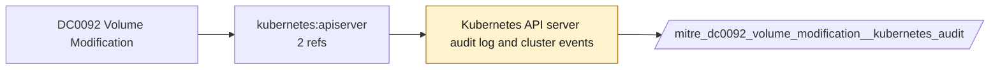

# DC0092 Volume Modification

[ATT&CK](https://attack.mitre.org/datacomponents/DC0092) · version 2.0 · modified 2025-10-21 · ATT&CK release 20.1

Status: **Ready** (needs a feed you have not ticked) · umbrella eventtype `mitre_dc0092_volume_modification`

> Changes made to a cloud volume, including its settings and control data (ex: AWS modify-volume)

## Why this component matters

PersistentVolume/Claim changes in Kubernetes.

ATT&CK v20.1 has **2 analytics** across **2 detection strategies** that read this component, covering **2 techniques**. Tactics most dependent on it: defense-impairment (1), privilege-escalation (1).

Analytic references by platform: IaaS 1, Containers 1

## Where it comes from



## Requirements

Per feed (from `config/stack.yml` and `config/log_sources.yml`):

| Feed | Status | Sourcetype or source | Constraint | Origin | TA / collector |
|---|---|---|---|---|---|
| `kubernetes_audit` | ready (tick in stack.yml) | sourcetype=`kube:apiserver-audit` | `verb IN (patch, update) (objectRef.resource IN (persistentvolumes, persistentvolumeclaims))` | defaults | Splunk OpenTelemetry Collector for Kubernetes / Splunk Connect for Kubernetes |

Collection prerequisites:

- **kubernetes_audit**: Audit policy at Metadata level minimum
- **kubernetes_audit**: RequestResponse for secrets/pods/exec; ship the audit log file from control-plane nodes.

Review notes: `kubernetes_audit` has 2 ATT&CK reference(s) with no usable event filter (prose channel), constraint origin is *defaults*.

## Splunk

Eventtypes (literal constraints, see `dist/splunk/TA-mitre-attack-datacomponents/default/eventtypes.conf`):

```ini
[mitre_dc0092_volume_modification__kubernetes_audit]
search = index=k8s sourcetype="kube:apiserver-audit" verb IN (patch, update) (objectRef.resource IN (persistentvolumes, persistentvolumeclaims))
disabled = 1

[mitre_dc0092_volume_modification]
search = eventtype=mitre_dc0092_volume_modification__kubernetes_audit
```

Macros for analytics: `` `mitre_dc0092` `` (umbrella), `` `mitre_dc0092_kubernetes_audit` ``, `` `mitre_dc0092_filter` `` (site exclusions).
CIM: no data model mapping; analytics on this component run as raw eventtype searches.

## Sigma

No generic Sigma category maps to this component; rules use `product`/`service` logsources, which the pipeline maps to index and sourcetype.

## Dependents

Top techniques detected through this component (of 2):

| Technique | Name | Tactics | Analytics using this DC |
|---|---|---|---|
| [T1578](https://attack.mitre.org/techniques/T1578) | Modify Cloud Compute Infrastructure | defense-impairment | 1 |
| [T1611](https://attack.mitre.org/techniques/T1611) | Escape to Host | privilege-escalation | 1 |

Full list: `lookups/mitre_attack_analytics.csv` filtered on `dc_ids` containing `DC0092`.
