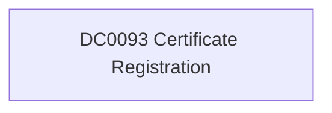

# DC0093 Certificate Registration

[ATT&CK](https://attack.mitre.org/datacomponents/DC0093) · version 2.0 · modified 2025-10-21 · ATT&CK release 20.1

**Out of scope** for the current platform set

> Certificate Registration refers to the collection and analysis of information about digital certificates, including current, revoked, and expired certificates. Sources such as Certificate Transparency logs and other public resources provide visibility into certificates issued for specific domains or organizations. Monitoring certificate registrations can help identify potential misuse, such as unauthorized certificates or signs of adversary reconnaissance. Examples:   - Certificate Transparency Logs: These logs record the issuance of SSL/TLS certificates by trusted Certificate Authorities (CAs). - Revoked Certificates: Information about certificates that have been invalidated before their expiration date. - Expired Certificates: Reports of expired certificates for a domain, which may indicate lax security practices or opportunities for adversaries to exploit expired credentials. - Domain Monitoring for Certificates: Maps SSL/TLS certificates to domains and subdomains, helping to identify any rogue certificates. - Public Certificate Directories: Services providing APIs to query issued certificates for analysis.  This data component can be collected through the following measures:  Use Certificate Transparency Monitors  - Tools like crt.sh, CertStream, or APIs provided by certificate authorities (CAs) allow you to monitor issued certificates in real-time. - Example: Use CertStream to stream certificate issuance logs and filter for domains of interest.  Analyze Certificate Revocation Sources  - Monitor CRLs or query OCSP responders to detect revoked certificates. - Configure tools like OpenSSL or browsers to validate certificate revocation status automatically.  Leverage Public Scanning Tools  - Use tools such as SSL Labs, Censys, or Shodan to scan for certificate details related to your domain or network.  Automate Certificate Monitoring  - Set up automated scripts or services to parse Certificate Transparency logs for anomalies. - Example: Automate searches on crt.sh to identify certificates issued for typo-squatted domains.  Integrate with Threat Intelligence  - Enrich certificate data with threat intelligence feeds to detect connections to known adversary-controlled infrastructure. - Tools like VirusTotal can identify malicious certificates based on associated indicators.

## Why this component matters

ATT&CK v20.1 has **2 analytics** across **2 detection strategies** that read this component, covering **2 techniques**. Tactics most dependent on it: resource-development (2).

Analytic references by platform: PRE 2

## Where it comes from

## Requirements

Per feed (from `config/stack.yml` and `config/log_sources.yml`):

| Feed | Schedule | Sourcetype or source | Constraint | Origin | TA / collector |
|---|---|---|---|---|---|

## Splunk

No eventtypes rendered: none of this component's log sources belong to an in-scope platform feed. See [gaps](../gaps.md).

## Sigma

No generic Sigma category maps to this component; rules use `product`/`service` logsources, which the pipeline maps to index and sourcetype.

## Dependents

Top techniques detected through this component (of 2):

| Technique | Name | Tactics | Analytics using this DC |
|---|---|---|---|
| [T1588](https://attack.mitre.org/techniques/T1588) | Obtain Capabilities | resource-development | 1 |
| [T1588.004](https://attack.mitre.org/techniques/T1588/004) | Digital Certificates | resource-development | 1 |

Full list: `lookups/mitre_attack_analytics.csv` filtered on `dc_ids` containing `DC0093`.
