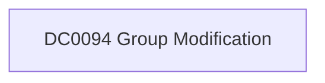

# DC0094 Group Modification

[ATT&CK](https://attack.mitre.org/datacomponents/DC0094) · version 2.0 · modified 2025-10-21 · ATT&CK release 20.1

Umbrella eventtype `mitre_dc0094_group_modification` over 1 feed(s)

> Changes made to a group, such as membership, name, or permissions (ex: Windows EID 4728 or 4732, AWS IAM UpdateGroup). Examples:   - Active Directory:     - Event ID 4728: Member added to a global group.     - Event ID 4732: Member added to a local group. - Azure AD: `Set-AzureADGroup -ObjectId <GroupId> -DisplayName "New Name"` - AWS IAM: `aws iam update-group --group-name <GroupName> --new-path "/admin/"` - Google Workspace: Modify permissions via Admin SDK API: `PATCH https://admin.googleapis.com/admin/directory/v1/groups/<groupKey>` - Office 365: Modify groups via Graph API: `PATCH https://graph.microsoft.com/v1.0/groups/<groupId>`  *Data Collection Measures:*  - Directory Logging:     - Windows: Log EIDs 4728 (add), 4729 (remove).     - Azure AD: Enable "Audit logs."     - Google Workspace: Enable Admin Activity logs.     - Office 365: Use Unified Audit Logs. - Cloud Monitoring:     - AWS: Log `UpdateGroup`, `AttachGroupPolicy`, `RemoveUserFromGroup`.     - Azure: Track modifications via Audit logs. - API Monitoring: Log Google Admin SDK and Microsoft Graph API calls. - SIEM Integration: Centralize and monitor group modification logs.

## Why this component matters

Membership changes to security groups (4728/4732/4756 and removals).

ATT&CK v20.1 has **1 analytics** across **1 detection strategies** that read this component, covering **1 techniques**. Tactics most dependent on it: persistence (1).

Analytic references by platform: Office Suite 1

## Where it comes from



## Requirements

Per feed (from `config/stack.yml` and `config/log_sources.yml`):

| Feed | Schedule | Sourcetype or source | Constraint | Origin | TA / collector |
|---|---|---|---|---|---|
| `wineventlog` | scheduled | source=`XmlWinEventLog:Security` | `EventCode IN (4728, 4729, 4732, 4733, 4735, 4737, 4755, 4756, 4757)` | defaults | Splunk Add-on for Microsoft Windows (Splunk_TA_windows), XML rendering (renderXml = true) |

Collection prerequisites:

- **wineventlog**: Advanced Audit Policy configured (at minimum Process Creation, Logon, Account Management, Object Access, Policy Change, Privilege Use, Detailed Tracking). Without the matching subcategory the EventCodes below never fire.
- **wineventlog**: Include command line in process creation events enabled for 4688 (Computer Configuration > Administrative Templates > System > Audit Process Creation).
- **wineventlog**: PowerShell Script Block Logging (4104) and Module Logging (4103) enabled via GPO for the PowerShell/Operational channel.
- **wineventlog**: Object access events (4656/4663/4657/4660/4670) require SACLs on the files/keys of interest.
- **wineventlog**: Non-default channels (TaskScheduler, WMI-Activity, CodeIntegrity, Defender, Firewall, WinRM, SMBClient/Server...) must be listed as inputs in Splunk_TA_windows inputs.conf; several are disabled by default in Windows.

## Splunk

Eventtypes (literal constraints, see `dist/splunk/TA-mitre-attack-datacomponents/default/eventtypes.conf`):

```ini
[mitre_dc0094_group_modification__wineventlog]
search = index=wineventlog source="XmlWinEventLog:Security" EventCode IN (4728, 4729, 4732, 4733, 4735, 4737, 4755, 4756, 4757)

[mitre_dc0094_group_modification]
search = eventtype=mitre_dc0094_group_modification__wineventlog
```

Macros for analytics: `` `mitre_dc0094` `` (umbrella), `` `mitre_dc0094_wineventlog` ``, `` `mitre_dc0094_filter` `` (site exclusions).
CIM: `Change.Account_Management` via `` `mitre_dc0094_dm` `` / `` `mitre_dc0094_dm_where` `` for `tstats`. CIM tags emitted for: `wineventlog`.

## Sigma

No generic Sigma category maps to this component; rules use `product`/`service` logsources, which the pipeline maps to index and sourcetype.

## Dependents

Top techniques detected through this component (of 1):

| Technique | Name | Tactics | Analytics using this DC |
|---|---|---|---|
| [T1136.003](https://attack.mitre.org/techniques/T1136/003) | Cloud Account | persistence | 1 |

Full list: `lookups/mitre_attack_analytics.csv` filtered on `dc_ids` containing `DC0094`.
