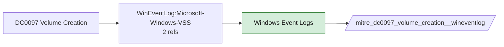

# DC0097 Volume Creation

[ATT&CK](https://attack.mitre.org/datacomponents/DC0097) · version 2.0 · modified 2025-11-12 · ATT&CK release 20.1

Status: **Live** · umbrella eventtype `mitre_dc0097_volume_creation`

> The initial provisioning of block storage volumes in cloud or on-prem environments, typically used for data storage, backup, or workload scaling.

## Why this component matters

VSS shadow copies (VSS channel, 8224) on Windows, PVC creation in Kubernetes, VMFS volumes on ESXi.

ATT&CK v20.1 has **2 analytics** across **2 detection strategies** that read this component, covering **2 techniques**. Tactics most dependent on it: credential-access (1), defense-impairment (1).

Analytic references by platform: Windows 1, IaaS 1

## Where it comes from



## Requirements

Per feed (from `config/stack.yml` and `config/log_sources.yml`):

| Feed | Status | Sourcetypes | Constraint | Origin | TA / collector |
|---|---|---|---|---|---|
| `wineventlog` | live | `XmlWinEventLog:Microsoft-Windows-VSS`, `XmlWinEventLog:System` | `EventCode IN (12, 7036, 8224)` | defaults | Splunk Add-on for Microsoft Windows (Splunk_TA_windows), XML rendering |
| `esxi_syslog` | ready (tick in stack.yml) | `vmware:esxlog:hostd`, `vmware:esxlog:vmkernel` | `(whole feed)` | defaults | Splunk Add-on for VMware ESXi Logs (vmware:esxlog:<log>) |
| `kubernetes_audit` | ready (tick in stack.yml) | `kube:apiserver-audit`, `kube:objects:events` | `verb IN (create) (objectRef.resource IN (persistentvolumes, persistentvolumeclaims))` | defaults | Splunk OpenTelemetry Collector for Kubernetes / Splunk Connect for Kubernetes |

Collection prerequisites:

- **wineventlog**: Advanced Audit Policy configured (at minimum Process Creation, Logon, Account Management, Object Access, Policy Change, Privilege Use, Detailed Tracking). Without the matching subcategory the EventCodes below never fire.
- **wineventlog**: Include command line in process creation events enabled for 4688 (Computer Configuration > Administrative Templates > System > Audit Process Creation).
- **wineventlog**: PowerShell Script Block Logging (4104) and Module Logging (4103) enabled via GPO for the PowerShell/Operational channel.
- **wineventlog**: Object access events (4656/4663/4657/4660/4670) require SACLs on the files/keys of interest.
- **wineventlog**: Non-default channels (TaskScheduler, WMI-Activity, CodeIntegrity, Defender, Firewall, WinRM, SMBClient/Server...) must be listed as inputs in Splunk_TA_windows inputs.conf; several are disabled by default in Windows.
- **esxi_syslog**: Syslog.global.logHost set on every host; ESXi Shell/SSH audit enabled; consider Syslog.global.auditRecord (ESXi 8).
- **kubernetes_audit**: Audit policy at Metadata level minimum
- **kubernetes_audit**: RequestResponse for secrets/pods/exec; ship the audit log file from control-plane nodes.

Review notes: `wineventlog` has 2 ATT&CK reference(s) with no usable event filter (prose channel), constraint origin is *defaults*.

## Splunk

Eventtypes (literal constraints, see `dist/splunk/TA-mitre-attack-datacomponents/default/eventtypes.conf`):

```ini
[mitre_dc0097_volume_creation__wineventlog]
search = index=wineventlog sourcetype IN ("XmlWinEventLog:Microsoft-Windows-VSS", "XmlWinEventLog:System") EventCode IN (12, 7036, 8224)

[mitre_dc0097_volume_creation__esxi_syslog]
search = index=vmware sourcetype IN ("vmware:esxlog:hostd", "vmware:esxlog:vmkernel")
disabled = 1

[mitre_dc0097_volume_creation__kubernetes_audit]
search = index=k8s sourcetype IN ("kube:apiserver-audit", "kube:objects:events") verb IN (create) (objectRef.resource IN (persistentvolumes, persistentvolumeclaims))
disabled = 1

[mitre_dc0097_volume_creation]
search = eventtype=mitre_dc0097_volume_creation__wineventlog OR eventtype=mitre_dc0097_volume_creation__esxi_syslog OR eventtype=mitre_dc0097_volume_creation__kubernetes_audit
```

Macros for analytics: `` `mitre_dc0097` `` (umbrella), `` `mitre_dc0097_wineventlog` ``, `` `mitre_dc0097_esxi_syslog` ``, `` `mitre_dc0097_kubernetes_audit` ``, `` `mitre_dc0097_filter` `` (site exclusions).
CIM: no data model mapping; analytics on this component run as raw eventtype searches.

## Sigma

No generic Sigma category maps to this component; rules use `product`/`service` logsources, which the pipeline maps to index and sourcetype.

## Dependents

Top techniques detected through this component (of 2):

| Technique | Name | Tactics | Analytics using this DC |
|---|---|---|---|
| [T1003.003](https://attack.mitre.org/techniques/T1003/003) | NTDS | credential-access | 1 |
| [T1578](https://attack.mitre.org/techniques/T1578) | Modify Cloud Compute Infrastructure | defense-impairment | 1 |

Full list: `lookups/mitre_attack_analytics.csv` filtered on `dc_ids` containing `DC0097`.
