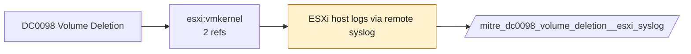

# DC0098 Volume Deletion

[ATT&CK](https://attack.mitre.org/datacomponents/DC0098) · version 2.0 · modified 2025-11-12 · ATT&CK release 20.1

Status: **Ready** (needs a feed you have not ticked) · umbrella eventtype `mitre_dc0098_volume_deletion`

> The removal of a cloud-based or on-premise block storage volume. This action permanently deletes the allocated storage and may result in data loss if not backed up.  *Data Collection Measures:*  - Cloud Logging & APIs     - AWS CloudTrail Logs         - `eventName: DeleteVolume` (tracks volume deletions)     - Azure Monitor Logs         - `operationName: Microsoft.Compute/disks/delete`         - `status: Success | Failure` (flag unauthorized delete attempts)     - Google Cloud Audit Logs         - `protoPayload.methodName: "v1.compute.disks.delete"`         - `authenticationInfo.principalEmail` (identifies the user deleting the volume) - System & Host-Based Logging     - Linux & macOS Logs:         - `/var/log/syslog` or `/var/log/messages` for volume detach/deletion actions     - Windows Event Logs:         - Event ID 98 (Storage Class Memory)         - Event ID 225 (Volume Removal Detected)         - Event ID 12 (Disk Removal Notification)

## Why this component matters

Datastore or VMFS volume removal on ESXi; pairs with snapshot deletion for ransomware staging.

ATT&CK v20.1 has **2 analytics** across **2 detection strategies** that read this component, covering **2 techniques**. Tactics most dependent on it: impact (1), defense-impairment (1).

Analytic references by platform: ESXi 1, IaaS 1

## Where it comes from



## Requirements

Per feed (from `config/stack.yml` and `config/log_sources.yml`):

| Feed | Status | Sourcetypes | Constraint | Origin | TA / collector |
|---|---|---|---|---|---|
| `esxi_syslog` | ready (tick in stack.yml) | `vmware:esxlog:hostd`, `vmware:esxlog:vmkernel` | `(whole feed)` | defaults | Splunk Add-on for VMware ESXi Logs (vmware:esxlog:<log>) |

Collection prerequisites:

- **esxi_syslog**: Syslog.global.logHost set on every host; ESXi Shell/SSH audit enabled; consider Syslog.global.auditRecord (ESXi 8).

## Splunk

Eventtypes (literal constraints, see `dist/splunk/TA-mitre-attack-datacomponents/default/eventtypes.conf`):

```ini
[mitre_dc0098_volume_deletion__esxi_syslog]
search = index=vmware sourcetype IN ("vmware:esxlog:hostd", "vmware:esxlog:vmkernel")
disabled = 1

[mitre_dc0098_volume_deletion]
search = eventtype=mitre_dc0098_volume_deletion__esxi_syslog
```

Macros for analytics: `` `mitre_dc0098` `` (umbrella), `` `mitre_dc0098_esxi_syslog` ``, `` `mitre_dc0098_filter` `` (site exclusions).
CIM: no data model mapping; analytics on this component run as raw eventtype searches.

## Sigma

No generic Sigma category maps to this component; rules use `product`/`service` logsources, which the pipeline maps to index and sourcetype.

## Dependents

Top techniques detected through this component (of 2):

| Technique | Name | Tactics | Analytics using this DC |
|---|---|---|---|
| [T1485](https://attack.mitre.org/techniques/T1485) | Data Destruction | impact | 1 |
| [T1578](https://attack.mitre.org/techniques/T1578) | Modify Cloud Compute Infrastructure | defense-impairment | 1 |

Full list: `lookups/mitre_attack_analytics.csv` filtered on `dc_ids` containing `DC0098`.
