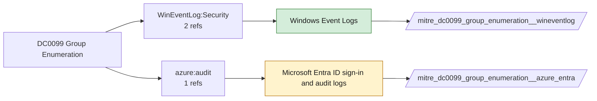

# DC0099 Group Enumeration

[ATT&CK](https://attack.mitre.org/datacomponents/DC0099) · version 2.1 · modified 2026-05-12 · ATT&CK release 20.1

Status: **Live** · umbrella eventtype `mitre_dc0099_group_enumeration`

> Extracting group lists from identity systems identifies permissions, roles, or configurations. Adversaries may exploit high-privilege groups or misconfigurations. Examples:  - AWS CLI: `aws iam list-groups` - PowerShell: `Get-ADGroup -Filter *` - (Saas) Google Workspace: Admin SDK Directory API - Azure: `Get-AzureADGroup` - Microsoft 365:  Graph API `GET https://graph.microsoft.com/v1.0/groups`  *Data Collection Measures:*  - Cloud Logging: Enable AWS CloudTrail, Azure Activity Logs, and Google Workspace Admin Logs for group-related actions. - Directory Monitoring: Track logs like AD Event ID 4662 (object operations). - API Monitoring: Log API activity like AWS IAM queries. - SaaS Monitoring: Use platform logs (e.g., Office 365 Unified Audit Logs). - SIEM Integration: Centralize group query tracking.

## Why this component matters

4798/4799 fire when a process enumerates local group membership, a reliable signal for discovery tooling.

ATT&CK v20.1 has **3 analytics** across **2 detection strategies** that read this component, covering **2 techniques**. Tactics most dependent on it: discovery (3).

Analytic references by platform: SaaS 1, Windows 1, IaaS 1

## Where it comes from



## Requirements

Component specific:

- Audit Security Group Management and User Account Management.

Per feed (from `config/stack.yml` and `config/log_sources.yml`):

| Feed | Status | Sourcetypes | Constraint | Origin | TA / collector |
|---|---|---|---|---|---|
| `wineventlog` | live | `XmlWinEventLog:Security` | `EventCode IN (4798, 4799)` | defaults | Splunk Add-on for Microsoft Windows (Splunk_TA_windows), XML rendering |
| `azure_entra` | ready (tick in stack.yml) | `azure:aad:audit` | `(whole feed)` | defaults | Splunk Add-on for Microsoft Azure (azure:aad:signin, azure:aad:audit) or Microsoft Cloud Services add-on via Event Hub |

Collection prerequisites:

- **wineventlog**: Advanced Audit Policy configured (at minimum Process Creation, Logon, Account Management, Object Access, Policy Change, Privilege Use, Detailed Tracking). Without the matching subcategory the EventCodes below never fire.
- **wineventlog**: Include command line in process creation events enabled for 4688 (Computer Configuration > Administrative Templates > System > Audit Process Creation).
- **wineventlog**: PowerShell Script Block Logging (4104) and Module Logging (4103) enabled via GPO for the PowerShell/Operational channel.
- **wineventlog**: Object access events (4656/4663/4657/4660/4670) require SACLs on the files/keys of interest.
- **wineventlog**: Non-default channels (TaskScheduler, WMI-Activity, CodeIntegrity, Defender, Firewall, WinRM, SMBClient/Server...) must be listed as inputs in Splunk_TA_windows inputs.conf; several are disabled by default in Windows.
- **azure_entra**: Diagnostic settings on the tenant streaming SignInLogs
- **azure_entra**: AuditLogs
- **azure_entra**: NonInteractiveUserSignInLogs
- **azure_entra**: ServicePrincipalSignInLogs to an Event Hub or direct Graph pull.

Review notes: `azure_entra` has 1 ATT&CK reference(s) with no usable event filter (prose channel), constraint origin is *defaults*.

## Splunk

Eventtypes (literal constraints, see `dist/splunk/TA-mitre-attack-datacomponents/default/eventtypes.conf`):

```ini
[mitre_dc0099_group_enumeration__wineventlog]
search = index=wineventlog sourcetype=XmlWinEventLog:Security EventCode IN (4798, 4799)

[mitre_dc0099_group_enumeration__azure_entra]
search = index=azure sourcetype=azure:aad:audit
disabled = 1

[mitre_dc0099_group_enumeration]
search = eventtype=mitre_dc0099_group_enumeration__wineventlog OR eventtype=mitre_dc0099_group_enumeration__azure_entra
```

Macros for analytics: `` `mitre_dc0099` `` (umbrella), `` `mitre_dc0099_wineventlog` ``, `` `mitre_dc0099_azure_entra` ``, `` `mitre_dc0099_filter` `` (site exclusions).
CIM: no data model mapping; analytics on this component run as raw eventtype searches.

## Sigma

No generic Sigma category maps to this component; rules use `product`/`service` logsources, which the pipeline maps to index and sourcetype.

## Dependents

Top techniques detected through this component (of 2):

| Technique | Name | Tactics | Analytics using this DC |
|---|---|---|---|
| [T1069.003](https://attack.mitre.org/techniques/T1069/003) | Cloud Groups | discovery | 2 |
| [T1087](https://attack.mitre.org/techniques/T1087) | Account Discovery | discovery | 1 |

Full list: `lookups/mitre_attack_analytics.csv` filtered on `dc_ids` containing `DC0099`.
