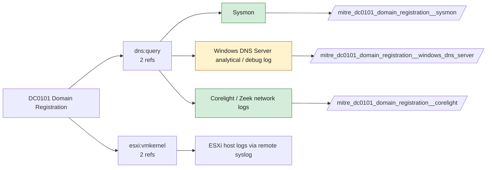

# DC0101 Domain Registration

[ATT&CK](https://attack.mitre.org/datacomponents/DC0101) · version 2.0 · modified 2025-10-21 · ATT&CK release 20.1

Status: **Live** · umbrella eventtype `mitre_dc0101_domain_registration`

> "Domain Name: Domain Registration" data component captures information about the assignment, ownership, and metadata of domain names. This information is often sourced from registries like WHOIS and includes details such as registrant names, contact information, registration dates, expiration dates, and registrar details. This data is invaluable for tracking domain ownership, detecting malicious domain registrations, and identifying trends in adversary behavior. Examples:   - Registrant Information: WHOIS lookup of example.com  - Registration and Expiration Dates: A domain registered a week before being used in phishing attacks. - Domain Status: Status codes like clientTransferProhibited or serverHold indicate domain restrictions or potential hijacking activity. - Name Server Information: Name servers point to a public DNS provider often associated with malicious campaigns. - Privacy Protection: A domain uses WHOIS privacy protection to hide registrant details.  This data component can be collected through the following measures:  - WHOIS Services: Use tools or services to perform WHOIS lookups: - WHOIS APIs: Automate domain registration lookups with APIs: - Registrar Platforms: Directly query domain registrars (e.g., GoDaddy, Namecheap) for detailed registration data. - Threat Intelligence Platforms: Integrate domain registration data from services like Recorded Future, RiskIQ, or PassiveTotal for enriched analysis.

## Why this component matters

Newly registered or look-alike domains observed in DNS (Corelight dns.log, Sysmon 22) rather than from registrar data; the registrar side is threat intel.

ATT&CK v20.1 has **6 analytics** across **5 detection strategies** that read this component, covering **5 techniques**. Tactics most dependent on it: resource-development (4), command-and-control (2).

Analytic references by platform: PRE 4, ESXi 1, Windows 1

## Where it comes from



## Requirements

Per feed (from `config/stack.yml` and `config/log_sources.yml`):

| Feed | Status | Sourcetypes | Constraint | Origin | TA / collector |
|---|---|---|---|---|---|
| `corelight` | live | `corelight_dns`, `corelight_x509` | `(whole feed)` | defaults | Corelight App for Splunk (corelight_<log>). For TA_zeek use prefix zeek: and suffix :json. |
| `sysmon` | live | `XmlWinEventLog:Microsoft-Windows-Sysmon/Operational` | `EventCode IN (22)` | defaults | Splunk Add-on for Sysmon (TA-microsoft-sysmon) |
| `windows_dns_server` | ready (tick in stack.yml) | `MSAD:NT6:DNS` | `(whole feed)` | derived | Splunk_TA_windows (MSAD:NT6:DNS) or Microsoft-Windows-DNS-Server/Analytical ETW |

Collection prerequisites:

- **corelight**: Sensor placement covering east-west (DC, server VLANs) and north-south; without internal taps the lateral-movement components are blind.
- **corelight**: Enable the log set above; files/pe/smb_* and ldap/kerberos/ntlm are what distinguish Corelight from flow data.
- **sysmon**: Sysmon deployed with a maintained modular configuration (e.g. sysmon-modular or SwiftOnSecurity). Event IDs referenced by a data component only exist if the config includes that rule group (ProcessAccess=10, ImageLoad=7, DNS=22, FileDelete=23/26, ClipboardChange=24, ProcessTampering=25, FileBlock=27/28 are off in minimal configs).
- **sysmon**: Hashes configured (SHA256 at least, IMPHASH useful) for File/Process metadata components.

Review notes: `windows_dns_server` has 2 ATT&CK reference(s) with no usable event filter (prose channel), constraint origin is *derived*.

## Splunk

Eventtypes (literal constraints, see `dist/splunk/TA-mitre-attack-datacomponents/default/eventtypes.conf`):

```ini
[mitre_dc0101_domain_registration__corelight]
search = index=corelight sourcetype IN (corelight_dns, corelight_x509)

[mitre_dc0101_domain_registration__sysmon]
search = index=sysmon sourcetype=XmlWinEventLog:Microsoft-Windows-Sysmon/Operational EventCode IN (22)

[mitre_dc0101_domain_registration__windows_dns_server]
search = index=wineventlog sourcetype=MSAD:NT6:DNS
disabled = 1

[mitre_dc0101_domain_registration]
search = eventtype=mitre_dc0101_domain_registration__corelight OR eventtype=mitre_dc0101_domain_registration__sysmon OR eventtype=mitre_dc0101_domain_registration__windows_dns_server
```

Macros for analytics: `` `mitre_dc0101` `` (umbrella), `` `mitre_dc0101_corelight` ``, `` `mitre_dc0101_sysmon` ``, `` `mitre_dc0101_windows_dns_server` ``, `` `mitre_dc0101_filter` `` (site exclusions).
CIM: no data model mapping; analytics on this component run as raw eventtype searches.

## Sigma

No generic Sigma category maps to this component; rules use `product`/`service` logsources, which the pipeline maps to index and sourcetype.

## Dependents

Top techniques detected through this component (of 5):

| Technique | Name | Tactics | Analytics using this DC |
|---|---|---|---|
| [T1665](https://attack.mitre.org/techniques/T1665) | Hide Infrastructure | command-and-control | 2 |
| [T1583](https://attack.mitre.org/techniques/T1583) | Acquire Infrastructure | resource-development | 1 |
| [T1583.001](https://attack.mitre.org/techniques/T1583/001) | Domains | resource-development | 1 |
| [T1584](https://attack.mitre.org/techniques/T1584) | Compromise Infrastructure | resource-development | 1 |
| [T1584.001](https://attack.mitre.org/techniques/T1584/001) | Domains | resource-development | 1 |

Full list: `lookups/mitre_attack_analytics.csv` filtered on `dc_ids` containing `DC0101`.
