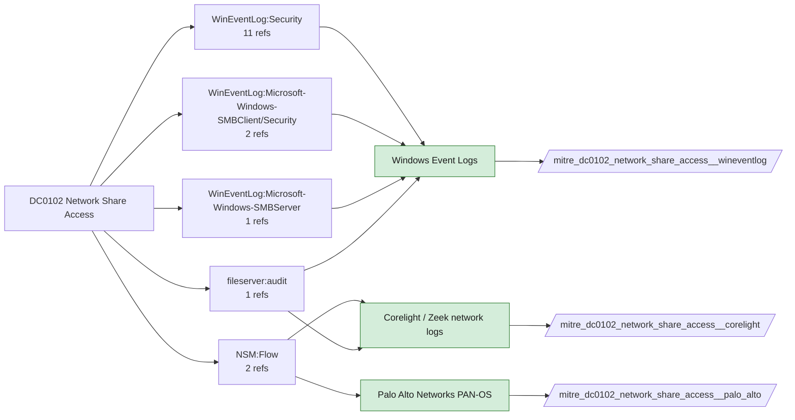

# DC0102 Network Share Access

[ATT&CK](https://attack.mitre.org/datacomponents/DC0102) · version 2.0 · modified 2026-10-13 · ATT&CK release 20.1

Status: **Live** · umbrella eventtype `mitre_dc0102_network_share_access`

> Opening a network share, which makes the contents available to the requestor (ex: Windows EID 5140 or 5145)

## Why this component matters

Admin-share lateral movement, data staging and ransomware spreading. 5140/5145 (with Audit File Share and Detailed File Share) on the server, SMBClient/Security on the client, Corelight smb_files/smb_mapping on the wire.

ATT&CK v20.1 has **11 analytics** across **9 detection strategies** that read this component, covering **9 techniques**. Tactics most dependent on it: lateral-movement (4), collection (4), credential-access (2), persistence (1).

Analytic references by platform: Windows 9, SaaS 1, Linux 1

## Where it comes from



## Requirements

Component specific:

- 5145 (Detailed File Share) is very high volume on file servers; enable it on domain controllers and sensitive servers only.

Per feed (from `config/stack.yml` and `config/log_sources.yml`):

| Feed | Status | Sourcetypes | Constraint | Origin | TA / collector |
|---|---|---|---|---|---|
| `corelight` | live | `corelight_smb_files`, `corelight_smb_mapping` | `(whole feed)` | defaults | Corelight App for Splunk (corelight_<log>). For TA_zeek use prefix zeek: and suffix :json. |
| `palo_alto` | live | `pan:traffic` | `(app=ms-ds-smb OR app=ms-ds-smbv3 OR app=ms-ds-smbv2)` | defaults | Splunk Add-on for Palo Alto Networks (pan:*) |
| `wineventlog` | live | `XmlWinEventLog:Microsoft-Windows-SMBClient/Security`, `XmlWinEventLog:Microsoft-Windows-SMBServer/Security`, `XmlWinEventLog:Security` | `EventCode IN (5140, 5142, 5144, 5145, 31001)` | defaults | Splunk Add-on for Microsoft Windows (Splunk_TA_windows), XML rendering |

Collection prerequisites:

- **corelight**: Sensor placement covering east-west (DC, server VLANs) and north-south; without internal taps the lateral-movement components are blind.
- **corelight**: Enable the log set above; files/pe/smb_* and ldap/kerberos/ntlm are what distinguish Corelight from flow data.
- **palo_alto**: Log forwarding profiles attached to every security rule (traffic start+end, threat, url, wildfire, data).
- **palo_alto**: System and Config logs forwarded from each firewall / Panorama; GlobalProtect logs enabled.
- **palo_alto**: URL filtering and Threat Prevention licensed for pan:threat subtypes url/vulnerability/virus/spyware.
- **palo_alto**: Operational (show/debug) commands are not in config or system logs by default. Enable administrator activity audit tracking (Device > Setup > Management > Logging and Reporting, PAN-OS 10.1+) and forward the audit log if you want CLI discovery analytics for the firewall.
- **wineventlog**: Advanced Audit Policy configured (at minimum Process Creation, Logon, Account Management, Object Access, Policy Change, Privilege Use, Detailed Tracking). Without the matching subcategory the EventCodes below never fire.
- **wineventlog**: Include command line in process creation events enabled for 4688 (Computer Configuration > Administrative Templates > System > Audit Process Creation).
- **wineventlog**: PowerShell Script Block Logging (4104) and Module Logging (4103) enabled via GPO for the PowerShell/Operational channel.
- **wineventlog**: Object access events (4656/4663/4657/4660/4670) require SACLs on the files/keys of interest.
- **wineventlog**: Non-default channels (TaskScheduler, WMI-Activity, CodeIntegrity, Defender, Firewall, WinRM, SMBClient/Server...) must be listed as inputs in Splunk_TA_windows inputs.conf; several are disabled by default in Windows.

Review notes: `wineventlog` has 1 ATT&CK reference(s) with no usable event filter (prose channel), constraint origin is *defaults*.

## Splunk

Eventtypes (literal constraints, see `dist/splunk/TA-mitre-attack-datacomponents/default/eventtypes.conf`):

```ini
[mitre_dc0102_network_share_access__corelight]
search = index=corelight sourcetype IN (corelight_smb_files, corelight_smb_mapping)

[mitre_dc0102_network_share_access__palo_alto]
search = index=pan_logs sourcetype=pan:traffic (app=ms-ds-smb OR app=ms-ds-smbv3 OR app=ms-ds-smbv2)

[mitre_dc0102_network_share_access__wineventlog]
search = index=wineventlog sourcetype IN ("XmlWinEventLog:Microsoft-Windows-SMBClient/Security", "XmlWinEventLog:Microsoft-Windows-SMBServer/Security", "XmlWinEventLog:Security") EventCode IN (5140, 5142, 5144, 5145, 31001)

[mitre_dc0102_network_share_access]
search = eventtype=mitre_dc0102_network_share_access__corelight OR eventtype=mitre_dc0102_network_share_access__palo_alto OR eventtype=mitre_dc0102_network_share_access__wineventlog
```

Macros for analytics: `` `mitre_dc0102` `` (umbrella), `` `mitre_dc0102_corelight` ``, `` `mitre_dc0102_palo_alto` ``, `` `mitre_dc0102_wineventlog` ``, `` `mitre_dc0102_filter` `` (site exclusions).
CIM: `Endpoint.Filesystem` via `` `mitre_dc0102_dm` `` / `` `mitre_dc0102_dm_where` `` for `tstats`. CIM tags emitted for: none (no feed is known CIM-compliant for this model).

## Sigma

No generic Sigma category maps to this component; rules use `product`/`service` logsources, which the pipeline maps to index and sourcetype.

## Dependents

Top techniques detected through this component (of 9):

| Technique | Name | Tactics | Analytics using this DC |
|---|---|---|---|
| [T1080](https://attack.mitre.org/techniques/T1080) | Taint Shared Content | lateral-movement | 3 |
| [T1037.003](https://attack.mitre.org/techniques/T1037/003) | Network Logon Script | persistence, privilege-escalation | 1 |
| [T1039](https://attack.mitre.org/techniques/T1039) | Data from Network Shared Drive | collection | 1 |
| [T1074.002](https://attack.mitre.org/techniques/T1074/002) | Remote Data Staging | collection | 1 |
| [T1114](https://attack.mitre.org/techniques/T1114) | Email Collection | collection | 1 |
| [T1213](https://attack.mitre.org/techniques/T1213) | Data from Information Repositories | collection | 1 |
| [T1552.004](https://attack.mitre.org/techniques/T1552/004) | Private Keys | credential-access | 1 |
| [T1552.006](https://attack.mitre.org/techniques/T1552/006) | Group Policy Preferences | credential-access | 1 |
| [T1570](https://attack.mitre.org/techniques/T1570) | Lateral Tool Transfer | lateral-movement | 1 |

Full list: `lookups/mitre_attack_analytics.csv` filtered on `dc_ids` containing `DC0102`.
