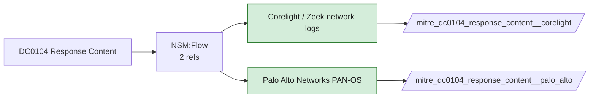

# DC0104 Response Content

[ATT&CK](https://attack.mitre.org/datacomponents/DC0104) · version 2.0 · modified 2025-11-12 · ATT&CK release 20.1

Status: **Live** · umbrella eventtype `mitre_dc0104_response_content`

> Captured network traffic that provides details about responses received during an internet scan. This data includes both protocol header values (e.g., HTTP status codes, IP headers, or DNS response codes) and response body content (e.g., HTML, JSON, or raw data). Examples:  - HTTP Scan: A web server responds to a probe with an HTTP 200 status code and an HTML body indicating the default page is accessible. - DNS Scan: A DNS server replies to a query with a resolved IP address for a domain, along with details like Time-To-Live (TTL) and authoritative information. - TCP Banner Grab: A service listening on a port (e.g., SSH or FTP) responds with a banner containing service name, version, or other metadata.

## Why this component matters

Server responses (HTTP bodies, DNS answers, TLS certificates) captured by Corelight protocol logs and PAN-OS threat logs; C2 and phishing infrastructure fingerprinting.

ATT&CK v20.1 has **28 analytics** across **28 detection strategies** that read this component, covering **28 techniques**. Tactics most dependent on it: resource-development (23), reconnaissance (4), command-and-control (1).

Analytic references by platform: PRE 27, macOS 1

## Where it comes from



## Requirements

Per feed (from `config/stack.yml` and `config/log_sources.yml`):

| Feed | Status | Sourcetypes | Constraint | Origin | TA / collector |
|---|---|---|---|---|---|
| `corelight` | live | `corelight_dns`, `corelight_http`, `corelight_ssl` | `(whole feed)` | defaults | Corelight App for Splunk (corelight_<log>). For TA_zeek use prefix zeek: and suffix :json. |
| `palo_alto` | live | `pan:threat` | `(whole feed)` | defaults | Splunk Add-on for Palo Alto Networks (pan:*) |

Collection prerequisites:

- **corelight**: Sensor placement covering east-west (DC, server VLANs) and north-south; without internal taps the lateral-movement components are blind.
- **corelight**: Enable the log set above; files/pe/smb_* and ldap/kerberos/ntlm are what distinguish Corelight from flow data.
- **palo_alto**: Log forwarding profiles attached to every security rule (traffic start+end, threat, url, wildfire, data).
- **palo_alto**: System and Config logs forwarded from each firewall / Panorama; GlobalProtect logs enabled.
- **palo_alto**: URL filtering and Threat Prevention licensed for pan:threat subtypes url/vulnerability/virus/spyware.

Review notes: `corelight` has 2 ATT&CK reference(s) with no usable event filter (prose channel), constraint origin is *defaults*.

## Splunk

Eventtypes (literal constraints, see `dist/splunk/TA-mitre-attack-datacomponents/default/eventtypes.conf`):

```ini
[mitre_dc0104_response_content__corelight]
search = index=corelight sourcetype IN (corelight_dns, corelight_http, corelight_ssl)

[mitre_dc0104_response_content__palo_alto]
search = index=pan_logs sourcetype=pan:threat

[mitre_dc0104_response_content]
search = eventtype=mitre_dc0104_response_content__corelight OR eventtype=mitre_dc0104_response_content__palo_alto
```

Macros for analytics: `` `mitre_dc0104` `` (umbrella), `` `mitre_dc0104_corelight` ``, `` `mitre_dc0104_palo_alto` ``, `` `mitre_dc0104_filter` `` (site exclusions).
CIM: no data model mapping; analytics on this component run as raw eventtype searches.

## Sigma

No generic Sigma category maps to this component; rules use `product`/`service` logsources, which the pipeline maps to index and sourcetype.

## Dependents

Top techniques detected through this component (of 28):

| Technique | Name | Tactics | Analytics using this DC |
|---|---|---|---|
| [T1583](https://attack.mitre.org/techniques/T1583) | Acquire Infrastructure | resource-development | 1 |
| [T1583.003](https://attack.mitre.org/techniques/T1583/003) | Virtual Private Server | resource-development | 1 |
| [T1583.004](https://attack.mitre.org/techniques/T1583/004) | Server | resource-development | 1 |
| [T1583.006](https://attack.mitre.org/techniques/T1583/006) | Web Services | resource-development | 1 |
| [T1583.007](https://attack.mitre.org/techniques/T1583/007) | Serverless | resource-development | 1 |
| [T1583.008](https://attack.mitre.org/techniques/T1583/008) | Malvertising | resource-development | 1 |
| [T1584](https://attack.mitre.org/techniques/T1584) | Compromise Infrastructure | resource-development | 1 |
| [T1584.003](https://attack.mitre.org/techniques/T1584/003) | Virtual Private Server | resource-development | 1 |
| [T1584.004](https://attack.mitre.org/techniques/T1584/004) | Server | resource-development | 1 |
| [T1584.006](https://attack.mitre.org/techniques/T1584/006) | Web Services | resource-development | 1 |
| [T1584.007](https://attack.mitre.org/techniques/T1584/007) | Serverless | resource-development | 1 |
| [T1584.008](https://attack.mitre.org/techniques/T1584/008) | Network Devices | resource-development | 1 |
| [T1587](https://attack.mitre.org/techniques/T1587) | Develop Capabilities | resource-development | 1 |
| [T1587.003](https://attack.mitre.org/techniques/T1587/003) | Digital Certificates | resource-development | 1 |
| [T1588](https://attack.mitre.org/techniques/T1588) | Obtain Capabilities | resource-development | 1 |
| … | 13 more | | |

Full list: `lookups/mitre_attack_analytics.csv` filtered on `dc_ids` containing `DC0104`.
