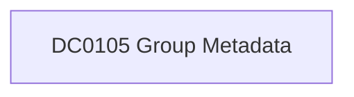

# DC0105 Group Metadata

[ATT&CK](https://attack.mitre.org/datacomponents/DC0105) · version 2.0 · modified 2025-10-21 · ATT&CK release 20.1

Status: **Live** · umbrella eventtype `mitre_dc0105_group_metadata`

> Group metadata includes attributes like name, permissions, purpose, and associated user accounts or roles, which adversaries may exploit for privilege escalation. Examples:  - Active Directory: `Get-ADGroup -Identity "Domain Admins" -Properties Members, Description` - Azure AD: `Get-AzureADGroup -ObjectId <GroupId>` - Google Workspace: `GET https://admin.googleapis.com/admin/directory/v1/groups/<groupKey>` - AWS IAM: `aws iam list-group-policies --group-name <group_name>` - Office 365: `GET https://graph.microsoft.com/v1.0/groups/<id>`  *Data Collection Measures:*  - Cloud Logging:     - AWS CloudTrail for IAM group-related activities.     - Azure AD Sign-In/Audit logs for metadata changes.     - Google Admin Activity logs for API calls. - Directory Logging: Log metadata access (e.g., Windows Event ID 4662). - API Monitoring: Log API calls to modify group metadata (e.g., Microsoft Graph API). - SIEM Integration: Centralize group metadata logs for analysis.

## Why this component matters

Group attribute changes and enumeration events; no v20.1 analytic yet.

ATT&CK v20.1 has **1 analytics** across **1 detection strategies** that read this component, covering **1 techniques**. Tactics most dependent on it: discovery (1).

Analytic references by platform: Office Suite 1

## Where it comes from



## Requirements

Per feed (from `config/stack.yml` and `config/log_sources.yml`):

| Feed | Status | Sourcetype or source | Constraint | Origin | TA / collector |
|---|---|---|---|---|---|
| `wineventlog` | live | source=`XmlWinEventLog:Security` | `EventCode IN (4727, 4730, 4731, 4734, 4754, 4758, 4798, 4799)` | defaults | Splunk Add-on for Microsoft Windows (Splunk_TA_windows), XML rendering (renderXml = true) |

Collection prerequisites:

- **wineventlog**: Advanced Audit Policy configured (at minimum Process Creation, Logon, Account Management, Object Access, Policy Change, Privilege Use, Detailed Tracking). Without the matching subcategory the EventCodes below never fire.
- **wineventlog**: Include command line in process creation events enabled for 4688 (Computer Configuration > Administrative Templates > System > Audit Process Creation).
- **wineventlog**: PowerShell Script Block Logging (4104) and Module Logging (4103) enabled via GPO for the PowerShell/Operational channel.
- **wineventlog**: Object access events (4656/4663/4657/4660/4670) require SACLs on the files/keys of interest.
- **wineventlog**: Non-default channels (TaskScheduler, WMI-Activity, CodeIntegrity, Defender, Firewall, WinRM, SMBClient/Server...) must be listed as inputs in Splunk_TA_windows inputs.conf; several are disabled by default in Windows.

## Splunk

Eventtypes (literal constraints, see `dist/splunk/TA-mitre-attack-datacomponents/default/eventtypes.conf`):

```ini
[mitre_dc0105_group_metadata__wineventlog]
search = index=wineventlog source="XmlWinEventLog:Security" EventCode IN (4727, 4730, 4731, 4734, 4754, 4758, 4798, 4799)

[mitre_dc0105_group_metadata]
search = eventtype=mitre_dc0105_group_metadata__wineventlog
```

Macros for analytics: `` `mitre_dc0105` `` (umbrella), `` `mitre_dc0105_wineventlog` ``, `` `mitre_dc0105_filter` `` (site exclusions).
CIM: no data model mapping; analytics on this component run as raw eventtype searches.

## Sigma

No generic Sigma category maps to this component; rules use `product`/`service` logsources, which the pipeline maps to index and sourcetype.

## Dependents

Top techniques detected through this component (of 1):

| Technique | Name | Tactics | Analytics using this DC |
|---|---|---|---|
| [T1069.003](https://attack.mitre.org/techniques/T1069/003) | Cloud Groups | discovery | 1 |

Full list: `lookups/mitre_attack_analytics.csv` filtered on `dc_ids` containing `DC0105`.
