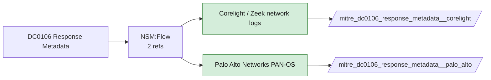

# DC0106 Response Metadata

[ATT&CK](https://attack.mitre.org/datacomponents/DC0106) · version 2.0 · modified 2025-10-21 · ATT&CK release 20.1

Status: **Live** · umbrella eventtype `mitre_dc0106_response_metadata`

> Contextual information about an Internet-facing resource collected during a scan, including details such as open ports, running services, protocols, and versions. This metadata is typically derived from interpreting scan results and helps build a profile of the targeted system. Examples:   - Port and Service Details:     - Open ports (e.g., 22, 80, 443).     - Identified services running on those ports (e.g., SSH, HTTP, HTTPS). - Service Versions: Detected software version information (e.g., Apache 2.4.41, OpenSSH 8.2). - Operating System Information: OS fingerprinting data (e.g., Linux Kernel 5.4.0). - TLS/SSL Certificate Data: Information about the TLS/SSL certificate, such as the expiration date, issuer, and cipher suites.  *Data Collection Measures:*  - Scanning Tools:     - Nmap: Collects port, service, and version information using commands like nmap -sV <IP>.     - Masscan: High-speed scanning tool for discovering open ports and active services.     - Zmap: Focused on large-scale Internet scanning, collecting metadata about discovered services.     - Shodan API: Retrieves scan metadata for publicly exposed devices and services. - Network Logs:     - Use logs from firewalls, intrusion detection systems (IDS), or intrusion prevention systems (IPS) to gather metadata from scan attempts. Example: Zeek or Suricata logs for incoming scan traffic. - OSINT Platforms: Platforms like Censys, GreyNoise, or Shodan provide aggregated metadata about Internet-facing resources. - Cloud Metadata Services: AWS Security Hub, Azure Monitor, or GCP Security Command Center can collect and centralize scan-related metadata for Internet-facing resources in cloud environments.

## Why this component matters

Response status codes, sizes, timing and certificate metadata from Corelight http/dns/ssl/x509 and PAN-OS.

ATT&CK v20.1 has **7 analytics** across **7 detection strategies** that read this component, covering **7 techniques**. Tactics most dependent on it: resource-development (6), command-and-control (1).

Analytic references by platform: PRE 6, Linux 1

## Where it comes from



## Requirements

Per feed (from `config/stack.yml` and `config/log_sources.yml`):

| Feed | Status | Sourcetypes | Constraint | Origin | TA / collector |
|---|---|---|---|---|---|
| `corelight` | live | `corelight_dns`, `corelight_http`, `corelight_ssl`, `corelight_x509` | `(whole feed)` | defaults | Corelight App for Splunk (corelight_<log>). For TA_zeek use prefix zeek: and suffix :json. |
| `palo_alto` | live | `pan:threat`, `pan:traffic` | `(whole feed)` | defaults | Splunk Add-on for Palo Alto Networks (pan:*) |

Collection prerequisites:

- **corelight**: Sensor placement covering east-west (DC, server VLANs) and north-south; without internal taps the lateral-movement components are blind.
- **corelight**: Enable the log set above; files/pe/smb_* and ldap/kerberos/ntlm are what distinguish Corelight from flow data.
- **palo_alto**: Log forwarding profiles attached to every security rule (traffic start+end, threat, url, wildfire, data).
- **palo_alto**: System and Config logs forwarded from each firewall / Panorama; GlobalProtect logs enabled.
- **palo_alto**: URL filtering and Threat Prevention licensed for pan:threat subtypes url/vulnerability/virus/spyware.
- **palo_alto**: Operational (show/debug) commands are not in config or system logs by default. Enable administrator activity audit tracking (Device > Setup > Management > Logging and Reporting, PAN-OS 10.1+) and forward the audit log if you want CLI discovery analytics for the firewall.

Review notes: `corelight` has 2 ATT&CK reference(s) with no usable event filter (prose channel), constraint origin is *defaults*.

## Splunk

Eventtypes (literal constraints, see `dist/splunk/TA-mitre-attack-datacomponents/default/eventtypes.conf`):

```ini
[mitre_dc0106_response_metadata__corelight]
search = index=corelight sourcetype IN (corelight_dns, corelight_http, corelight_ssl, corelight_x509)

[mitre_dc0106_response_metadata__palo_alto]
search = index=pan_logs sourcetype IN ("pan:threat", "pan:traffic")

[mitre_dc0106_response_metadata]
search = eventtype=mitre_dc0106_response_metadata__corelight OR eventtype=mitre_dc0106_response_metadata__palo_alto
```

Macros for analytics: `` `mitre_dc0106` `` (umbrella), `` `mitre_dc0106_corelight` ``, `` `mitre_dc0106_palo_alto` ``, `` `mitre_dc0106_filter` `` (site exclusions).
CIM: no data model mapping; analytics on this component run as raw eventtype searches.

## Sigma

No generic Sigma category maps to this component; rules use `product`/`service` logsources, which the pipeline maps to index and sourcetype.

## Dependents

Top techniques detected through this component (of 7):

| Technique | Name | Tactics | Analytics using this DC |
|---|---|---|---|
| [T1583](https://attack.mitre.org/techniques/T1583) | Acquire Infrastructure | resource-development | 1 |
| [T1583.003](https://attack.mitre.org/techniques/T1583/003) | Virtual Private Server | resource-development | 1 |
| [T1583.004](https://attack.mitre.org/techniques/T1583/004) | Server | resource-development | 1 |
| [T1584](https://attack.mitre.org/techniques/T1584) | Compromise Infrastructure | resource-development | 1 |
| [T1584.003](https://attack.mitre.org/techniques/T1584/003) | Virtual Private Server | resource-development | 1 |
| [T1584.004](https://attack.mitre.org/techniques/T1584/004) | Server | resource-development | 1 |
| [T1665](https://attack.mitre.org/techniques/T1665) | Hide Infrastructure | command-and-control | 1 |

Full list: `lookups/mitre_attack_analytics.csv` filtered on `dc_ids` containing `DC0106`.
