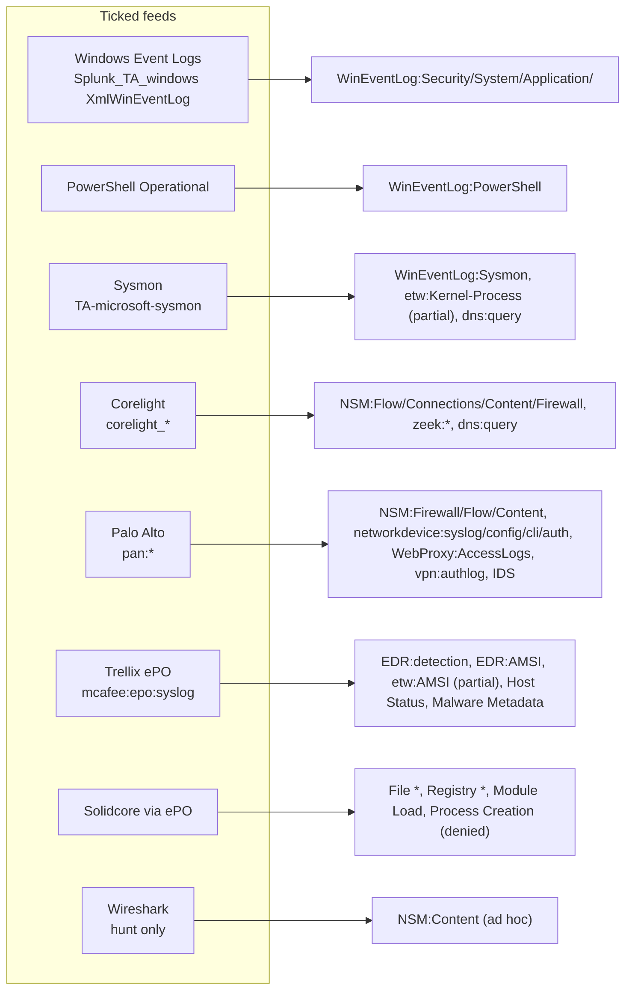

# Data sources: your stack against ATT&CK's log sources

ATT&CK v20.1 names ~400 log sources. `config/log_sources.yml` collapses typos and case variants (123 aliases), maps 145 names explicitly and the rest via 24 prefix rules, onto the 44 feeds in `config/stack.yml`. This page explains the choices for the feeds named in the brief and the assumptions behind sourcetypes.

## Windows Event Logs (`wineventlog`, `powershell_logging`)

* XML rendering (`renderXml = true`) through Splunk_TA_windows. Since add-on version 5.0 the sourcetype is `XmlWinEventLog` for every channel and the channel is in `source` (`XmlWinEventLog:Security`). Earlier versions used the channel as the sourcetype, but `source` held the same value in both, so the eventtypes match on `source` (`constraint_field: source` in `stack.yml`) and work with either. For classic rendering change the values to `WinEventLog:<channel>`.
* ATT&CK names channels loosely (`WinEventLog:TaskScheduler`, `WinEventLog:WMI`, `WinEventLog:AppLocker`). `log_sources.yml` maps each to the real channel name (`Microsoft-Windows-TaskScheduler/Operational`, `Microsoft-Windows-WMI-Activity/Operational`, `Microsoft-Windows-AppLocker/EXE and DLL`). Several are disabled in Windows by default and all need an input stanza.
* PowerShell is its own feed because 4103/4104 require a GPO and an input of their own; it shares the `wineventlog` index.
* 1310 of 1386 Windows channel strings carried a parseable EventCode. The rest are prose; the per-component defaults in `config/dc_defaults.yml` take over.

## Sysmon (`sysmon`)

Matched on `source="XmlWinEventLog:Microsoft-Windows-Sysmon/Operational"` (sourcetype `XmlWinEventLog` on current add-ons), index `sysmon`. The Sysmon add-on needs Splunk_TA_windows installed for XML parsing. The highest-yield feed in ATT&CK v20 (861 analytic references). Event IDs used per component: 1 Process Creation/Command Execution, 3 Network Connection, 5 Process Termination, 6 Driver Load, 7 Module Load, 8/10/25 Process Access/Modification/OS API, 9 Drive Access, 11/15/2 File Creation/Metadata, 12/13/14 Registry, 17/18 Named Pipe, 19/20/21 WMI, 22 DNS (Network Traffic Content), 23/26 File Deletion, 4/16 Host Status. Your Sysmon config must include the matching rule groups.

Sysmon also stands in for some ETW providers ATT&CK names directly: `etw:Microsoft-Windows-Kernel-Process` (EID 1/5/8/10/25) and `etw:Microsoft-Windows-Kernel-ImageLoad` (EID 7). Providers like Win32k, WinINet, RPC, DotNETRuntime, Token have no Sysmon equivalent; they sit in the unticked `etw` feed.

## Corelight (`corelight`)

Sourcetypes `corelight_<log>` from the Corelight App for Splunk. For TA_zeek set `sourcetype_template: "zeek:{log}:json"`. Zeek log names are parsed from channels (`conn.log`, `http.log, ftp.log`); prose channels fall back to per-component defaults (Network Connection Creation → conn; Network Traffic Content → http, dns, ssl, x509, files, smtp, ftp, ssh, rdp, smb_files, dce_rpc, kerberos, ntlm, ldap, notice, weird; Network Share Access → smb_files, smb_mapping; Logon Session Creation → ssh, rdp, kerberos, ntlm; Active Directory Credential Request → kerberos).

## Palo Alto (`palo_alto`)

Sourcetypes `pan:traffic`, `pan:threat` (url, wildfire, virus, spyware, vulnerability subtypes), `pan:system`, `pan:config`, `pan:userid`, `pan:globalprotect`, `pan:decryption` from the Splunk Add-on for Palo Alto Networks. PAN-OS covers two ATT&CK roles:

1. **Network sensor**: `NSM:Firewall`, `NSM:Flow`, `NSM:Content` (threat), `WebProxy:AccessLogs` (url), `IDS:*`, `perimeter:firewall` → Network Traffic Flow/Content, Network Connection Creation, Firewall Rule Modification/Disable/Metadata.
2. **Network device**: `networkdevice:syslog|config|cli|audit|auth`, `vpn:authlog` → the Network Devices platform's Command Execution, File Modification (config), Logon Session Creation, User Account Authentication (GlobalProtect), Firmware Modification (system log). Only for the firewall itself; routers and switches remain in the unticked `netdev_syslog` feed.

Log forwarding profiles must be attached to every security rule, and system/config logs forwarded from each device or Panorama.

## Trellix ePO (`trellix_epo`) and Solidcore (`solidcore`)

ATT&CK has no Trellix-specific log source names, so these feeds are mapped as *alternative providers* for components where the product observes the same thing:

* ePO/ENS threat events (`mcafee:epo:syslog`, the sourcetype of Splunk's ePO Syslog add-on): Host Status (AV disabled, tamper, update failure), Malware Metadata/Content, Application Log Content, and the `EDR:detection` / `EDR:AMSI` / `etw:Microsoft-Antimalware-Scan-Interface` references via ENS's AMSI integration.
* Solidcore (Application and Change Control) events arrive through ePO with event names such as `FILE_CREATED`, `FILE_MODIFIED`, `FILE_DELETED`, `FILE_ATTR_MODIFIED`, `EXECUTION_DENIED`, `PROCESS_HIJACK_ATTEMPTED`, `REG_VALUE_MODIFIED`, `WRITE_DENIED`, `READ_DENIED`. They are mapped to File Creation/Modification/Deletion/Access/Metadata, Registry Key Creation/Modification/Deletion, Module Load and Process Creation (denied). **Verify the field that carries the event name in your TA version** (`threat_name` or `event_description`) and adjust the filters in `config/dc_defaults.yml`; the shipped filters check both.

## Wireshark (`wireshark`)

Packet captures are hunt material, not a scheduled feed. Mapped only to Network Traffic Content; eventtypes are generated `disabled = 1` with sourcetype `wireshark:json` (tshark `-T ek`). For continuous capture use Splunk Stream or Corelight.

## Feeds you have not ticked

Linux (`auditd`, `linux_syslog`, `linux_osquery`, `sysmon_linux`, `iptables`, `ebpf`), Azure (`azure_entra`, `azure_activity`, `azure_resource`, `m365_defender`), containers (`kubernetes_audit`, `container_runtime`), ESXi (`esxi_syslog`, `vcenter`) and network devices (`netdev_syslog`, `snmp`, `netflow`) are fully mapped with sourcetypes from the standard Splunk add-ons, so ticking them is a config change plus a rebuild. Counts of what each unlocks are in [gaps.md](gaps.md). macOS, M365, AWS, GCP, Okta, SaaS, mobile, OT and PRE intelligence sources are listed in the checklist with `render: false`; they can be brought into scope by editing `config/platforms.yml` and removing the flag.

## Generic names

ATT&CK sometimes uses the old data-source vocabulary as a log source name (`Process`, `File`, `Network Traffic`, `Command`, `Logon Session`). These resolve to the virtual `unspecified` feed, produce no eventtype, and are covered by the component's other feeds. Pure intelligence sources (`Internet Scan`, `Domain Name`, `Malware Repository`, `Persona`) resolve to `threat_intel`.
