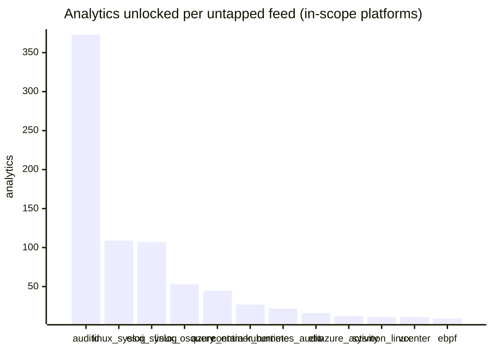

# Gaps (ATT&CK v20.1)

Feeds you have **not** ticked in `config/stack.yml`, ranked by what ticking them would unlock. *Analytics* counts analytics that are not yet live and reference the feed; *components* counts data components that would gain a provider.

## In-scope platforms

| Feed | Platforms | Analytics unlocked | Components | What it is | TA / collector |
|---|---|---|---|---|---|
| `auditd` | Linux, Containers | 373 | 33 | Linux auditd (SYSCALL/EXECVE/PATH/CONFIG_CHANGE/USER_LOGIN...) | Splunk Add-on for Unix and Linux (linux:audit) or auditd -> auditbeat/syslog |
| `linux_syslog` | Linux, Containers | 109 | 16 | Linux syslog / journald (messages, secure/auth, cron, kernel, daemon) | Splunk Add-on for Unix and Linux (syslog, linux_secure, linux_messages_syslog) |
| `esxi_syslog` | ESXi | 107 | 27 | ESXi host logs via remote syslog (hostd, vmkernel, shell, vobd, vpxa, auth, esxupdate) | Splunk Add-on for VMware ESXi Logs (vmware:esxlog:<log>) |
| `linux_osquery` | Linux, Containers | 53 | 7 | osquery on Linux | osquery TA |
| `azure_entra` | Identity Provider, IaaS, Office Suite, Windows | 45 | 14 | Microsoft Entra ID sign-in and audit logs | Splunk Add-on for Microsoft Azure (azure:aad:signin, azure:aad:audit) or Microsoft Cloud Services add-on via Event Hub |
| `container_runtime` | Containers | 27 | 10 | Docker / containerd daemon and runtime events | docker events scripted input or OpenTelemetry (docker:events, containerd) |
| `kubernetes_audit` | Containers | 22 | 18 | Kubernetes API server audit log and cluster events | Splunk OpenTelemetry Collector for Kubernetes / Splunk Connect for Kubernetes |
| `etw` | Windows | 16 | 6 | ETW providers not surfaced by Sysmon (Kernel-Process, Win32k, WinINet, RPC, DotNETRuntime, AMSI, Token...) | Requires a user-mode ETW consumer (SilkETW/Sealighter, Splunk Stream for NDIS, or an EDR that exposes the provider). No standard Splunk TA. |
| `azure_activity` | IaaS | 12 | 13 | Azure Activity Log (subscription control plane) and Azure Policy | Splunk Add-on for Microsoft Cloud Services (mscs:azure:audit) |
| `sysmon_linux` | Linux | 11 | 5 | Sysmon for Linux | Splunk Add-on for Sysmon for Linux |
| `vcenter` | ESXi | 11 | 3 | vCenter vpxd logs and events | Splunk Add-on for VMware (vmware:vclog:vpxd) |
| `ebpf` | Linux, Containers | 9 | 8 | eBPF runtime security (Falco, Tetragon, Tracee) | Vendor specific (falco JSON, tetragon) |
| `netdev_syslog` | Network Devices | 8 | 6 | Router / switch / non-PAN firewall syslog, config change and AAA logs | Cisco Networks Add-on (cisco:ios, cisco:asa), Juniper/Arista TAs, or generic syslog |
| `snmp` | Network Devices | 6 | 1 | SNMP traps / polling | Splunk Connect for SNMP |
| `edr_telemetry` | Windows, Linux | 5 | 8 | EDR raw telemetry (memory, hunting, script block, syscall) - e.g. Trellix EDR, Defender for Endpoint advanced hunting | Vendor specific |
| `iis` | Windows | 4 | 2 | IIS access and configuration logs | Splunk Add-on for Microsoft IIS |
| `netflow` | Network Devices, Linux, Containers | 4 | 2 | NetFlow / IPFIX (non-Zeek flow) | Splunk Stream or Splunk Add-on for NetFlow |
| `windows_perfmon` | Windows | 4 | 1 | Windows Performance counters | Splunk_TA_windows perfmon inputs |
| `iptables` | Linux | 4 | 1 | iptables / nftables LOG target via kernel syslog | Splunk Add-on for Unix and Linux (syslog) |
| `m365_defender` | Windows, Identity Provider, Office Suite | 4 | 0 | Microsoft Defender XDR / Defender for Identity alerts and Graph API logs | Splunk Add-on for Microsoft Security |
| `windows_osquery` | Windows | 2 | 2 | osquery on Windows | osquery TA (osquery:results) |
| `azure_resource` | IaaS | 2 | 1 | Azure resource diagnostic logs (NSG flow, VM guest, Key Vault, Storage) | Splunk Add-on for Microsoft Cloud Services (mscs:azure:eventhub) |
| `windows_firewall_log` | Windows | 1 | 1 | Windows Firewall text log (pfirewall.log) | Splunk_TA_windows (monitor input on %systemroot%\System32\LogFiles\Firewall\pfirewall.log) |
| `autoruns` | Windows | 1 | 1 | Sysinternals Autoruns scans | TA-autoruns (scripted input) |
| `windows_dhcp` | Windows | 1 | 0 | Windows DHCP server log | Splunk_TA_windows |
| `windows_dns_server` | Windows | 0 | 2 | Windows DNS Server analytical / debug log | Splunk_TA_windows (MSAD:NT6:DNS) or Microsoft-Windows-DNS-Server/Analytical ETW |

## Out-of-scope platforms

Listed so the checklist is complete; rendering for these platforms is a later phase.

| Feed | Platforms | Analytics referencing it | What it is |
|---|---|---|---|
| `macos` | macOS | 354 | macOS unified log / Endpoint Security / osquery / FSEvents |
| `m365_unified` | Office Suite, SaaS, Identity Provider, Windows | 103 | Microsoft 365 unified audit log (Exchange, SharePoint, Teams, Purview) |
| `aws` | IaaS, SaaS, Containers | 98 | AWS CloudTrail / VPC Flow / CloudWatch / Bedrock |
| `gcp` | IaaS, SaaS, Identity Provider | 18 | Google Cloud audit / VPC flow / Workspace admin |
| `okta` | Identity Provider, SaaS | 0 | Okta System Log |
| `saas` | SaaS | 57 | SaaS application audit logs (GitHub, Slack, Salesforce, Zoom, Box, Confluence, Google Workspace...) |
| `mobile` | — | 0 | Mobile EDR / MDM telemetry |
| `ot` | — | 0 | OT / ICS application and protocol logs |
| `threat_intel` | PRE | 39 | External reconnaissance sources (internet scan data, domain registration, malware repositories, persona monitoring) |

## Components with no in-scope provider

| Component | Analytics | Log sources named by ATT&CK |
|---|---|---|
| [DC0022](data-components/DC0022-cloud-storage-deletion.md) Cloud Storage Deletion | 2 | AWS:CloudTrail |
| [DC0023](data-components/DC0023-cloud-storage-modification.md) Cloud Storage Modification | 5 | AWS:CloudTrail, m365:unified, saas:googledrive |
| [DC0024](data-components/DC0024-cloud-storage-creation.md) Cloud Storage Creation | 1 | AWS:CloudTrail |
| [DC0025](data-components/DC0025-cloud-storage-access.md) Cloud Storage Access | 13 | AWS:CloudTrail, m365:unified, m365:sharepoint, saas:github, gcp:workspaceaudit |
| [DC0026](data-components/DC0026-image-deletion.md) Image Deletion | 0 |  |
| [DC0027](data-components/DC0027-cloud-storage-metadata.md) Cloud Storage Metadata | 3 | AWS:CloudTrail, m365:unified, saas:box, saas:dropbox |
| [DC0047](data-components/DC0047-snapshot-enumeration.md) Snapshot Enumeration | 0 |  |
| [DC0052](data-components/DC0052-social-media.md) Social Media | 4 | Persona |
| [DC0058](data-components/DC0058-snapshot-modification.md) Snapshot Modification | 2 | AWS:CloudTrail |
| [DC0062](data-components/DC0062-snapshot-metadata.md) Snapshot Metadata | 2 | AWS:CloudTrail, gcp:audit |
| [DC0070](data-components/DC0070-cloud-service-metadata.md) Cloud Service Metadata | 10 | AWS:CloudTrail, saas:github, AWS:CloudWatch, m365:sharepoint, m365:exchange, m365:unified |
| [DC0074](data-components/DC0074-driver-metadata.md) Driver Metadata | 1 | macos:unifiedlog |
| [DC0080](data-components/DC0080-instance-start.md) Instance Start | 11 | AWS:CloudTrail |
| [DC0086](data-components/DC0086-instance-metadata.md) Instance Metadata | 3 | AWS:CloudTrail |
| [DC0089](data-components/DC0089-instance-stop.md) Instance Stop | 4 | AWS:CloudTrail |
| [DC0093](data-components/DC0093-certificate-registration.md) Certificate Registration | 2 | Certificate |
| [DC0095](data-components/DC0095-volume-enumeration.md) Volume Enumeration | 0 |  |
| [DC0096](data-components/DC0096-passive-dns.md) Passive DNS | 5 | Domain Name |
| [DC0100](data-components/DC0100-volume-metadata.md) Volume Metadata | 0 | Metadata |
| [DC0103](data-components/DC0103-active-dns.md) Active DNS | 5 | Domain Name |
