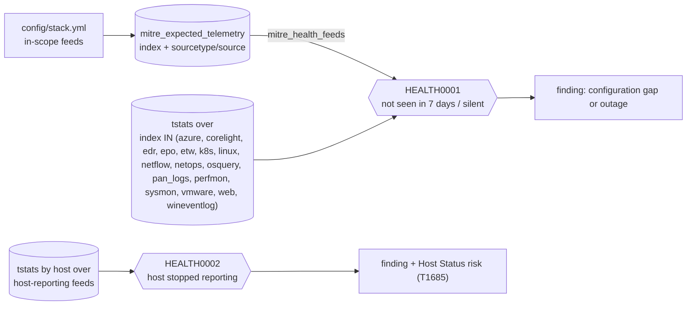

# Telemetry health

What must arrive in Splunk for the eventtypes to mean anything, and the two detections that check it. Generated from `config/stack.yml`; the same list ships as the `mitre_expected_telemetry` lookup.

## Detections

| Id | Detection | Output | Schedule |
|---|---|---|---|
| HEALTH0001 | Telemetry an eventtype depends on is missing or silent | finding | `37 */4 * * *` |
| HEALTH0002 | Host stopped sending endpoint telemetry | finding + risk | `47 * * * *` |

**HEALTH0001.** Compares every index and sourcetype or source that the eventtypes of the feeds in `mitre_health_feeds` match on with what arrived in the last 7 days. not_seen_7d means a data component looks covered but has no data (a configuration gap: wrong sourcetype, channel not collected, audit policy off). silent means it arrived earlier in the week but not in the last few hours (an outage).

**HEALTH0002.** A host that sent Sysmon or Security events in the last 7 days has sent none for several hours. Agents stopped by an attacker look like this, so it raises Host Status risk on the host as well as a finding. Uses the indexed host field: with Windows Event Forwarding the host is the collector unless props set host from Computer.

Scope: set the `mitre_health_feeds` macro to the feeds you collect (default `feed=*` checks every in-scope feed, so feeds you do not have show up as not_seen_7d until you do). Thresholds: `mitre_health_silence_hours` and `mitre_health_host_silence_hours` (TA macros, default 4). Host-reporting scope: `((index=wineventlog source="XmlWinEventLog:Security") OR (index=sysmon source="XmlWinEventLog:Microsoft-Windows-Sysmon/Operational"))`.

**Not seen in 7 days does not always mean broken.** Some channels are off by default in Windows (TaskScheduler, WMI-Activity, CodeIntegrity, Kernel-Boot) and some Corelight logs are quiet on small networks. Each row says which data components depend on it, so either collect it or accept that those components are not really covered.

## Expected telemetry (84 values across 30 feeds)

| Feed | Index | Field | Value | Data components | Eventtypes |
|---|---|---|---|---|---|
| `auditd` | `linux` | sourcetype | `linux:audit` | DC0001, DC0002, DC0004, DC0010, DC0012, DC0013, DC0014, DC0016 … 25 more | 33 |
| `autoruns` | `wineventlog` | sourcetype | `autoruns` | DC0050 | 1 |
| `azure_activity` | `azure` | sourcetype | `mscs:azure:audit` | DC0010, DC0013, DC0017, DC0038, DC0049, DC0057, DC0069, DC0073 … 5 more | 13 |
| `azure_entra` | `azure` | sourcetype | `azure:aad:audit` | DC0006, DC0010, DC0013, DC0014, DC0038, DC0066, DC0069, DC0083 … 2 more | 10 |
| `azure_entra` | `azure` | sourcetype | `azure:aad:signin` | DC0002, DC0006, DC0007, DC0038, DC0067, DC0088 | 6 |
| `azure_resource` | `azure` | sourcetype | `mscs:azure:eventhub` | DC0085 | 1 |
| `container_runtime` | `k8s` | sourcetype | `containerd:events` | DC0015, DC0032, DC0072, DC0077, DC0091 | 5 |
| `container_runtime` | `k8s` | sourcetype | `docker:daemon` | DC0015, DC0032, DC0036, DC0038, DC0064, DC0072, DC0091 | 7 |
| `container_runtime` | `k8s` | sourcetype | `docker:events` | DC0028, DC0032, DC0033, DC0038, DC0064, DC0072, DC0077 | 7 |
| `corelight` | `corelight` | sourcetype | `corelight_conn` | DC0078, DC0082 | 2 |
| `corelight` | `corelight` | sourcetype | `corelight_dce_rpc` | DC0085 | 1 |
| `corelight` | `corelight` | sourcetype | `corelight_dns` | DC0085, DC0101, DC0104, DC0106 | 4 |
| `corelight` | `corelight` | sourcetype | `corelight_files` | DC0011, DC0059, DC0085 | 3 |
| `corelight` | `corelight` | sourcetype | `corelight_ftp` | DC0085 | 1 |
| `corelight` | `corelight` | sourcetype | `corelight_http` | DC0007, DC0038, DC0085, DC0104, DC0106 | 5 |
| `corelight` | `corelight` | sourcetype | `corelight_kerberos` | DC0002, DC0067, DC0084, DC0085 | 4 |
| `corelight` | `corelight` | sourcetype | `corelight_ldap` | DC0085 | 1 |
| `corelight` | `corelight` | sourcetype | `corelight_notice` | DC0038, DC0085 | 2 |
| `corelight` | `corelight` | sourcetype | `corelight_ntlm` | DC0002, DC0067, DC0085 | 3 |
| `corelight` | `corelight` | sourcetype | `corelight_pe` | DC0011, DC0059 | 2 |
| `corelight` | `corelight` | sourcetype | `corelight_radius` | DC0002 | 1 |
| `corelight` | `corelight` | sourcetype | `corelight_rdp` | DC0002, DC0067, DC0085 | 3 |
| `corelight` | `corelight` | sourcetype | `corelight_smb_files` | DC0085, DC0102 | 2 |
| `corelight` | `corelight` | sourcetype | `corelight_smb_mapping` | DC0102 | 1 |
| `corelight` | `corelight` | sourcetype | `corelight_smtp` | DC0038, DC0085 | 2 |
| `corelight` | `corelight` | sourcetype | `corelight_ssh` | DC0002, DC0038, DC0067, DC0085, DC0088 | 5 |
| `corelight` | `corelight` | sourcetype | `corelight_ssl` | DC0007, DC0085, DC0104, DC0106 | 4 |
| `corelight` | `corelight` | sourcetype | `corelight_weird` | DC0085 | 1 |
| `corelight` | `corelight` | sourcetype | `corelight_x509` | DC0085, DC0101, DC0106 | 3 |
| `ebpf` | `linux` | sourcetype | `falco` | DC0020, DC0032, DC0055, DC0059, DC0061, DC0064, DC0082, DC0085 | 8 |
| `edr_telemetry` | `edr` | sourcetype | `edr:telemetry` | DC0021, DC0029, DC0034, DC0035, DC0059, DC0064, DC0078, DC0085 | 8 |
| `esxi_syslog` | `vmware` | sourcetype | `vmware:esxlog:auth` | DC0002, DC0067, DC0088 | 3 |
| `esxi_syslog` | `vmware` | sourcetype | `vmware:esxlog:esxupdate` | DC0038 | 1 |
| `esxi_syslog` | `vmware` | sourcetype | `vmware:esxlog:hostd` | DC0009, DC0018, DC0033, DC0038, DC0039, DC0040, DC0041, DC0043 … 12 more | 20 |
| `esxi_syslog` | `vmware` | sourcetype | `vmware:esxlog:shell` | DC0029, DC0032, DC0040, DC0061, DC0064 | 5 |
| `esxi_syslog` | `vmware` | sourcetype | `vmware:esxlog:syslog` | DC0001, DC0005 | 2 |
| `esxi_syslog` | `vmware` | sourcetype | `vmware:esxlog:vmkernel` | DC0031, DC0038, DC0039, DC0055, DC0057, DC0061, DC0078, DC0082 … 2 more | 10 |
| `esxi_syslog` | `vmware` | sourcetype | `vmware:esxlog:vobd` | DC0018, DC0078 | 2 |
| `etw` | `etw` | sourcetype | `etw:json` | DC0016, DC0020, DC0021, DC0029, DC0032, DC0034 | 6 |
| `iis` | `web` | sourcetype | `ms:iis:auto` | DC0038, DC0085 | 2 |
| `iptables` | `linux` | sourcetype | `syslog` | DC0078 | 1 |
| `kubernetes_audit` | `k8s` | sourcetype | `kube:apiserver-audit` | DC0001, DC0002, DC0010, DC0015, DC0019, DC0030, DC0032, DC0037 … 7 more | 15 |
| `kubernetes_audit` | `k8s` | sourcetype | `kube:container:ingress-nginx` | DC0038, DC0085 | 2 |
| `kubernetes_audit` | `k8s` | sourcetype | `kube:objects:events` | DC0018, DC0030, DC0072, DC0077, DC0097 | 5 |
| `linux_osquery` | `osquery` | sourcetype | `osquery:results` | DC0004, DC0013, DC0032, DC0034, DC0041, DC0059, DC0082 | 7 |
| `linux_syslog` | `linux` | sourcetype | `access_combined` | DC0038, DC0085 | 2 |
| `linux_syslog` | `linux` | sourcetype | `linux_messages_syslog` | DC0001, DC0005, DC0018, DC0031, DC0038, DC0042, DC0051, DC0060 … 2 more | 10 |
| `linux_syslog` | `linux` | sourcetype | `linux_secure` | DC0001, DC0002, DC0005, DC0010, DC0014, DC0018, DC0031, DC0038 … 7 more | 15 |
| `linux_syslog` | `linux` | sourcetype | `syslog` | DC0001, DC0005, DC0018, DC0031, DC0042, DC0051, DC0060, DC0061 … 1 more | 9 |
| `netdev_syslog` | `netops` | sourcetype | `cisco:asa` | DC0004, DC0051, DC0061, DC0064, DC0078, DC0082 | 6 |
| `netdev_syslog` | `netops` | sourcetype | `cisco:ios` | DC0004, DC0051, DC0061, DC0064, DC0078, DC0082 | 6 |
| `netdev_syslog` | `netops` | sourcetype | `syslog` | DC0004, DC0051, DC0061, DC0064, DC0078, DC0082 | 6 |
| `netflow` | `netflow` | sourcetype | `stream:netflow` | DC0078, DC0082 | 2 |
| `palo_alto` | `pan_logs` | sourcetype | `pan:config` | DC0014, DC0041, DC0043, DC0044, DC0051, DC0053, DC0061, DC0064 | 8 |
| `palo_alto` | `pan_logs` | sourcetype | `pan:decryption` | DC0085 | 1 |
| `palo_alto` | `pan_logs` | sourcetype | `pan:globalprotect` | DC0002, DC0038, DC0067, DC0088 | 4 |
| `palo_alto` | `pan_logs` | sourcetype | `pan:system` | DC0002, DC0004, DC0018, DC0038, DC0041, DC0043, DC0044, DC0053 … 2 more | 10 |
| `palo_alto` | `pan_logs` | sourcetype | `pan:threat` | DC0003, DC0007, DC0011, DC0038, DC0059, DC0085, DC0104, DC0106 | 8 |
| `palo_alto` | `pan_logs` | sourcetype | `pan:traffic` | DC0007, DC0078, DC0082, DC0102, DC0106 | 5 |
| `powershell_logging` | `wineventlog` | source | `XmlWinEventLog:Microsoft-Windows-PowerShell/Operational` | DC0029, DC0034, DC0064 | 3 |
| `snmp` | `netops` | sourcetype | `sc4snmp:event` | DC0004 | 1 |
| `solidcore` | `epo` | sourcetype | `mcafee:epo:syslog` | DC0016, DC0032, DC0039, DC0040, DC0045, DC0055, DC0056, DC0059 … 2 more | 10 |
| `sysmon` | `sysmon` | source | `XmlWinEventLog:Microsoft-Windows-Sysmon/Operational` | DC0008, DC0016, DC0018, DC0020, DC0021, DC0032, DC0033, DC0034 … 18 more | 26 |
| `sysmon_linux` | `linux` | sourcetype | `sysmon:linux` | DC0016, DC0032, DC0039, DC0040, DC0082 | 5 |
| `trellix_epo` | `epo` | sourcetype | `mcafee:epo:syslog` | DC0003, DC0011, DC0018, DC0029, DC0038, DC0059, DC0064 | 7 |
| `vcenter` | `vmware` | sourcetype | `vmware:vclog:vpxd` | DC0038, DC0064, DC0078 | 3 |
| `windows_dns_server` | `wineventlog` | sourcetype | `MSAD:NT6:DNS` | DC0085, DC0101 | 2 |
| `windows_firewall_log` | `wineventlog` | sourcetype | `WinFirewall` | DC0078 | 1 |
| `windows_osquery` | `osquery` | sourcetype | `osquery:results` | DC0004, DC0013 | 2 |
| `wineventlog` | `wineventlog` | source | `XmlWinEventLog:AD FS/Admin` | DC0006 | 1 |
| `wineventlog` | `wineventlog` | source | `XmlWinEventLog:Application` | DC0016, DC0029, DC0038 | 3 |
| `wineventlog` | `wineventlog` | source | `XmlWinEventLog:Microsoft-Windows-AppLocker/EXE and DLL` | DC0034 | 1 |
| `wineventlog` | `wineventlog` | source | `XmlWinEventLog:Microsoft-Windows-CodeIntegrity/Operational` | DC0016, DC0034, DC0059, DC0079 | 4 |
| `wineventlog` | `wineventlog` | source | `XmlWinEventLog:Microsoft-Windows-DeviceGuard/Operational` | DC0034 | 1 |
| `wineventlog` | `wineventlog` | source | `XmlWinEventLog:Microsoft-Windows-Kernel-Boot` | DC0004 | 1 |
| `wineventlog` | `wineventlog` | source | `XmlWinEventLog:Microsoft-Windows-SMBClient/Security` | DC0102 | 1 |
| `wineventlog` | `wineventlog` | source | `XmlWinEventLog:Microsoft-Windows-SMBServer/Security` | DC0102 | 1 |
| `wineventlog` | `wineventlog` | source | `XmlWinEventLog:Microsoft-Windows-TaskScheduler/Operational` | DC0001, DC0005, DC0012 | 3 |
| `wineventlog` | `wineventlog` | source | `XmlWinEventLog:Microsoft-Windows-VSS` | DC0097 | 1 |
| `wineventlog` | `wineventlog` | source | `XmlWinEventLog:Microsoft-Windows-WMI-Activity/Operational` | DC0008 | 1 |
| `wineventlog` | `wineventlog` | source | `XmlWinEventLog:Microsoft-Windows-Windows Defender/Operational` | DC0003, DC0018, DC0059, DC0085 | 4 |
| `wineventlog` | `wineventlog` | source | `XmlWinEventLog:Microsoft-Windows-Windows Firewall With Advanced Security/Firewall` | DC0043, DC0051, DC0053, DC0082 | 4 |
| `wineventlog` | `wineventlog` | source | `XmlWinEventLog:Security` | DC0001, DC0002, DC0006, DC0009, DC0010, DC0012, DC0013, DC0014 … 37 more | 45 |
| `wineventlog` | `wineventlog` | source | `XmlWinEventLog:System` | DC0004, DC0018, DC0029, DC0038, DC0041, DC0042, DC0046, DC0060 … 3 more | 11 |
