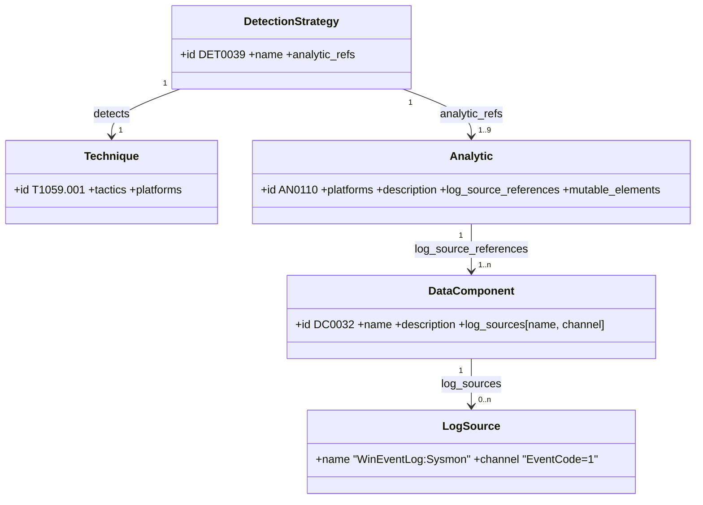
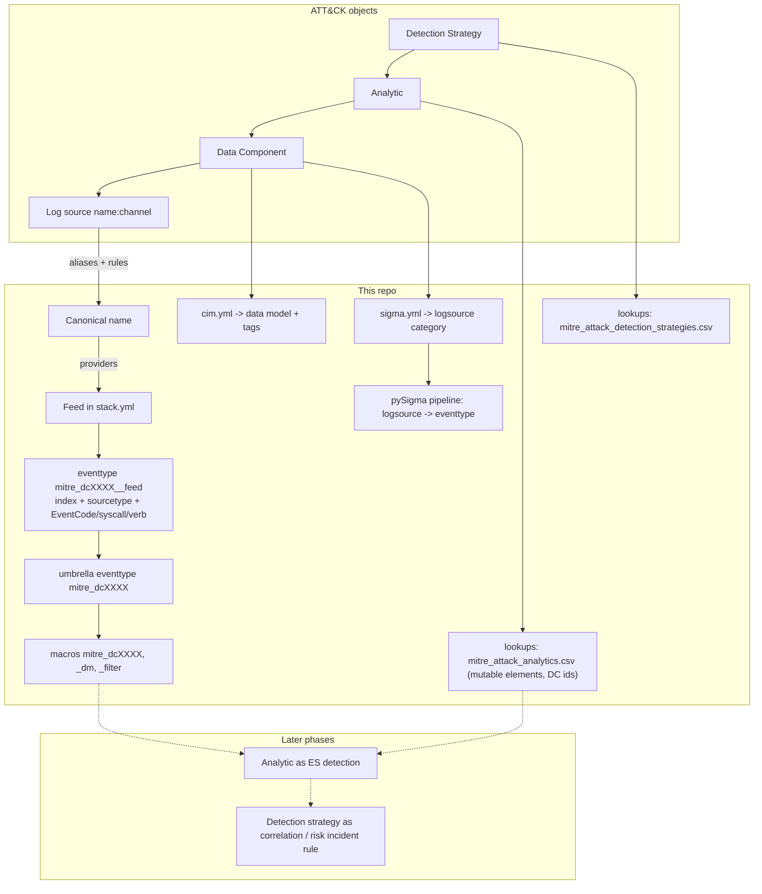

# The ATT&CK v20 detection model and how it maps here

## Objects

ATT&CK v18 replaced "data source detects technique" with a four-layer model. v20.1 counts for Enterprise:

* A **detection strategy** is the per-technique plan (1:1 with techniques in 20.1).
* An **analytic** is one platform-specific implementation of that plan, written as prose. It names the data components and log sources it reads and declares **mutable elements**: the thresholds, time windows and allow-lists that must be tuned per environment (`TimeWindow` appears on 581 analytics, `UserContext` on 230).
* A **data component** is the observable (Process Creation, File Modification...). Since v18 it carries **log sources** directly; Data Source objects no longer exist.
* A **log source** is `name` + free-text `channel`. Names are loosely standardised (`WinEventLog:Sysmon`, `auditd:SYSCALL`, `NSM:Flow`, `esxi:hostd`...), channels range from `EventCode=4688` to a paragraph of prose.

## Mapping to Splunk and Sigma

| ATT&CK | Splunk | Sigma | Status |
|---|---|---|---|
| Log source | literal `index`/`sourcetype`/field constraint inside an eventtype | `logsource` product/service | done |
| Data component | umbrella eventtype, `mitre_dcXXXX*` macros, CIM tags, `_dm` macro | generic category (`process_creation`, `file_event`...) | done |
| Mutable elements | environment macros and tuning lookups (`mitre_allowlist_*`, `mitre_asset_roles`, `mitre_time_window(1)`) | pipeline placeholders | surface shipped, bindings in phase 2 |
| Analytic | ES 8 detection with a declared content type (TTP → notable, Anomaly → risk, Hunting → scheduled search, Baseline → summary) | rule | phase 2 |
| Detection strategy | correlation search, risk incident rule or notable, chosen per DET | correlation rule | phase 3 |

## Why eventtypes for data components

Eventtypes are the Splunk object that says "these events are an instance of X" without changing the data. That is exactly a data component. Benefits: analytics reference `eventtype=mitre_dc0032_process_creation` and stay valid when you swap Sysmon for an EDR feed; `tag=dc0032` gives instant visibility of coverage; the `mitre_attack_log_sources` lookup joins an eventtype back to the ATT&CK objects.

Limits, and what the repo does about them:

* Eventtypes cannot expand macros, use subsearches or lookups. Index and sourcetype names are therefore substituted at build time from `config/stack.yml`; override in `local/`.
* Eventtypes are evaluated at search time and are not available to `tstats`. Hot components (Process Creation backs 860 analytics) get a `mitre_dcXXXX_dm` macro so phase-2 analytics can run against accelerated CIM data models instead.
* ATT&CK's channel prose is not always parseable. The constraint origin (`curated`, `defaults`, `derived`) is shown on each component page, and `broad_refs` counts references that carried no usable filter.
