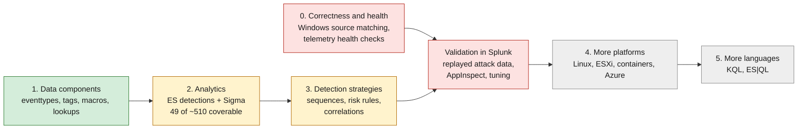

# Roadmap

Phases and where each stands. The ordered, checkbox-level work list is [TODO.md](../TODO.md); this page is the map.



Green is done, amber is in progress, red is next and blocks enabling anything in production, grey is later.

## Phase 1: data components (done)

Feed checklist, log-source normalisation, per-component eventtypes, tags, macros and lookups, Sigma logsource pipeline, per-component docs, coverage, gaps, checklist, changelog tooling, CI. Open correctness item: Windows feeds must match on `source` for current add-on versions (TODO P0).

## Phase 2: analytics (in progress)

Done: schema and scaffolding (`new-analytic`), validation, ES 8 detections app, Sigma rules with correlation support, per-analytic docs, prioritised backlog, 49 analytics. Next: the batches listed in TODO P2, then `reviewed` status after production tuning.

The `curated` schema of `content/analytics/ANxxxx.yml`:

```yaml
status: implemented            # scaffold | implemented | reviewed
title: LSASS memory access by an unexpected process
content_type: ttp              # ttp | anomaly | hunting
severity: high
summary: what this search detects
gaps: what ATT&CK's text asks for that this does not cover
data_components: [DC0035]
feeds: [sysmon]
tuning:                        # one entry per ATT&CK mutable element that is bound
  - {element: AccessMask, bind: macro, name: mitre_an1030_access_mask, default: 'GrantedAccess IN (...)'}
  - {element: ParentProcessName, bind: lookup, name: mitre_allowlist_processes}
spl: |                         # uses mitre_dcXXXX macros and ends with mitre_anXXXX_filter
risk: {message: "...", objects: [{field: dest, type: system, score: 70}], threat_objects: [...]}
schedule: {cron, earliest, latest}     # optional; default every 15 minutes with a per-analytic offset
throttle: {fields: [dest], period: 3600s}
baselines: [{name, lookup, fields, search, cron, earliest}]
sigma: {logsource, detection}  # or rules: [...] + correlation: {...}, or not_expressible: reason
```

## Phase 3: detection strategies (in progress)

Done: strategy and correlation schema (`new-strategy`), generated risk rules over the Risk data model, 6 sequences, 4 strategy risk rules, 3 cross-strategy correlations. Next: sequences for the strategies listed in TODO P2, and threshold tuning of RISK0001 and RISK0002 against real risk data.

## Phase 0 and validation: before production (next)

Nothing here has run in Splunk. Before enabling content: fix Windows source matching, add telemetry health detections, set up asset and identity mapping, then replay attack data on a test search head and record which detections fire (TODO P0, P1, P3).

## Phase 4: more platforms (later)

Tick the feed in `config/stack.yml`, then implement from the backlog: Linux (357 analytics ready), ESXi (107), containers (35), Entra ID (21). Out-of-scope platforms (macOS, M365, AWS, GCP, SaaS) need `config/platforms.yml` and the `render` flags changed first.

## Phase 5: more query languages (later)

KQL (Sentinel and Defender tables are recorded per log source as `kql.table`) and ES|QL (`elastic.dataset`). The renderer interface and stubs exist in `src/mitremap/render/`.

## Maintenance (ongoing)

New ATT&CK release: fetch, diff, build, review. Optional contentctl export. ICS and Mobile domains use the same STIX layout (`fetch --domain`).
