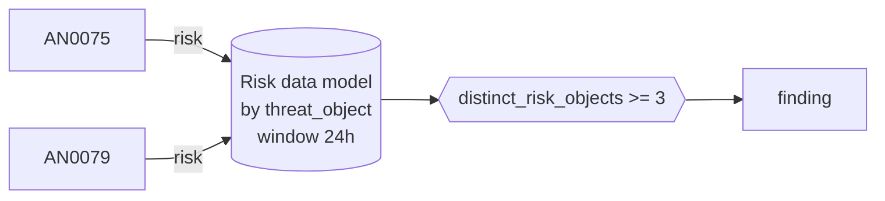

# DET0027 Several hosts sending tool-like or encoded HTTP to the same external host

[ATT&CK detection strategy](https://attack.mitre.org/detectionstrategies/DET0027) · Detection of Web Protocol-Based C2 Over HTTP, HTTPS, or WebSockets · [T1071.001 Web Protocols](https://attack.mitre.org/techniques/T1071/001) · tactics: command-and-control

**Shape:** risk rule: over the Risk data model → finding only · **Severity:** medium · **Status:** implemented

Three or more internal hosts raise AN0075 (non-browser user agent) or AN0079 (encoded URI tokens) risk against the same external HTTP host within 24 hours. One script talking to an API is common; the same unusual pattern spreading across hosts looks like an implant's C2.



## Analytics in this strategy

| Analytic | Platforms | Status | Type |
|---|---|---|---|
| [AN0075](../analytics/AN0075-http-to-external-hosts-with-a-non-browser-user-agent.md) | Windows | implemented | anomaly |
| [AN0076](https://attack.mitre.org/detectionstrategies/DET0027#AN0076) | Linux | backlog |  |
| [AN0077](https://attack.mitre.org/detectionstrategies/DET0027#AN0077) | macOS | backlog |  |
| [AN0078](https://attack.mitre.org/detectionstrategies/DET0027#AN0078) | ESXi | backlog |  |
| [AN0079](../analytics/AN0079-repeated-http-requests-carrying-long-encoded-tokens-in-the-u.md) | Network Devices | implemented | anomaly |

**Not covered:** TLS traffic has no user agent in ssl.log and is not covered; see the backlog for JA3-based analytics.

## Tuning

| Macro | Default | Purpose |
|---|---|---|
| `mitre_det0027_filter` | `search *` | Exclusions for DET0027 Several hosts sending tool-like or encoded HTTP to the same external host. |
| `mitre_det0027_condition` | `distinct_risk_objects >= 3` | Firing condition for DET0027. Fields: risk_score, risk_events, distinct_analytics, distinct_strategies, distinct_tactics, distinct_techniques, distinct_risk_objects. |

## Splunk

Stanza `[MITRE - DET0027 - Several hosts sending tool-like or encoded HTTP to the same external host - Rule]` in `DA-ESS-mitre-attack-detections`. Schedule `22 * * * *`, window `-24h` to `now`. Ships disabled.

Generated from the parameters below; edit the YAML, not the search. Scope: `source IN ("MITRE - AN0075 - *", "MITRE - AN0079 - *") All_Risk.threat_object_type IN ("domain")`.

| Parameter | Value |
|---|---|
| group_by | threat_object |
| window | 24h |
| condition | `distinct_risk_objects >= 3` |

```spl
| tstats `mitre_summariesonly` min(_time) as firstTime max(_time) as lastTime sum(All_Risk.calculated_risk_score) as risk_score count as risk_events
    from datamodel=Risk.All_Risk where source IN ("MITRE - AN0075 - *", "MITRE - AN0079 - *") All_Risk.threat_object_type IN ("domain")
    by All_Risk.threat_object All_Risk.threat_object_type All_Risk.risk_object All_Risk.risk_object_type source
| `drop_dm_object_name(All_Risk)`
| rex field=source "^MITRE - (?<mitre_id>(AN|DET)\d{4}) - "
| lookup mitre_attack_analytics an_id AS mitre_id OUTPUT det_id AS an_det_id tactics AS an_tactics technique_id AS an_technique_id
| lookup mitre_attack_detection_strategies det_id AS mitre_id OUTPUT tactics AS det_tactics technique_id AS det_technique_id
| eval det_id=coalesce(an_det_id, if(match(mitre_id, "^DET"), mitre_id, null())), tactic=split(coalesce(an_tactics, det_tactics), "|"), technique_id=coalesce(an_technique_id, det_technique_id)
| stats min(firstTime) as firstTime max(lastTime) as lastTime sum(risk_score) as risk_score sum(risk_events) as risk_events dc(mitre_id) as distinct_analytics dc(det_id) as distinct_strategies dc(tactic) as distinct_tactics dc(technique_id) as distinct_techniques dc(risk_object) as distinct_risk_objects values(risk_object) as risk_object values(mitre_id) as mitre_ids values(technique_id) as technique_ids values(tactic) as tactics values(source) as source by threat_object threat_object_type
| where `mitre_det0027_condition`
| `mitre_ctime(firstTime)` | `mitre_ctime(lastTime)`
| `mitre_det0027_filter`
```

## Sigma

Not expressed in Sigma: Operates on Enterprise Security risk events, which Sigma does not model.

## Known false positives

- An internal script deployed fleet-wide that calls an external API; allow-list the domain in mitre_allowlist_domains.
