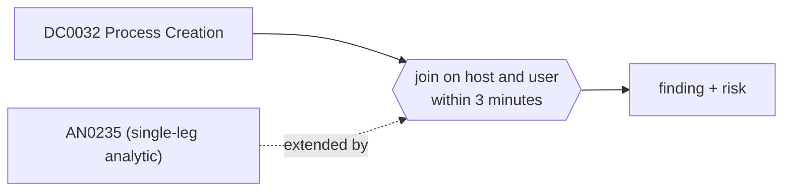

# DET0085 SYSTEM hive saved together with SAM or SECURITY

[ATT&CK detection strategy](https://attack.mitre.org/detectionstrategies/DET0085) · Credential Dumping from SAM via Registry Dump and Local File Access · [T1003.002 Security Account Manager](https://attack.mitre.org/techniques/T1003/002) · tactics: credential-access

**Shape:** sequence: raw-event chain joined on a key → finding + risk · **Severity:** critical · **Status:** implemented

The same user on the same host saves or exports the SYSTEM hive and the SAM or SECURITY hive within three minutes. SAM hashes are encrypted with the boot key stored in SYSTEM, so both together are what offline hash extraction needs; either alone (AN0235) is a weaker signal.



## Analytics in this strategy

| Analytic | Platforms | Status | Type |
|---|---|---|---|
| [AN0235](../analytics/AN0235-sam-system-or-security-hive-dumped-from-the-command-line.md) | Windows | implemented | ttp |

**Not covered:** Hive reads through shadow-copy paths and raw volume access are not paired here; AN0235 still raises them individually.

## Tuning

| Macro | Default | Purpose |
|---|---|---|
| `mitre_det0085_filter` | `search *` | Exclusions for DET0085 SYSTEM hive saved together with SAM or SECURITY. |
| `mitre_det0085_window_seconds` | `180` | DET0085 tunable for 'TimeWindow'. |

## Splunk

Stanza `[MITRE - DET0085 - SYSTEM hive saved together with SAM or SECURITY - Rule]` in `DA-ESS-mitre-attack-detections`. Schedule `9-59/15 * * * *`, window `-75m@m` to `-5m@m`. Ships disabled.

```spl
| tstats `mitre_summariesonly` min(_time) as firstTime max(_time) as lastTime
    from `mitre_dc0032_dm` where `mitre_dc0032_dm_where` Processes.process IN ("* save *", "* export *") `mitre_an0235_hives`
    by Processes.dest Processes.user Processes.process
| `drop_dm_object_name(Processes)`
| eval hive=case(match(lower(process), "\\\\sam\\s"), "SAM", match(lower(process), "\\\\security\\s"), "SECURITY", match(lower(process), "\\\\system\\s"), "SYSTEM")
| stats min(firstTime) as firstTime max(lastTime) as lastTime dc(hive) as hive_count values(hive) as hives values(process) as process by dest user
| where hive_count >= 2 AND isnotnull(mvfind(hives, "^SYSTEM$")) AND lastTime - firstTime <= `mitre_det0085_window_seconds`
| `mitre_ctime(firstTime)` | `mitre_ctime(lastTime)`
| `mitre_det0085_filter`
```

Risk: `dest` (system, 90), `user` (user, 90). Message: $user$ saved the SYSTEM and SAM or SECURITY hives on $dest$

## Sigma

Rule file: `dist/sigma/rules/det0085_system_hive_saved_together_with_sam_or_security.yml` (base rules plus a `temporal` correlation).

## Known false positives

- System-state backups that export every hive.
