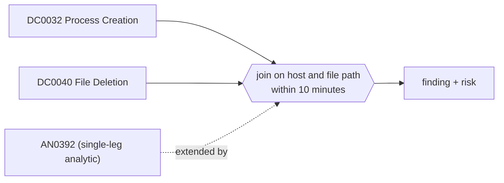

# DET0140 Binary or script run from a staging path, then deleted

[ATT&CK detection strategy](https://attack.mitre.org/detectionstrategies/DET0140) · Behavioral Detection of Malicious File Deletion · [T1070.004 File Deletion](https://attack.mitre.org/techniques/T1070/004) · tactics: stealth

**Shape:** sequence: raw-event chain joined on a key → finding + risk · **Severity:** high · **Status:** implemented

A program or script runs from a staging path (Sysmon 1, directly or on an interpreter's command line) and the same file is deleted within ten minutes (Sysmon 23/26). Droppers and hands-on-keyboard tooling clean up this way; legitimate software rarely deletes its own binary minutes after running it.



## Analytics in this strategy

| Analytic | Platforms | Status | Type |
|---|---|---|---|
| [AN0392](../analytics/AN0392-secure-deletion-self-deletion-or-interpreter-removing-execut.md) | Windows | implemented | anomaly |
| [AN0393](https://attack.mitre.org/detectionstrategies/DET0140#AN0393) | Linux | backlog |  |
| [AN0394](https://attack.mitre.org/detectionstrategies/DET0140#AN0394) | macOS | backlog |  |
| [AN0395](https://attack.mitre.org/detectionstrategies/DET0140#AN0395) | ESXi | backlog |  |

**Not covered:** Deletion by a different name (renamed before deletion) or by wiping tools that overwrite in place is not joined; AN0392 still reports secure deletion on its own.

## Tuning

| Macro | Default | Purpose |
|---|---|---|
| `mitre_det0140_filter` | `search *` | Exclusions for DET0140 Binary or script run from a staging path, then deleted. |
| `mitre_det0140_staging_paths` | `("*\\AppData\\Local\\Temp\\*", "*\\Windows\\Temp\\*", "*\\Users\\Public\\*", "*\\ProgramData\\*", "*\\PerfLogs\\*", "*\\Downloads\\*")` | DET0140 tunable for 'FilePathPattern'. A parenthesised value list used with IN. |
| `mitre_det0140_window_seconds` | `600` | DET0140 tunable for 'TimeWindow'. |

## Splunk

Stanza `[MITRE - DET0140 - Binary or script run from a staging path, then deleted - Rule]` in `DA-ESS-mitre-attack-detections`. Schedule `9-59/15 * * * *`, window `-75m@m` to `-5m@m`. Ships disabled.

```spl
(`mitre_dc0032_sysmon` EventCode=1 (Image IN `mitre_det0140_staging_paths` OR CommandLine IN `mitre_det0140_staging_paths`))
  OR (`mitre_dc0040_sysmon` EventCode IN (23, 26) TargetFilename IN `mitre_det0140_staging_paths` TargetFilename IN ("*.exe", "*.dll", "*.scr", "*.ps1", "*.bat", "*.cmd", "*.vbs", "*.js", "*.hta"))
| `mitre_normalize_host`
| rex field=CommandLine "(?i)(?<cmd_path>[a-z]:\\\\[^\"]+?\.(ps1|bat|cmd|vbs|js|hta|dll))"
| eval file_path=lower(case(EventCode IN (23, 26), TargetFilename, isnotnull(cmd_path), cmd_path, true(), Image))
| eval exec_time=if(EventCode==1, _time, null()), delete_time=if(EventCode IN (23, 26), _time, null()), deleter=if(EventCode IN (23, 26), replace(Image, "^.*\\\\", ""), null())
| stats min(exec_time) as exec_time max(delete_time) as delete_time values(deleter) as deleter values(eval(if(EventCode==1, CommandLine, null()))) as process values(user) as user by dest file_path
| where isnotnull(exec_time) AND isnotnull(delete_time) AND delete_time >= exec_time AND delete_time - exec_time <= `mitre_det0140_window_seconds`
| eval firstTime=exec_time, lastTime=delete_time
| `mitre_ctime(firstTime)` | `mitre_ctime(lastTime)`
| `mitre_det0140_filter`
```

Risk: `dest` (system, 60), `user` (user, 50). Message: $file_path$ ran on $dest$ and was deleted shortly after

## Sigma

Rule file: `dist/sigma/rules/det0140_binary_or_script_run_from_a_staging_path_then_deleted.yml` (base rules plus a `temporal` correlation).

Uses a temporal (unordered) correlation because the Splunk pySigma backend does not implement temporal_ordered; scripts run through an interpreter are joined only in the Splunk search.

## Known false positives

- Installers and updaters that run a bootstrapper from Temp and remove it when done.
