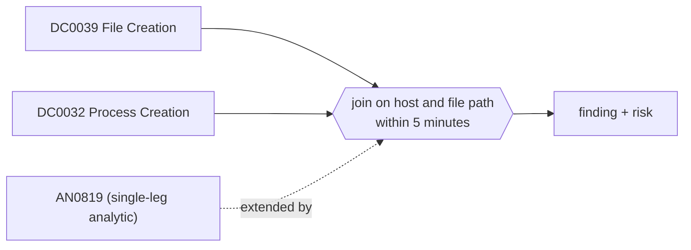

# DET0294 File written by a document or archive application, then executed

[ATT&CK detection strategy](https://attack.mitre.org/detectionstrategies/DET0294) · User Execution – Malicious File via download/open → spawn chain (T1204.002) · [T1204.002 Malicious File](https://attack.mitre.org/techniques/T1204/002) · tactics: execution

**Shape:** sequence: raw-event chain joined on a key → finding + risk · **Severity:** high · **Status:** implemented

A document, mail, PDF or archive application writes an executable or script into a user-controlled path (Sysmon 11), and within five minutes a process is started from that file, or a script host or shell is started with that file on its command line (Sysmon 1). Joined on host and file path.



## Analytics in this strategy

| Analytic | Platforms | Status | Type |
|---|---|---|---|
| [AN0819](../analytics/AN0819-document-or-mail-application-spawned-an-interpreter-or-lolbi.md) | Windows | implemented | ttp |
| [AN0820](https://attack.mitre.org/detectionstrategies/DET0294#AN0820) | macOS | backlog |  |
| [AN0821](https://attack.mitre.org/detectionstrategies/DET0294#AN0821) | Linux | backlog |  |

**Not covered:** The Zone.Identifier stream (Sysmon 15) and signer allow-listing are not used. Payloads extracted to a different name before running break the path join.

## Tuning

| Macro | Default | Purpose |
|---|---|---|
| `mitre_det0294_filter` | `search *` | Exclusions for DET0294 File written by a document or archive application, then executed. |
| `mitre_det0294_writer_apps` | `Image IN ("*\\winword.exe", "*\\excel.exe", "*\\powerpnt.exe", "*\\outlook.exe", "*\\msaccess.exe", "*\\onenote.exe", "*\\acrord32.exe", "*\\acrobat.exe", "*\\foxitpdfreader.exe", "*\\winrar.exe", "*\\7zfm.exe", "*\\7zg.exe", "*\\explorer.exe")` | DET0294 tunable for 'ParentApps'. explorer.exe covers files extracted from ZIP and ISO containers by the shell. |
| `mitre_det0294_user_paths` | `(TargetFilename IN ("*\\Downloads\\*", "*\\AppData\\Local\\Temp\\*", "*\\Desktop\\*", "*\\Users\\Public\\*", "*\\INetCache\\*", "*\\Content.Outlook\\*") OR Image IN ("*\\Downloads\\*", "*\\AppData\\Local\\Temp\\*", "*\\Desktop\\*", "*\\Users\\Public\\*", "*\\INetCache\\*", "*\\Content.Outlook\\*") OR CommandLine IN ("*\\Downloads\\*", "*\\AppData\\Local\\Temp\\*", "*\\Desktop\\*", "*\\Users\\Public\\*", "*\\INetCache\\*", "*\\Content.Outlook\\*"))` | DET0294 tunable for 'UserPaths'. |
| `mitre_det0294_extensions` | `TargetFilename IN ("*.exe", "*.scr", "*.com", "*.pif", "*.cpl", "*.dll", "*.js", "*.jse", "*.vbs", "*.vbe", "*.wsf", "*.hta", "*.bat", "*.cmd", "*.ps1", "*.lnk", "*.msi")` | DET0294 tunable for 'SuspiciousExtensions'. |
| `mitre_det0294_window_seconds` | `300` | DET0294 tunable for 'TimeWindow'. |

## Splunk

Stanza `[MITRE - DET0294 - File written by a document or archive application, then executed - Rule]` in `DA-ESS-mitre-attack-detections`. Schedule `7-59/15 * * * *`, window `-75m@m` to `-5m@m`. Ships disabled.

```spl
(`mitre_dc0039_sysmon` EventCode=11 `mitre_det0294_writer_apps` `mitre_det0294_user_paths` `mitre_det0294_extensions`)
  OR (`mitre_dc0032_sysmon` EventCode=1 `mitre_det0294_user_paths`)
| `mitre_normalize_host`
| rex field=CommandLine "(?i)(?<cmd_path>[a-z]:\\\\[^\"]+?\.(js|jse|vbs|vbe|wsf|hta|bat|cmd|ps1|lnk|dll|cpl|msi))"
| eval file_path=lower(case(EventCode==11, TargetFilename, isnotnull(cmd_path), cmd_path, true(), Image))
| eval write_time=if(EventCode==11, _time, null()), exec_time=if(EventCode==1, _time, null()), writer=if(EventCode==11, Image, null()), launched=if(EventCode==1, Image, null())
| stats min(write_time) as write_time min(exec_time) as exec_time values(writer) as writer values(launched) as launched values(CommandLine) as process values(user) as user by dest file_path
| where isnotnull(write_time) AND isnotnull(exec_time) AND exec_time >= write_time AND exec_time - write_time <= `mitre_det0294_window_seconds`
| eval writer_name=replace(mvindex(writer, 0), "^.*\\\\", ""), firstTime=write_time, lastTime=exec_time
| `mitre_ctime(firstTime)` | `mitre_ctime(lastTime)`
| `mitre_det0294_filter`
```

Risk: `dest` (system, 70), `user` (user, 70). Message: File written by $writer_name$ was executed on $dest$

## Sigma

Rule file: `dist/sigma/rules/det0294_file_written_by_a_document_or_archive_application_then_execu.yml` (base rules plus a `temporal` correlation).

Scripts launched through an interpreter carry the path on the command line, which a Sigma alias cannot extract; the rule pairs direct executable launches only. The correlation is temporal (unordered) because the Splunk pySigma backend does not implement temporal_ordered; the Splunk search enforces the order.

## Known false positives

- Users installing software downloaded through the browser and opened from Explorer; signed installers can be excluded by path in the filter macro.
