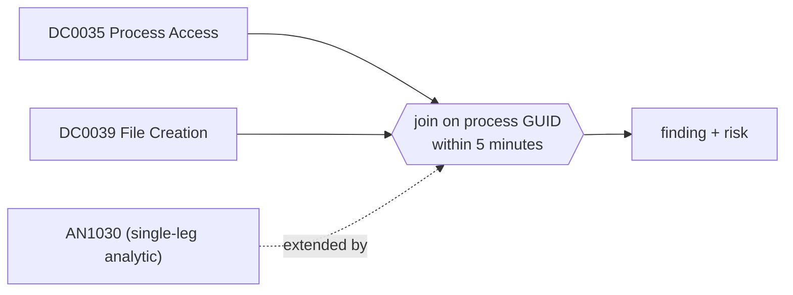

# DET0363 LSASS memory read followed by a file write from the same process

[ATT&CK detection strategy](https://attack.mitre.org/detectionstrategies/DET0363) · Detection of Credential Dumping from LSASS Memory via Access and Dump Sequence · [T1003.001 LSASS Memory](https://attack.mitre.org/techniques/T1003/001) · tactics: credential-access

**Shape:** sequence: raw-event chain joined on a key → finding + risk · **Severity:** critical · **Status:** implemented

The process that opened lsass.exe with a memory-read access mask (Sysmon 10) then writes a dump-like file (Sysmon 11) within five minutes. The two events are joined on the process GUID, so this is the access-then-dump chain ATT&CK describes rather than two coincidences on one host.



## Analytics in this strategy

| Analytic | Platforms | Status | Type |
|---|---|---|---|
| [AN1030](../analytics/AN1030-lsass-memory-access-by-an-unexpected-process.md) | Windows | implemented | ttp |

**Not covered:** The 4673 privileged-service call and registry legs are not used. Dumps written by a second process (for example a helper spawned for the write) break the GUID join.

## Tuning

| Macro | Default | Purpose |
|---|---|---|
| `mitre_det0363_filter` | `search *` | Exclusions for DET0363 LSASS memory read followed by a file write from the same process. |
| `mitre_det0363_dump_files` | `TargetFilename IN ("*.dmp", "*.dump", "*.mdmp", "*lsass*", "*\\Temp\\*", "*\\Users\\Public\\*", "*\\ProgramData\\*", "*\\PerfLogs\\*")` | DET0363 tunable for 'DumpFilePath'. The GUID join already ties the write to the LSASS reader, so this can be widened to TargetFilename=* if your Sysmon config logs those writes. |
| `mitre_det0363_window_seconds` | `300` | DET0363 tunable for 'TimeWindow'. |

## Splunk

Stanza `[MITRE - DET0363 - LSASS memory read followed by a file write from the same process - Rule]` in `DA-ESS-mitre-attack-detections`. Schedule `3-59/15 * * * *`, window `-75m@m` to `-5m@m`. Ships disabled.

```spl
(`mitre_dc0035_sysmon` EventCode=10 TargetImage="*\\lsass.exe" `mitre_an1030_access_mask`)
  OR (`mitre_dc0039_sysmon` EventCode=11 `mitre_det0363_dump_files`)
| `mitre_normalize_host`
| eval process_guid=coalesce(SourceProcessGUID, ProcessGuid), user=coalesce(SourceUser, User, user)
| eval access_time=if(EventCode==10, _time, null()), write_time=if(EventCode==11, _time, null()), process_path=coalesce(SourceImage, Image)
| stats min(access_time) as access_time min(write_time) as write_time values(process_path) as process_path values(TargetFilename) as file_path values(GrantedAccess) as granted_access values(user) as user by dest process_guid
| where isnotnull(access_time) AND isnotnull(write_time) AND write_time >= access_time AND write_time - access_time <= `mitre_det0363_window_seconds`
| eval process_name=replace(mvindex(process_path, 0), "^.*\\\\", ""), firstTime=access_time, lastTime=write_time
| `mitre_ctime(firstTime)` | `mitre_ctime(lastTime)`
| `mitre_det0363_filter`
```

Risk: `dest` (system, 90), `user` (user, 90). Message: $process_name$ read LSASS memory and wrote a file on $dest$

## Sigma

Rule file: `dist/sigma/rules/det0363_lsass_memory_read_followed_by_a_file_write_from_the_same_pro.yml` (base rules plus a `temporal` correlation).

Uses a temporal (unordered) correlation because the Splunk pySigma backend does not implement temporal_ordered; the Splunk search enforces the order.

## Known false positives

- Crash-dump tooling (WerFault, procdump run by administrators for support cases).
