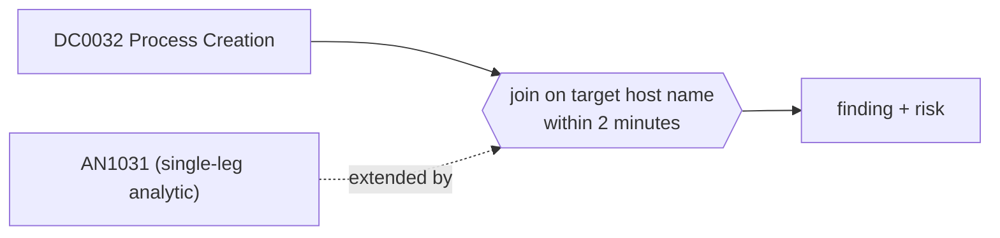

# DET0364 Remote WMI process creation followed by execution on the target

[ATT&CK detection strategy](https://attack.mitre.org/detectionstrategies/DET0364) · Behavioral Detection Strategy for WMI Execution Abuse on Windows · [T1047 Windows Management Instrumentation](https://attack.mitre.org/techniques/T1047) · tactics: execution

**Shape:** sequence: raw-event chain joined on a key → finding + risk · **Severity:** high · **Status:** implemented

A host runs wmic /node:<target> process call create or Invoke-WmiMethod / Invoke-CimMethod with -ComputerName <target>, and within two minutes WmiPrvSE starts a process on that target. Joined across hosts on the target's short host name, so both ends of the remote execution are in one finding.



## Analytics in this strategy

| Analytic | Platforms | Status | Type |
|---|---|---|---|
| [AN1031](../analytics/AN1031-wmi-used-to-create-processes-locally-or-on-remote-hosts.md) | Windows | implemented | anomaly |

**Not covered:** Targets given as IP addresses do not join to host names (add them to the asset map and extend the join if needed); only the first target of a comma-separated /node list is used; DCOM and WinRM connections are not used.

## Tuning

| Macro | Default | Purpose |
|---|---|---|
| `mitre_det0364_filter` | `search *` | Exclusions for DET0364 Remote WMI process creation followed by execution on the target. |
| `mitre_det0364_window_seconds` | `120` | DET0364 tunable for 'TimeWindow'. |
| `mitre_det0364_remote_wmi` | `((Image="*\\wmic.exe" CommandLine="*/node:*" CommandLine="*process*call*create*") OR (Image IN ("*\\powershell.exe", "*\\pwsh.exe") CommandLine IN ("*Invoke-WmiMethod*", "*Invoke-CimMethod*") CommandLine="*-ComputerName*"))` | DET0364 tunable for 'SuspiciousCommandPatterns'. |

## Splunk

Stanza `[MITRE - DET0364 - Remote WMI process creation followed by execution on the target - Rule]` in `DA-ESS-mitre-attack-detections`. Schedule `11-59/15 * * * *`, window `-75m@m` to `-5m@m`. Ships disabled.

```spl
(`mitre_dc0032_sysmon` EventCode=1 `mitre_det0364_remote_wmi`)
  OR (`mitre_dc0032_sysmon` EventCode=1 ParentImage="*\\WmiPrvSE.exe")
| `mitre_normalize_host`
| rex field=CommandLine "(?i)/node:\"?(?<wmi_target>[^\s\",]+)"
| rex field=CommandLine "(?i)-ComputerName\s+\"?(?<ps_target>[^\s\",]+)"
| eval remote_target=coalesce(wmi_target, ps_target), is_source=if(isnotnull(remote_target) AND NOT match(ParentImage, "(?i)wmiprvse\.exe$"), 1, 0)
| eval target_host=lower(mvindex(split(if(is_source==1, remote_target, dest), "."), 0))
| eval src_time=if(is_source==1, _time, null()), exec_time=if(is_source==0, _time, null()), src=if(is_source==1, dest, null()), src_user=if(is_source==1, user, null()), target_process=if(is_source==0, CommandLine, null())
| stats min(src_time) as src_time min(exec_time) as exec_time values(src) as src values(src_user) as user values(target_process) as process by target_host
| where isnotnull(src_time) AND isnotnull(exec_time) AND exec_time >= src_time AND exec_time - src_time <= `mitre_det0364_window_seconds`
| rename target_host as dest
| eval firstTime=src_time, lastTime=exec_time
| `mitre_ctime(firstTime)` | `mitre_ctime(lastTime)`
| `mitre_det0364_filter`
```

Risk: `dest` (system, 70), `user` (user, 60). Message: Remote WMI execution on $dest$ from $src$

## Sigma

Not expressed in Sigma: The join is on a host name extracted from the source command line and compared with the target's Computer field across two hosts; Sigma correlations can only group on a field both events carry.

## Known false positives

- Administrators and management tools that use WMI to run commands on other hosts.
