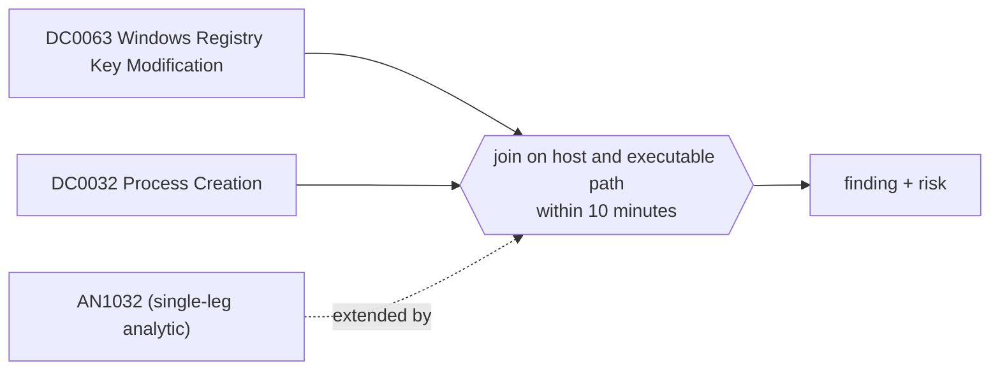

# DET0365 Run key set to a user-writable binary that also executes

[ATT&CK detection strategy](https://attack.mitre.org/detectionstrategies/DET0365) · Detect Registry and Startup Folder Persistence (Windows) · [T1547.001 Registry Run Keys / Startup Folder](https://attack.mitre.org/techniques/T1547/001) · tactics: persistence, privilege-escalation

**Shape:** sequence: raw-event chain joined on a key → finding + risk · **Severity:** high · **Status:** implemented

A Run or RunOnce value is written pointing to a file in a user-writable location (Sysmon 13), and a process runs from that same file within ten minutes either side (Sysmon 1). Malware usually registers the binary it is already running from, so the execution often precedes the registry write.



## Analytics in this strategy

| Analytic | Platforms | Status | Type |
|---|---|---|---|
| [AN1032](../analytics/AN1032-run-key-value-pointing-to-a-script-or-user-writable-path.md) | Windows | implemented | anomaly |

**Not covered:** Startup-folder shortcuts and execution at the next logon (outside the window) are not paired. Values pointing at a shared interpreter (powershell.exe with arguments) match on the interpreter path, which is broader; AN1032 still scores those.

## Tuning

| Macro | Default | Purpose |
|---|---|---|
| `mitre_det0365_filter` | `search *` | Exclusions for DET0365 Run key set to a user-writable binary that also executes. |
| `mitre_det0365_run_keys` | `TargetObject IN ("*\\CurrentVersion\\Run\\*", "*\\CurrentVersion\\RunOnce\\*", "*\\CurrentVersion\\RunOnceEx\\*", "*\\CurrentVersion\\Policies\\Explorer\\Run\\*")` | DET0365 tunable for 'RegistryKeyPath'. |
| `mitre_det0365_user_writable` | `(Details IN ("*\\AppData\\*", "*\\Users\\Public\\*", "*\\Temp\\*", "*\\ProgramData\\*", "*\\Downloads\\*") OR Image IN ("*\\AppData\\*", "*\\Users\\Public\\*", "*\\Temp\\*", "*\\ProgramData\\*", "*\\Downloads\\*"))` | DET0365 tunable for 'ImagePath'. |
| `mitre_det0365_window_seconds` | `600` | DET0365 tunable for 'TimeWindow'. |

## Splunk

Stanza `[MITRE - DET0365 - Run key set to a user-writable binary that also executes - Rule]` in `DA-ESS-mitre-attack-detections`. Schedule `4-59/15 * * * *`, window `-75m@m` to `-5m@m`. Ships disabled.

```spl
(`mitre_dc0063_sysmon` EventCode=13 `mitre_det0365_run_keys` `mitre_det0365_user_writable`)
  OR (`mitre_dc0032_sysmon` EventCode=1 `mitre_det0365_user_writable`)
| `mitre_normalize_host`
| rex field=Details "(?i)^\"?(?<run_path>[a-z]:\\\\[^\"]+?\.(exe|scr|com|dll|bat|cmd|vbs|js|ps1|hta))"
| eval file_path=lower(if(EventCode==13, run_path, Image)), set_time=if(EventCode==13, _time, null()), exec_time=if(EventCode==1, _time, null())
| where isnotnull(file_path)
| stats min(set_time) as set_time min(exec_time) as exec_time values(TargetObject) as registry_path values(Details) as registry_value_data values(eval(if(EventCode==13, Image, null()))) as writer values(user) as user by dest file_path
| where isnotnull(set_time) AND isnotnull(exec_time) AND abs(exec_time - set_time) <= `mitre_det0365_window_seconds`
| eval firstTime=min(set_time, exec_time), lastTime=max(set_time, exec_time)
| `mitre_ctime(firstTime)` | `mitre_ctime(lastTime)`
| `mitre_det0365_filter`
```

Risk: `dest` (system, 60), `user` (user, 50). Message: Run key on $dest$ points to $file_path$, which also executed

## Sigma

Rule file: `dist/sigma/rules/det0365_run_key_set_to_a_user_writable_binary_that_also_executes.yml` (base rules plus a `temporal` correlation).

The Run value data carries quotes and arguments, so Sigma cannot alias it to the image path; the rule pairs the two events on the host only.

## Known false positives

- Per-user applications that register themselves at install and start immediately (collaboration clients, updaters).
