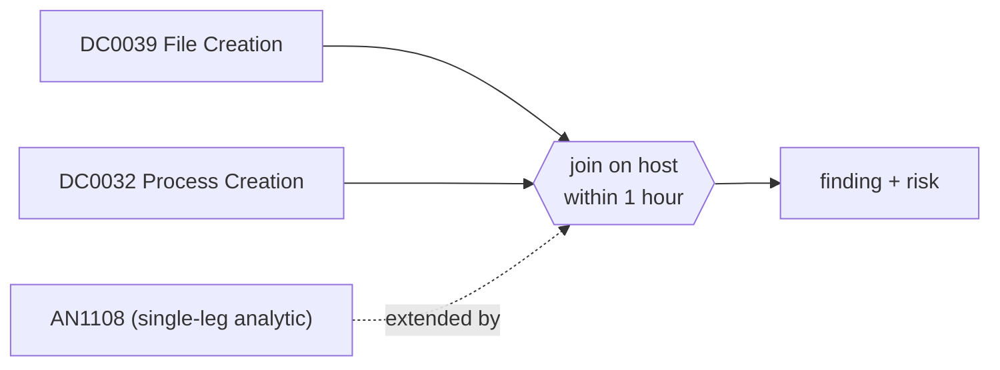

# DET0394 Script file dropped in a web root, then the web server spawned a shell

[ATT&CK detection strategy](https://attack.mitre.org/detectionstrategies/DET0394) · Web Shell Detection via Server Behavior and File Execution Chains · [T1505.003 Web Shell](https://attack.mitre.org/techniques/T1505/003) · tactics: persistence

**Shape:** sequence: raw-event chain joined on a key → finding + risk · **Severity:** critical · **Status:** implemented

A server-side script file (aspx, ashx, asmx, asp, php, jsp, cfm) is created under a web root (Sysmon 11) and within an hour a web server worker on the same host starts a shell or LOLBin (Sysmon 1). This is the write-then-use chain of a web shell; AN1108 alone sees only the second half.



## Analytics in this strategy

| Analytic | Platforms | Status | Type |
|---|---|---|---|
| [AN1108](../analytics/AN1108-web-server-process-spawned-a-shell-or-script-interpreter.md) | Windows | implemented | ttp |
| [AN1109](https://attack.mitre.org/detectionstrategies/DET0394#AN1109) | Linux | backlog |  |
| [AN1110](https://attack.mitre.org/detectionstrategies/DET0394#AN1110) | macOS | backlog |  |

**Not covered:** The inbound HTTP POST to the new file (Corelight http.log) and the associated logon are not joined. A web shell planted more than an hour before its first use is missed by this sequence.

## Tuning

| Macro | Default | Purpose |
|---|---|---|
| `mitre_det0394_filter` | `search *` | Exclusions for DET0394 Script file dropped in a web root, then the web server spawned a shell. |
| `mitre_det0394_web_roots` | `TargetFilename IN ("*\\inetpub\\wwwroot\\*", "*\\inetpub\\*\\*", "*\\FrontEnd\\HttpProxy\\*", "*\\ClientAccess\\*", "*\\htdocs\\*", "*\\webapps\\*", "*\\www\\*", "*\\wwwroot\\*")` | DET0394 tunable for 'WebRootPath'. |
| `mitre_det0394_script_ext` | `TargetFilename IN ("*.aspx", "*.ashx", "*.asmx", "*.asp", "*.cer", "*.php", "*.php5", "*.phtml", "*.jsp", "*.jspx", "*.cfm")` | DET0394 tunable for 'ScriptExtensions'. |
| `mitre_det0394_web_workers` | `ParentImage IN ("*\\w3wp.exe", "*\\httpd.exe", "*\\nginx.exe", "*\\php-cgi.exe", "*\\php.exe", "*\\tomcat*.exe", "*\\UMWorkerProcess.exe")` | DET0394 tunable for 'ParentProcess'. |
| `mitre_det0394_window_seconds` | `3600` | DET0394 tunable for 'TimeWindow'. |

## Splunk

Stanza `[MITRE - DET0394 - Script file dropped in a web root, then the web server spawned a shell - Rule]` in `DA-ESS-mitre-attack-detections`. Schedule `7-59/15 * * * *`, window `-125m@m` to `-5m@m`. Ships disabled.

```spl
(`mitre_dc0039_sysmon` EventCode=11 `mitre_det0394_web_roots` `mitre_det0394_script_ext`)
  OR (`mitre_dc0032_sysmon` EventCode=1 `mitre_det0394_web_workers` Image IN ("*\\cmd.exe", "*\\powershell.exe", "*\\pwsh.exe", "*\\wscript.exe", "*\\cscript.exe", "*\\mshta.exe", "*\\rundll32.exe", "*\\regsvr32.exe", "*\\certutil.exe", "*\\whoami.exe", "*\\net.exe", "*\\net1.exe", "*\\nltest.exe", "*\\systeminfo.exe"))
| `mitre_normalize_host`
| eval write_time=if(EventCode==11, _time, null()), spawn_time=if(EventCode==1, _time, null())
| stats min(write_time) as write_time max(spawn_time) as spawn_time values(TargetFilename) as file_path values(eval(if(EventCode==1, Image, null()))) as spawned values(CommandLine) as process values(ParentImage) as web_worker by dest
| where isnotnull(write_time) AND isnotnull(spawn_time) AND spawn_time >= write_time AND spawn_time - write_time <= `mitre_det0394_window_seconds`
| eval firstTime=write_time, lastTime=spawn_time
| `mitre_ctime(firstTime)` | `mitre_ctime(lastTime)`
| `mitre_det0394_filter`
```

Risk: `dest` (system, 90). Message: Script dropped in a web root on $dest$ followed by web server shell activity

## Sigma

Rule file: `dist/sigma/rules/det0394_script_file_dropped_in_a_web_root_then_the_web_server_spawne.yml` (base rules plus a `temporal` correlation).

Uses a temporal (unordered) correlation because the Splunk pySigma backend does not implement temporal_ordered; the Splunk search enforces the order.

## Known false positives

- Application deployments that publish pages and then run setup scripts through the application pool.
