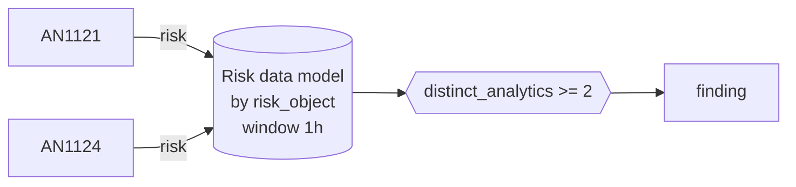

# DET0400 DNS tunnelling seen from both the endpoint and the network

[ATT&CK detection strategy](https://attack.mitre.org/detectionstrategies/DET0400) · Behavioral Detection of DNS Tunneling and Application Layer Abuse · [T1071.004 DNS](https://attack.mitre.org/techniques/T1071/004) · tactics: command-and-control

**Shape:** risk rule: over the Risk data model → finding only · **Severity:** high · **Status:** implemented

The same risk object carries both AN1121 (Sysmon DNS queries from a non-browser process) and AN1124 (Corelight dns.log pattern) within an hour. Agreement between the two vantage points raises confidence well above either alone.



## Analytics in this strategy

| Analytic | Platforms | Status | Type |
|---|---|---|---|
| [AN1121](../analytics/AN1121-dns-tunnelling-pattern-from-a-non-browser-process.md) | Windows | implemented | anomaly |
| [AN1122](https://attack.mitre.org/detectionstrategies/DET0400#AN1122) | Linux | backlog |  |
| [AN1123](https://attack.mitre.org/detectionstrategies/DET0400#AN1123) | macOS | backlog |  |
| [AN1124](../analytics/AN1124-dns-tunnelling-pattern-from-a-client-network-view.md) | Network Devices | implemented | anomaly |
| [AN1125](https://attack.mitre.org/detectionstrategies/DET0400#AN1125) | ESXi | backlog |  |

**Not covered:** AN1121 raises risk on the host name and AN1124 on the client IP. They only meet when ES Asset and Identity management maps the host's IP to its name; without that this rule never fires.

## Tuning

| Macro | Default | Purpose |
|---|---|---|
| `mitre_det0400_filter` | `search *` | Exclusions for DET0400 DNS tunnelling seen from both the endpoint and the network. |
| `mitre_det0400_condition` | `distinct_analytics >= 2` | Firing condition for DET0400. Fields: risk_score, risk_events, distinct_analytics, distinct_strategies, distinct_tactics, distinct_techniques. |

## Splunk

Stanza `[MITRE - DET0400 - DNS tunnelling seen from both the endpoint and the network - Rule]` in `DA-ESS-mitre-attack-detections`. Schedule `13-59/15 * * * *`, window `-1h` to `now`. Ships disabled.

Generated from the parameters below; edit the YAML, not the search. Scope: `source IN ("MITRE - AN1121 - *", "MITRE - AN1124 - *") All_Risk.risk_object_type IN ("system")`.

| Parameter | Value |
|---|---|
| group_by | risk_object |
| window | 1h |
| condition | `distinct_analytics >= 2` |

```spl
| tstats `mitre_summariesonly` min(_time) as firstTime max(_time) as lastTime sum(All_Risk.calculated_risk_score) as risk_score count as risk_events
    from datamodel=Risk.All_Risk where source IN ("MITRE - AN1121 - *", "MITRE - AN1124 - *") All_Risk.risk_object_type IN ("system")
    by All_Risk.risk_object All_Risk.risk_object_type source
| `drop_dm_object_name(All_Risk)`
| rex field=source "^MITRE - (?<mitre_id>(AN|DET)\d{4}) - "
| lookup mitre_attack_analytics an_id AS mitre_id OUTPUT det_id AS an_det_id tactics AS an_tactics technique_id AS an_technique_id
| lookup mitre_attack_detection_strategies det_id AS mitre_id OUTPUT tactics AS det_tactics technique_id AS det_technique_id
| eval det_id=coalesce(an_det_id, if(match(mitre_id, "^DET"), mitre_id, null())), tactic=split(coalesce(an_tactics, det_tactics), "|"), technique_id=coalesce(an_technique_id, det_technique_id)
| stats min(firstTime) as firstTime max(lastTime) as lastTime sum(risk_score) as risk_score sum(risk_events) as risk_events dc(mitre_id) as distinct_analytics dc(det_id) as distinct_strategies dc(tactic) as distinct_tactics dc(technique_id) as distinct_techniques values(mitre_id) as mitre_ids values(technique_id) as technique_ids values(tactic) as tactics values(source) as source by risk_object risk_object_type
| where `mitre_det0400_condition`
| `mitre_ctime(firstTime)` | `mitre_ctime(lastTime)`
| `mitre_det0400_filter`
```

## Sigma

Not expressed in Sigma: Operates on Enterprise Security risk events and asset correlation, which Sigma does not model.

## Known false positives

- Security agents that use DNS for reputation lookups, seen by both sensors.
