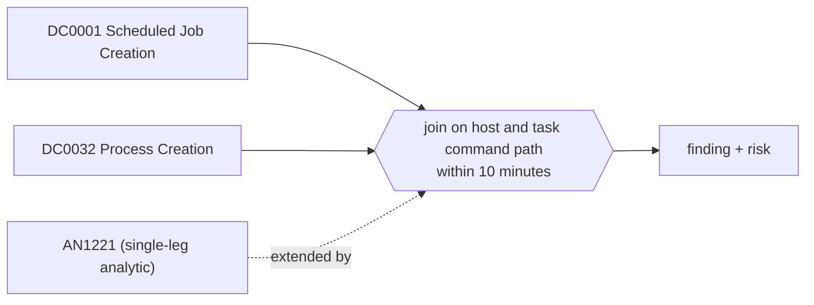

# DET0441 Suspicious scheduled task created and then run by Task Scheduler

[ATT&CK detection strategy](https://attack.mitre.org/detectionstrategies/DET0441) · Detection of Suspicious Scheduled Task Creation and Execution on Windows · [T1053.005 Scheduled Task](https://attack.mitre.org/techniques/T1053/005) · tactics: execution, persistence, privilege-escalation

**Shape:** sequence: raw-event chain joined on a key → finding + risk · **Severity:** high · **Status:** implemented

A scheduled task whose action runs an interpreter or a user-writable binary is registered (Security 4698), and within ten minutes Task Scheduler starts a process from the task's command (Sysmon 1 with the Schedule service or taskeng as parent). Joined on host and the executable path in the task XML.



## Analytics in this strategy

| Analytic | Platforms | Status | Type |
|---|---|---|---|
| [AN1221](../analytics/AN1221-scheduled-task-registered-with-an-interpreter-or-user-writab.md) | Windows | implemented | anomaly |

**Not covered:** Commands written with environment variables (%windir%, %appdata%) are not expanded, so they do not join; tasks set to run at the next logon or boot fall outside the window.

## Tuning

| Macro | Default | Purpose |
|---|---|---|
| `mitre_det0441_filter` | `search *` | Exclusions for DET0441 Suspicious scheduled task created and then run by Task Scheduler. |
| `mitre_det0441_window_seconds` | `600` | DET0441 tunable for 'TimeWindow'. |

## Splunk

Stanza `[MITRE - DET0441 - Suspicious scheduled task created and then run by Task Scheduler - Rule]` in `DA-ESS-mitre-attack-detections`. Schedule `8-59/15 * * * *`, window `-75m@m` to `-5m@m`. Ships disabled.

```spl
(`mitre_dc0001_wineventlog` EventCode=4698 `mitre_an1221_suspicious_actions`)
  OR (`mitre_dc0032_sysmon` EventCode=1 (ParentImage="*\\taskeng.exe" OR (ParentImage="*\\svchost.exe" ParentCommandLine="*Schedule*")))
| `mitre_normalize_host`
| rex field=TaskContent "(?i)(?:<|&lt;)Command(?:>|&gt;)\s*\"?(?<task_command>[^\"<&]+?)\"?\s*(?:<|&lt;)/Command"
| eval file_path=lower(trim(if(EventCode==4698, task_command, Image))), created_time=if(EventCode==4698, _time, null()), run_time=if(EventCode==1, _time, null())
| where isnotnull(file_path)
| stats min(created_time) as created_time min(run_time) as run_time values(TaskName) as task_name values(eval(if(EventCode==1, CommandLine, null()))) as process values(eval(if(EventCode==4698, SubjectUserName, null()))) as user by dest file_path
| where isnotnull(created_time) AND isnotnull(run_time) AND run_time >= created_time AND run_time - created_time <= `mitre_det0441_window_seconds`
| eval firstTime=created_time, lastTime=run_time
| `mitre_ctime(firstTime)` | `mitre_ctime(lastTime)`
| `mitre_det0441_filter`
```

Risk: `dest` (system, 60), `user` (user, 50). Message: Scheduled task $task_name$ on $dest$ was created and ran $file_path$

## Sigma

Rule file: `dist/sigma/rules/det0441_suspicious_scheduled_task_created_and_then_run_by_task_sched.yml` (base rules plus a `temporal` correlation).

The task command sits inside the task XML, which Sigma cannot alias to the image path; the rule pairs creation and a Task Scheduler launch on the host only. The correlation is temporal (unordered) because the Splunk pySigma backend does not implement temporal_ordered; the Splunk search enforces the order.

## Known false positives

- Software deployment that registers and immediately runs a PowerShell-based task.
