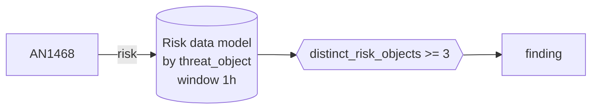

# DET0530 One source executing remotely on several hosts

[ATT&CK detection strategy](https://attack.mitre.org/detectionstrategies/DET0530) · Multi-Event Detection for SMB Admin Share Lateral Movement · [T1021.002 SMB/Windows Admin Shares](https://attack.mitre.org/techniques/T1021/002) · tactics: lateral-movement

**Shape:** risk rule: over the Risk data model → finding only · **Severity:** high · **Status:** implemented

The same source address is the threat object on AN1468 risk events (a shell or LOLBin running inside a network logon session) for three or more distinct hosts within an hour. That is lateral movement fanning out, not a single administrative session.



## Analytics in this strategy

| Analytic | Platforms | Status | Type |
|---|---|---|---|
| [AN1468](../analytics/AN1468-shell-or-lolbin-executed-inside-a-network-logon-session.md) | Windows | implemented | anomaly |

**Not covered:** SMB writes to ADMIN$/C$ (5145) are not required; see AN1468 for the single-host leg.

## Tuning

| Macro | Default | Purpose |
|---|---|---|
| `mitre_det0530_filter` | `search *` | Exclusions for DET0530 One source executing remotely on several hosts. |
| `mitre_det0530_condition` | `distinct_risk_objects >= 3` | Firing condition for DET0530. Fields: risk_score, risk_events, distinct_analytics, distinct_strategies, distinct_tactics, distinct_techniques, distinct_risk_objects. |

## Splunk

Stanza `[MITRE - DET0530 - One source executing remotely on several hosts - Rule]` in `DA-ESS-mitre-attack-detections`. Schedule `9-59/15 * * * *`, window `-1h` to `now`. Ships disabled.

Generated from the parameters below; edit the YAML, not the search. Scope: `source IN ("MITRE - AN1468 - *") All_Risk.risk_object_type IN ("system") All_Risk.threat_object_type IN ("ip_address")`.

| Parameter | Value |
|---|---|
| group_by | threat_object |
| window | 1h |
| condition | `distinct_risk_objects >= 3` |

```spl
| tstats `mitre_summariesonly` min(_time) as firstTime max(_time) as lastTime sum(All_Risk.calculated_risk_score) as risk_score count as risk_events
    from datamodel=Risk.All_Risk where source IN ("MITRE - AN1468 - *") All_Risk.risk_object_type IN ("system") All_Risk.threat_object_type IN ("ip_address")
    by All_Risk.threat_object All_Risk.threat_object_type All_Risk.risk_object All_Risk.risk_object_type source
| `drop_dm_object_name(All_Risk)`
| rex field=source "^MITRE - (?<mitre_id>(AN|DET)\d{4}) - "
| lookup mitre_attack_analytics an_id AS mitre_id OUTPUT det_id AS an_det_id tactics AS an_tactics technique_id AS an_technique_id
| lookup mitre_attack_detection_strategies det_id AS mitre_id OUTPUT tactics AS det_tactics technique_id AS det_technique_id
| eval det_id=coalesce(an_det_id, if(match(mitre_id, "^DET"), mitre_id, null())), tactic=split(coalesce(an_tactics, det_tactics), "|"), technique_id=coalesce(an_technique_id, det_technique_id)
| stats min(firstTime) as firstTime max(lastTime) as lastTime sum(risk_score) as risk_score sum(risk_events) as risk_events dc(mitre_id) as distinct_analytics dc(det_id) as distinct_strategies dc(tactic) as distinct_tactics dc(technique_id) as distinct_techniques dc(risk_object) as distinct_risk_objects values(risk_object) as risk_object values(mitre_id) as mitre_ids values(technique_id) as technique_ids values(tactic) as tactics values(source) as source by threat_object threat_object_type
| where `mitre_det0530_condition`
| `mitre_ctime(firstTime)` | `mitre_ctime(lastTime)`
| `mitre_det0530_filter`
```

## Sigma

Not expressed in Sigma: Operates on Enterprise Security risk events, which Sigma does not model. The Sigma counterpart is the AN1468 correlation.

## Known false positives

- Software deployment servers and remote-management consoles; exclude their addresses in mitre_det0530_filter.
