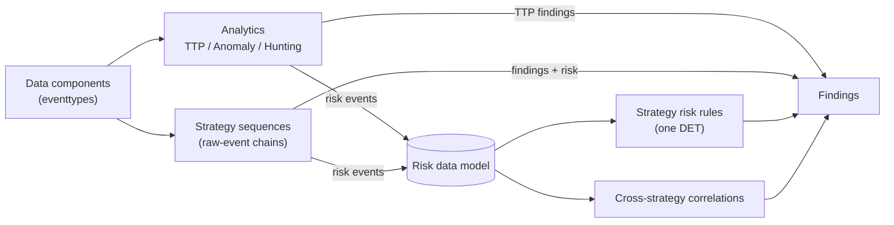
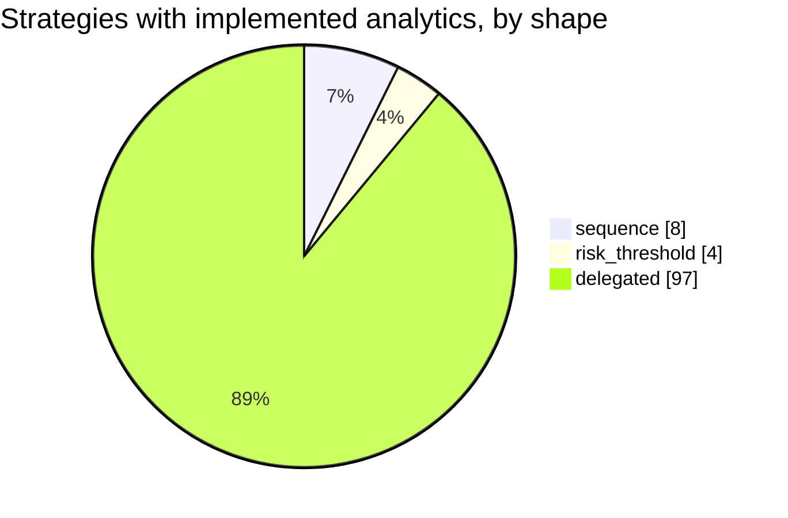

# Detection strategies (ATT&CK v20.1)

In ATT&CK v18+ a detection strategy's analytics are per-platform variants; the multi-event chain is described inside each analytic. So this layer correlates in two places: **sequences** implement, for one strategy, the chain its analytic left out, joining raw events on a key; **risk rules** read the Risk data model, either scoped to one strategy (for example one source hitting many hosts) or across strategies. A strategy with implemented analytics and no file of its own is **delegated**: its analytics' findings and risk events are its output.





## Cross-strategy correlations

| Id | Correlation | Scope | Group by | Window | Condition | Severity |
|---|---|---|---|---|---|---|
| RISK0001 | [Several ATT&CK detection strategies or tactics on one risk object](RISK0001-several-att-ck-detection-strategies-or-tactics-on-one-risk-o.md) | all MITRE content | risk_object | 24h | `distinct_strategies >= 3 OR distinct_tactics >= 3` | high |
| RISK0002 | [High accumulated risk on one risk object](RISK0002-high-accumulated-risk-on-one-risk-object.md) | all MITRE content | risk_object | 24h | `risk_score >= 150` | medium |
| RISK0003 | [Ransomware precursors on one host](RISK0003-ransomware-precursors-on-one-host.md) | AN0933, AN0061, AN1369, AN1472, AN0602 | risk_object | 1h | `distinct_analytics >= 2` | critical |

## Strategies

| Strategy | Technique | Tactics | Shape | Implemented analytics | Detection |
|---|---|---|---|---|---|
| [DET0027](https://attack.mitre.org/detectionstrategies/DET0027) Detection of Web Protocol-Based C2 Over HTTP, HTTPS, or WebSockets | T1071.001 Web Protocols | command-and-control | risk_threshold | [AN0075](../analytics/AN0075-http-to-external-hosts-with-a-non-browser-user-agent.md) (anomaly), [AN0079](../analytics/AN0079-repeated-http-requests-carrying-long-encoded-tokens-in-the-u.md) (anomaly) | [Several hosts sending tool-like or encoded HTTP to the same external host](DET0027-several-hosts-sending-tool-like-or-encoded-http-to-the-same-.md) |
| [DET0140](https://attack.mitre.org/detectionstrategies/DET0140) Behavioral Detection of Malicious File Deletion | T1070.004 File Deletion | stealth | sequence | [AN0392](../analytics/AN0392-secure-deletion-self-deletion-or-interpreter-removing-execut.md) (anomaly) | [Binary or script run from a staging path, then deleted](DET0140-binary-or-script-run-from-a-staging-path-then-deleted.md) |
| [DET0365](https://attack.mitre.org/detectionstrategies/DET0365) Detect Registry and Startup Folder Persistence (Windows) | T1547.001 Registry Run Keys / Startup Folder | persistence, privilege-escalation | sequence | [AN1032](../analytics/AN1032-run-key-value-pointing-to-a-script-or-user-writable-path.md) (anomaly) | [Run key set to a user-writable binary that also executes](DET0365-run-key-set-to-a-user-writable-binary-that-also-executes.md) |
| [DET0294](https://attack.mitre.org/detectionstrategies/DET0294) User Execution – Malicious File via download/open → spawn chain (T1204.002) | T1204.002 Malicious File | execution | sequence | [AN0819](../analytics/AN0819-document-or-mail-application-spawned-an-interpreter-or-lolbi.md) (ttp) | [File written by a document or archive application, then executed](DET0294-file-written-by-a-document-or-archive-application-then-execu.md) |
| [DET0441](https://attack.mitre.org/detectionstrategies/DET0441) Detection of Suspicious Scheduled Task Creation and Execution on Windows | T1053.005 Scheduled Task | execution, persistence, privilege-escalation | sequence | [AN1221](../analytics/AN1221-scheduled-task-registered-with-an-interpreter-or-user-writab.md) (anomaly) | [Suspicious scheduled task created and then run by Task Scheduler](DET0441-suspicious-scheduled-task-created-and-then-run-by-task-sched.md) |
| [DET0364](https://attack.mitre.org/detectionstrategies/DET0364) Behavioral Detection Strategy for WMI Execution Abuse on Windows | T1047 Windows Management Instrumentation | execution | sequence | [AN1031](../analytics/AN1031-wmi-used-to-create-processes-locally-or-on-remote-hosts.md) (anomaly) | [Remote WMI process creation followed by execution on the target](DET0364-remote-wmi-process-creation-followed-by-execution-on-the-tar.md) |
| [DET0363](https://attack.mitre.org/detectionstrategies/DET0363) Detection of Credential Dumping from LSASS Memory via Access and Dump Sequence | T1003.001 LSASS Memory | credential-access | sequence | [AN1030](../analytics/AN1030-lsass-memory-access-by-an-unexpected-process.md) (ttp) | [LSASS memory read followed by a file write from the same process](DET0363-lsass-memory-read-followed-by-a-file-write-from-the-same-pro.md) |
| [DET0327](https://attack.mitre.org/detectionstrategies/DET0327) Multi-event Detection Strategy for RDP-Based Remote Logins and Post-Access Activity | T1021.001 Remote Desktop Protocol | lateral-movement | risk_threshold | [AN0931](../analytics/AN0931-first-seen-rdp-logon-for-a-user-source-and-destination.md) (anomaly) | [One source opening first-seen RDP sessions to several hosts](DET0327-one-source-opening-first-seen-rdp-sessions-to-several-hosts.md) |
| [DET0394](https://attack.mitre.org/detectionstrategies/DET0394) Web Shell Detection via Server Behavior and File Execution Chains | T1505.003 Web Shell | persistence | sequence | [AN1108](../analytics/AN1108-web-server-process-spawned-a-shell-or-script-interpreter.md) (ttp) | [Script file dropped in a web root, then the web server spawned a shell](DET0394-script-file-dropped-in-a-web-root-then-the-web-server-spawne.md) |
| [DET0530](https://attack.mitre.org/detectionstrategies/DET0530) Multi-Event Detection for SMB Admin Share Lateral Movement | T1021.002 SMB/Windows Admin Shares | lateral-movement | risk_threshold | [AN1468](../analytics/AN1468-shell-or-lolbin-executed-inside-a-network-logon-session.md) (anomaly) | [One source executing remotely on several hosts](DET0530-one-source-executing-remotely-on-several-hosts.md) |
| [DET0400](https://attack.mitre.org/detectionstrategies/DET0400) Behavioral Detection of DNS Tunneling and Application Layer Abuse | T1071.004 DNS | command-and-control | risk_threshold | [AN1121](../analytics/AN1121-dns-tunnelling-pattern-from-a-non-browser-process.md) (anomaly), [AN1124](../analytics/AN1124-dns-tunnelling-pattern-from-a-client-network-view.md) (anomaly) | [DNS tunnelling seen from both the endpoint and the network](DET0400-dns-tunnelling-seen-from-both-the-endpoint-and-the-network.md) |
| [DET0085](https://attack.mitre.org/detectionstrategies/DET0085) Credential Dumping from SAM via Registry Dump and Local File Access | T1003.002 Security Account Manager | credential-access | sequence | [AN0235](../analytics/AN0235-sam-system-or-security-hive-dumped-from-the-command-line.md) (ttp) | [SYSTEM hive saved together with SAM or SECURITY](DET0085-system-hive-saved-together-with-sam-or-security.md) |
| [DET0060](https://attack.mitre.org/detectionstrategies/DET0060) Detect Ingress Tool Transfers via Behavioral Chain | T1105 Ingress Tool Transfer | command-and-control | delegated | [AN0165](../analytics/AN0165-lolbin-or-script-process-connected-externally-and-dropped-a-.md) (anomaly) |  |
| [DET0525](https://attack.mitre.org/detectionstrategies/DET0525) System Discovery via Native and Remote Utilities | T1082 System Information Discovery | discovery | delegated | [AN1452](../analytics/AN1452-system-information-discovery-commands.md) (hunting) |  |
| [DET0202](https://attack.mitre.org/detectionstrategies/DET0202) Behavioral Detection of Windows Command Shell Execution | T1059.003 Windows Command Shell | execution | delegated | [AN0578](../analytics/AN0578-cmd-exe-started-by-an-unusual-parent-or-running-a-batch-file.md) (anomaly) |  |
| [DET0370](https://attack.mitre.org/detectionstrategies/DET0370) Recursive Enumeration of Files and Directories Across Privilege Contexts | T1083 File and Directory Discovery | discovery | delegated | [AN1040](../analytics/AN1040-recursive-file-and-directory-enumeration-commands.md) (hunting) |  |
| [DET0275](https://attack.mitre.org/detectionstrategies/DET0275) Detect Adversary Deobfuscation or Decoding of Files and Payloads | T1140 Deobfuscate/Decode Files or Information | stealth | delegated | [AN0767](../analytics/AN0767-built-in-utility-used-to-decode-or-reassemble-a-payload.md) (ttp) |  |
| [DET0034](https://attack.mitre.org/detectionstrategies/DET0034) Detection of Adversarial Process Discovery Behavior | T1057 Process Discovery | discovery | delegated | [AN0095](../analytics/AN0095-process-discovery-commands.md) (hunting) |  |
| [DET0195](https://attack.mitre.org/detectionstrategies/DET0195) Behavioral Detection of System Network Configuration Discovery | T1016 System Network Configuration Discovery | discovery | delegated | [AN0559](../analytics/AN0559-network-configuration-discovery-commands.md) (hunting) |  |
| [DET0455](https://attack.mitre.org/detectionstrategies/DET0455) Abuse of PowerShell for Arbitrary Execution | T1059.001 PowerShell | execution | delegated | [AN1252](../analytics/AN1252-powershell-started-with-encoded-download-or-in-memory-execut.md) (anomaly) |  |
| [DET0087](https://attack.mitre.org/detectionstrategies/DET0087) Encrypted or Encoded File Payload Detection Strategy | T1027.013 Encrypted/Encoded File | stealth | delegated | [AN0237](../analytics/AN0237-binary-written-by-a-decoding-utility-then-executed-or-loaded.md) (ttp) |  |
| [DET0347](https://attack.mitre.org/detectionstrategies/DET0347) Detection Strategy for Masquerading via Legitimate Resource Name or Location | T1036.005 Match Legitimate Resource Name or Location | stealth | delegated | [AN0983](../analytics/AN0983-windows-system-process-name-running-from-an-unexpected-direc.md) (ttp) |  |
| [DET0093](https://attack.mitre.org/detectionstrategies/DET0093) Behavioral Detection of User Discovery via Local and Remote Enumeration | T1033 System Owner/User Discovery | discovery | delegated | [AN0254](../analytics/AN0254-user-and-session-discovery-commands.md) (hunting) |  |
| [DET0380](https://attack.mitre.org/detectionstrategies/DET0380) Detection of Local Data Collection Prior to Exfiltration | T1005 Data from Local System | collection | delegated | [AN1070](../analytics/AN1070-search-for-credential-files-or-sensitive-document-types.md) (anomaly) |  |
| [DET0280](https://attack.mitre.org/detectionstrategies/DET0280) Behavior-Based Registry Modification Detection on Windows | T1112 Modify Registry | defense-impairment, persistence | delegated | [AN0781](../analytics/AN0781-security-relevant-registry-value-modified.md) (ttp) |  |
| [DET0143](https://attack.mitre.org/detectionstrategies/DET0143) Detection Strategy for Encrypted Channel via Symmetric Cryptography across OS Platforms | T1573.001 Symmetric Cryptography | command-and-control | delegated | [AN0404](../analytics/AN0404-long-lived-or-high-volume-external-session-with-no-identifie.md) (anomaly) |  |
| [DET0076](https://attack.mitre.org/detectionstrategies/DET0076) Behavioral Detection of Visual Basic Execution (VBS/VBA/VBScript) | T1059.005 Visual Basic | execution | delegated | [AN0209](../analytics/AN0209-script-host-chain-from-office-or-into-a-second-stage-interpr.md) (anomaly) |  |
| [DET0346](https://attack.mitre.org/detectionstrategies/DET0346) Detect Screen Capture via Commands and API Calls | T1113 Screen Capture | collection | delegated | [AN0980](../analytics/AN0980-screenshot-captured-from-a-script-or-command-line-tool.md) (anomaly) |  |
| [DET0378](https://attack.mitre.org/detectionstrategies/DET0378) Behavioral Detection of Obfuscated Files or Information | T1027 Obfuscated Files or Information | stealth | delegated | [AN1064](../analytics/AN1064-script-host-or-lolbin-writing-an-archive-or-encoded-file-to-.md) (anomaly), [AN1067](../analytics/AN1067-executable-transferred-under-a-non-executable-file-name.md) (ttp) |  |
| [DET0261](https://attack.mitre.org/detectionstrategies/DET0261) Detection of Local Data Staging Prior to Exfiltration | T1074.001 Local Data Staging | collection | delegated | [AN0724](../analytics/AN0724-many-files-written-into-a-staging-directory-by-one-process.md) (anomaly) |  |
| [DET0497](https://attack.mitre.org/detectionstrategies/DET0497) Detection of Defense Impairment through Disabled or Modified Tools across OS Platforms. | T1685 Disable or Modify Tools | defense-impairment | delegated | [AN1369](../analytics/AN1369-security-tooling-disabled-or-tampered-with.md) (ttp), [AN1374](../analytics/AN1374-firewall-logging-or-monitoring-configuration-changed.md) (ttp) |  |
| [DET0016](https://attack.mitre.org/detectionstrategies/DET0016) Security Software Discovery Across Platforms | T1518.001 Security Software Discovery | discovery | delegated | [AN0048](../analytics/AN0048-security-software-enumeration.md) (anomaly) |  |
| [DET0552](https://attack.mitre.org/detectionstrategies/DET0552) Detection of Windows Service Creation or Modification | T1543.003 Windows Service | persistence, privilege-escalation | delegated | [AN1527](../analytics/AN1527-service-installed-with-an-interpreter-or-user-writable-binar.md) (ttp) |  |
| [DET0201](https://attack.mitre.org/detectionstrategies/DET0201) Detection Strategy for Hijack Execution Flow for DLLs | T1574.001 DLL | stealth, execution | delegated | [AN0577](../analytics/AN0577-unsigned-dll-loaded-from-a-user-writable-path-by-a-trusted-o.md) (anomaly) |  |
| [DET0574](https://attack.mitre.org/detectionstrategies/DET0574) Detection Strategy for Remote System Enumeration Behavior | T1018 Remote System Discovery | discovery | delegated | [AN1583](../analytics/AN1583-burst-of-remote-system-discovery-commands.md) (anomaly) |  |
| [DET0066](https://attack.mitre.org/detectionstrategies/DET0066) User Execution – Malicious Link (click → suspicious egress → download/write → follow-on activity) | T1204.001 Malicious Link | execution | delegated | [AN0178](../analytics/AN0178-high-risk-file-type-downloaded-by-a-browser-or-mail-client.md) (anomaly) |  |
| [DET0209](https://attack.mitre.org/detectionstrategies/DET0209) Detection of Registry Query for Environmental Discovery | T1012 Query Registry | discovery | delegated | [AN0589](../analytics/AN0589-registry-queries-for-environment-software-and-security-confi.md) (hunting) |  |
| [DET0298](https://attack.mitre.org/detectionstrategies/DET0298) Detect Archiving via Utility (T1560.001) | T1560.001 Archive via Utility | collection | delegated | [AN0831](../analytics/AN0831-archive-created-with-a-password-split-volumes-or-a-built-in-.md) (anomaly) |  |
| [DET0320](https://attack.mitre.org/detectionstrategies/DET0320) Detection of System Network Connections Discovery Across Platforms | T1049 System Network Connections Discovery | discovery | delegated | [AN0903](../analytics/AN0903-network-connection-and-session-discovery-commands.md) (hunting) |  |
| [DET0475](https://attack.mitre.org/detectionstrategies/DET0475) Detection Strategy for T1218.011 Rundll32 Abuse | T1218.011 Rundll32 | stealth | delegated | [AN1308](../analytics/AN1308-rundll32-executing-script-remote-or-user-writable-payloads.md) (ttp) |  |
| [DET0457](https://attack.mitre.org/detectionstrategies/DET0457) Detection of Non-Application Layer Protocols for C2 | T1095 Non-Application Layer Protocol | command-and-control | delegated | [AN1254](../analytics/AN1254-udp-to-the-internet-from-a-script-host-or-lolbin.md) (anomaly), [AN1258](../analytics/AN1258-icmp-session-with-unusual-volume-or-duration.md) (anomaly) |  |
| [DET0230](https://attack.mitre.org/detectionstrategies/DET0230) Detect Suspicious or Malicious Code Signing Abuse | T1553.002 Code Signing | defense-impairment | delegated | [AN0643](../analytics/AN0643-module-with-an-expired-revoked-or-untrusted-signature-loaded.md) (anomaly) |  |
| [DET0560](https://attack.mitre.org/detectionstrategies/DET0560) Detection of Valid Account Abuse Across Platforms | T1078 Valid Accounts | stealth, persistence, privilege-escalation, initial-access | delegated | [AN1543](../analytics/AN1543-interactive-or-remote-logon-by-a-service-account.md) (anomaly) |  |
| [DET0117](https://attack.mitre.org/detectionstrategies/DET0117) Detection of Masqueraded Tasks or Services with Suspicious Naming and Execution | T1036.004 Masquerade Task or Service | stealth | delegated | [AN0324](../analytics/AN0324-service-or-task-named-like-system-software-but-running-an-un.md) (anomaly) |  |
| [DET0037](https://attack.mitre.org/detectionstrategies/DET0037) Detect Suspicious Access to Browser Credential Stores | T1555.003 Credentials from Web Browsers | credential-access | delegated | [AN0105](../analytics/AN0105-browser-credential-store-read-by-a-non-browser-process.md) (ttp) |  |
| [DET0376](https://attack.mitre.org/detectionstrategies/DET0376) Behavioral Detection Strategy for Network Service Discovery Across Platforms | T1046 Network Service Discovery | discovery | delegated | [AN1057](../analytics/AN1057-process-connecting-to-many-hosts-or-ports-in-one-minute.md) (anomaly) |  |
| [DET0188](https://attack.mitre.org/detectionstrategies/DET0188) Local Storage Discovery via Drive Enumeration and Filesystem Probing | T1680 Local Storage Discovery | discovery | delegated | [AN0536](../analytics/AN0536-local-drive-and-volume-enumeration-commands.md) (hunting) |  |
| [DET0543](https://attack.mitre.org/detectionstrategies/DET0543) Detection Strategy for Encrypted Channel via Asymmetric Cryptography across OS Platforms | T1573.002 Asymmetric Cryptography | command-and-control | delegated | [AN1500](../analytics/AN1500-tls-to-an-external-host-on-an-unusual-port-with-an-unvalidat.md) (anomaly) |  |
| [DET0505](https://attack.mitre.org/detectionstrategies/DET0505) Detection Strategy for Command Obfuscation | T1027.010 Command Obfuscation | stealth | delegated | [AN1394](../analytics/AN1394-command-line-with-obfuscation-markers.md) (anomaly) |  |
| [DET0215](https://attack.mitre.org/detectionstrategies/DET0215) Detection of Multi-Platform File Encryption for Impact | T1486 Data Encrypted for Impact | impact | delegated | [AN0602](../analytics/AN0602-ransom-note-style-file-dropped-across-many-directories.md) (ttp) |  |
| [DET0508](https://attack.mitre.org/detectionstrategies/DET0508) Behavioral Detection of Process Injection Across Platforms | T1055 Process Injection | stealth, privilege-escalation | delegated | [AN1399](../analytics/AN1399-remote-thread-created-in-a-high-value-process.md) (anomaly) |  |
| [DET0287](https://attack.mitre.org/detectionstrategies/DET0287) Exploitation for Client Execution – cross-platform behavior chain (browser/Office/3rd-party apps) | T1203 Exploitation for Client Execution | execution | delegated | [AN0797](../analytics/AN0797-client-application-crashed-then-spawned-a-shell-or-lolbin.md) (ttp) |  |
| [DET0445](https://attack.mitre.org/detectionstrategies/DET0445) Detection of Proxy Infrastructure Setup and Traffic Bridging | T1090 Proxy | command-and-control | delegated | [AN1229](../analytics/AN1229-script-host-or-lolbin-accepting-inbound-network-connections.md) (anomaly), [AN1233](../analytics/AN1233-nat-port-forwarding-or-policy-based-forwarding-rule-changed-.md) (anomaly) |  |
| [DET0186](https://attack.mitre.org/detectionstrategies/DET0186) Automated File and API Collection Detection Across Platforms | T1119 Automated Collection | collection | delegated | [AN0531](../analytics/AN0531-bulk-copy-of-user-documents-into-a-staging-location.md) (anomaly) |  |
| [DET0129](https://attack.mitre.org/detectionstrategies/DET0129) Domain Account Enumeration Across Platforms | T1087.002 Domain Account | discovery | delegated | [AN0363](../analytics/AN0363-domain-account-enumeration-from-a-non-domain-controller.md) (anomaly) |  |
| [DET0227](https://attack.mitre.org/detectionstrategies/DET0227) Detection Strategy for Non-Standard Ports | T1571 Non-Standard Port | command-and-control | delegated | [AN0633](../analytics/AN0633-office-script-or-proxy-execution-process-connecting-out-on-a.md) (anomaly) |  |
| [DET0421](https://attack.mitre.org/detectionstrategies/DET0421) Detection Strategy for System Services Service Execution | T1569.002 Service Execution | execution | delegated | [AN1185](../analytics/AN1185-service-control-manager-started-an-unexpected-binary.md) (anomaly) |  |
| [DET0127](https://attack.mitre.org/detectionstrategies/DET0127) Behavioral Detection of Masquerading Across Platforms via Metadata and Execution Discrepancy | T1036 Masquerading | stealth | delegated | [AN0355](../analytics/AN0355-renamed-system-utility-file-name-does-not-match-pe-original-.md) (ttp) |  |
| [DET0483](https://attack.mitre.org/detectionstrategies/DET0483) Detection of System Service Discovery Commands Across OS Platforms | T1007 System Service Discovery | discovery | delegated | [AN1325](../analytics/AN1325-service-enumeration-commands.md) (hunting) |  |
| [DET0303](https://attack.mitre.org/detectionstrategies/DET0303) Local Account Enumeration Across Host Platforms | T1087.001 Local Account | discovery | delegated | [AN0846](../analytics/AN0846-local-account-and-group-enumeration-commands.md) (hunting) |  |
| [DET0183](https://attack.mitre.org/detectionstrategies/DET0183) Detection Strategy for Lateral Tool Transfer across OS platforms | T1570 Lateral Tool Transfer | lateral-movement | delegated | [AN0516](../analytics/AN0516-file-written-over-smb-then-executed-on-the-target.md) (ttp) |  |
| [DET0128](https://attack.mitre.org/detectionstrategies/DET0128) Detection Strategy for Hidden Windows | T1564.003 Hidden Window | stealth | delegated | [AN0360](../analytics/AN0360-interpreter-started-with-a-hidden-window.md) (anomaly) |  |
| [DET0168](https://attack.mitre.org/detectionstrategies/DET0168) Virtualization/Sandbox Evasion via System Checks across Windows, Linux, macOS | T1497.001 System Checks | stealth, discovery | delegated | [AN0478](../analytics/AN0478-burst-of-virtual-machine-and-sandbox-detection-checks.md) (anomaly) |  |
| [DET0389](https://attack.mitre.org/detectionstrategies/DET0389) Behavioral Detection of DLL Injection via Windows API | T1055.001 Dynamic-link Library Injection | stealth, privilege-escalation | delegated | [AN1095](../analytics/AN1095-process-handle-opened-for-injection-from-unbacked-memory.md) (anomaly) |  |
| [DET0032](https://attack.mitre.org/detectionstrategies/DET0032) Detection Strategy for Hidden Files and Directories | T1564.001 Hidden Files and Directories | stealth | delegated | [AN0091](../analytics/AN0091-file-hidden-with-attrib-or-written-to-an-alternate-data-stre.md) (anomaly) |  |
| [DET0388](https://attack.mitre.org/detectionstrategies/DET0388) Detection Strategy for T1548.002 – Bypass User Account Control (UAC) | T1548.002 Bypass User Account Control | privilege-escalation | delegated | [AN1094](../analytics/AN1094-uac-bypass-through-auto-elevated-binary-hijack.md) (ttp) |  |
| [DET0591](https://attack.mitre.org/detectionstrategies/DET0591) Cross-Platform Behavioral Detection of File Timestomping via Metadata Tampering | T1070.006 Timestomp | stealth | delegated | [AN1626](../analytics/AN1626-file-creation-time-moved-backwards-timestomp.md) (anomaly) |  |
| [DET0570](https://attack.mitre.org/detectionstrategies/DET0570) Detection Strategy for Exfiltration to Cloud Storage | T1567.002 Exfiltration to Cloud Storage | exfiltration | delegated | [AN1571](../analytics/AN1571-large-upload-to-a-cloud-storage-application.md) (anomaly) |  |
| [DET0425](https://attack.mitre.org/detectionstrategies/DET0425) Suspicious Use of Web Services for C2 | T1102 Web Service | command-and-control | delegated | [AN1189](../analytics/AN1189-non-browser-process-resolving-web-services-used-for-c2.md) (anomaly) |  |
| [DET0526](https://attack.mitre.org/detectionstrategies/DET0526) Detect Archiving and Encryption of Collected Data (T1560) | T1560 Archive Collected Data | collection | delegated | [AN1458](../analytics/AN1458-password-protected-archive-or-archive-written-to-a-staging-f.md) (anomaly) |  |
| [DET0392](https://attack.mitre.org/detectionstrategies/DET0392) Multi-Platform Software Discovery Behavior Chain | T1518 Software Discovery | discovery | delegated | [AN1100](../analytics/AN1100-installed-software-enumeration.md) (hunting) |  |
| [DET0491](https://attack.mitre.org/detectionstrategies/DET0491) Peripheral Device Enumeration via System Utilities and API Calls | T1120 Peripheral Device Discovery | discovery | delegated | [AN1353](../analytics/AN1353-peripheral-and-usb-device-enumeration.md) (hunting) |  |
| [DET0514](https://attack.mitre.org/detectionstrategies/DET0514) Detection Strategy for Exploitation for Privilege Escalation | T1068 Exploitation for Privilege Escalation | privilege-escalation | delegated | [AN1419](../analytics/AN1419-vulnerable-or-out-of-place-driver-loaded-or-system-process-s.md) (ttp) |  |
| [DET0210](https://attack.mitre.org/detectionstrategies/DET0210) Abuse of Domain Accounts | T1078.002 Domain Accounts | stealth, persistence, privilege-escalation, initial-access | delegated | [AN0590](../analytics/AN0590-one-domain-account-logging-on-to-many-hosts-in-an-hour.md) (anomaly) |  |
| [DET0516](https://attack.mitre.org/detectionstrategies/DET0516) Behavioral Detection of Command and Scripting Interpreter Abuse | T1059 Command and Scripting Interpreter | execution | delegated | [AN1428](../analytics/AN1428-command-interpreter-used-by-a-person-outside-working-hours.md) (anomaly) |  |
| [DET0538](https://attack.mitre.org/detectionstrategies/DET0538) Detection Strategy for Protocol Tunneling accross OS platforms. | T1572 Protocol Tunneling | command-and-control | delegated | [AN1483](../analytics/AN1483-port-forwarding-or-tunnelling-tool-started.md) (ttp) |  |
| [DET0329](https://attack.mitre.org/detectionstrategies/DET0329) Behavioral Detection for T1490 - Inhibit System Recovery | T1490 Inhibit System Recovery | impact | delegated | [AN0933](../analytics/AN0933-shadow-copies-backups-or-boot-recovery-disabled-with-native-.md) (ttp) |  |
| [DET0359](https://attack.mitre.org/detectionstrategies/DET0359) Multi-hop Proxy Behavior via Relay Node Chaining, Onion Routing, and Network Tunneling | T1090.003 Multi-hop Proxy | command-and-control | delegated | [AN1020](../analytics/AN1020-tor-or-i2p-client-running-on-an-endpoint.md) (ttp), [AN1024](../analytics/AN1024-tor-or-other-onion-routing-traffic-through-the-firewall.md) (ttp) |  |
| [DET0021](https://attack.mitre.org/detectionstrategies/DET0021) Behavioral Detection for Service Stop across Platforms | T1489 Service Stop | impact | delegated | [AN0061](../analytics/AN0061-burst-of-service-stop-or-disable-commands.md) (anomaly) |  |
| [DET0499](https://attack.mitre.org/detectionstrategies/DET0499) Behavioral Detection of Fallback or Alternate C2 Channels | T1008 Fallback Channels | command-and-control | delegated | [AN1376](../analytics/AN1376-one-process-connecting-out-on-many-uncommon-ports.md) (anomaly) |  |
| [DET0307](https://attack.mitre.org/detectionstrategies/DET0307) Detect Access to Unsecured Credential Files Across Platforms | T1552.001 Credentials In Files | credential-access | delegated | [AN0856](../analytics/AN0856-command-line-search-for-credentials-in-files.md) (ttp) |  |
| [DET0532](https://attack.mitre.org/detectionstrategies/DET0532) Detection of Event Log Clearing on Windows via Behavioral Chain | T1685.005 Clear Windows Event Logs | defense-impairment | delegated | [AN1472](../analytics/AN1472-windows-event-log-cleared.md) (ttp) |  |
| [DET0430](https://attack.mitre.org/detectionstrategies/DET0430) Detect Credentials Access from Password Stores | T1555 Credentials from Password Stores | credential-access | delegated | [AN1198](../analytics/AN1198-password-store-read-by-something-other-than-its-owner.md) (ttp) |  |
| [DET0562](https://attack.mitre.org/detectionstrategies/DET0562) Multi-Platform Execution Guardrails Environmental Validation Detection Strategy | T1480 Execution Guardrails | stealth | delegated | [AN1551](../analytics/AN1551-environment-checks-by-a-process-that-then-talks-to-the-inter.md) (anomaly) |  |
| [DET0360](https://attack.mitre.org/detectionstrategies/DET0360) Behavioral Detection of Domain Group Discovery | T1069.002 Domain Groups | discovery | delegated | [AN1025](../analytics/AN1025-domain-group-enumeration.md) (hunting) |  |
| [DET0281](https://attack.mitre.org/detectionstrategies/DET0281) Detection Strategy for Compressed Payload Creation and Execution | T1027.015 Compression | stealth | delegated | [AN0782](../analytics/AN0782-executable-extracted-from-an-archive-and-run-within-minutes.md) (anomaly) |  |
| [DET0382](https://attack.mitre.org/detectionstrategies/DET0382) Detection Strategy for Process Hollowing on Windows | T1055.012 Process Hollowing | stealth, privilege-escalation | delegated | [AN1076](../analytics/AN1076-process-image-replaced-in-memory-sysmon-process-tampering.md) (anomaly) |  |
| [DET0141](https://attack.mitre.org/detectionstrategies/DET0141) Detect Time-Based Evasion via Sleep, Timer Loops, and Delayed Execution | T1497.003 Time Based Checks | stealth, discovery | delegated | [AN0396](../analytics/AN0396-long-sleep-through-ping-timeout-or-start-sleep-on-a-command-.md) (anomaly) |  |
| [DET0341](https://attack.mitre.org/detectionstrategies/DET0341) Clipboard Data Access with Anomalous Context | T1115 Clipboard Data | collection | delegated | [AN0965](../analytics/AN0965-clipboard-read-from-a-script-or-command-line.md) (anomaly) |  |
| [DET0146](https://attack.mitre.org/detectionstrategies/DET0146) Detection of Data Destruction Across Platforms via Mass Overwrite and Deletion Patterns | T1485 Data Destruction | impact | delegated | [AN0411](../analytics/AN0411-mass-file-deletion-by-one-process-or-disk-wipe-commands.md) (anomaly) |  |
| [DET0586](https://attack.mitre.org/detectionstrategies/DET0586) Detection of NTDS.dit Credential Dumping from Domain Controllers | T1003.003 NTDS | credential-access | delegated | [AN1611](../analytics/AN1611-ntds-dit-extracted-with-ntdsutil-shadow-copies-or-esentutl.md) (ttp) |  |
| [DET0282](https://attack.mitre.org/detectionstrategies/DET0282) Detection Strategy for System Binary Proxy Execution: Regsvr32 | T1218.010 Regsvr32 | stealth | delegated | [AN0785](../analytics/AN0785-regsvr32-running-a-scriptlet-a-remote-or-user-folder-dll-or-.md) (anomaly) |  |
| [DET0447](https://attack.mitre.org/detectionstrategies/DET0447) T1136.001 Detection Strategy - Local Account Creation Across Platforms | T1136.001 Local Account | persistence | delegated | [AN1235](../analytics/AN1235-local-account-created-on-a-host-that-is-not-a-domain-control.md) (anomaly), [AN1240](../analytics/AN1240-administrator-account-added-on-the-firewall.md) (ttp) |  |
| [DET0506](https://attack.mitre.org/detectionstrategies/DET0506) Detecting Mshta-based Proxy Execution via Suspicious HTA or Script Invocation | T1218.005 Mshta | stealth | delegated | [AN1397](../analytics/AN1397-mshta-running-inline-script-or-remote-hta-connecting-out-or-.md) (ttp) |  |
| [DET0149](https://attack.mitre.org/detectionstrategies/DET0149) Detection of Exfiltration Over Unencrypted Non-C2 Protocol | T1048.003 Exfiltration Over Unencrypted Non-C2 Protocol | exfiltration | delegated | [AN0423](../analytics/AN0423-file-upload-over-cleartext-http-ftp-or-tftp-from-the-command.md) (anomaly), [AN0427](../analytics/AN0427-large-cleartext-upload-to-an-external-host.md) (anomaly) |  |
| [DET0007](https://attack.mitre.org/detectionstrategies/DET0007) Detection of Domain Trust Discovery via API, Script, and CLI Enumeration | T1482 Domain Trust Discovery | discovery | delegated | [AN0016](../analytics/AN0016-domain-trust-enumeration.md) (anomaly) |  |
| [DET0145](https://attack.mitre.org/detectionstrategies/DET0145) Detection of Disabled or Modified System Firewalls across OS Platforms. | T1686 Disable or Modify System Firewall | defense-impairment | delegated | [AN0406](../analytics/AN0406-windows-firewall-disabled-or-its-service-stopped.md) (ttp), [AN0410](../analytics/AN0410-security-rules-deleted-or-default-rules-changed-on-the-firew.md) (anomaly) |  |
| [DET0463](https://attack.mitre.org/detectionstrategies/DET0463) Brute Force Authentication Failures with Multi-Platform Log Correlation | T1110 Brute Force | credential-access | delegated | [AN1275](../analytics/AN1275-many-logon-failures-followed-by-a-success-for-the-same-accou.md) (ttp) |  |
| [DET0325](https://attack.mitre.org/detectionstrategies/DET0325) External Proxy Behavior via Outbound Relay to Intermediate Infrastructure | T1090.002 External Proxy | command-and-control | delegated | [AN0926](../analytics/AN0926-proxy-avoidance-sites-or-anonymising-proxy-applications.md) (anomaly) |  |
| [DET0559](https://attack.mitre.org/detectionstrategies/DET0559) Multi-Platform Shutdown or Reboot Detection via Execution and Host Status Events | T1529 System Shutdown/Reboot | impact | delegated | [AN1542](../analytics/AN1542-firewall-restart-or-shutdown.md) (anomaly) |  |
| [DET0416](https://attack.mitre.org/detectionstrategies/DET0416) Detection of File Transfer Protocol-Based C2 (FTP, FTPS, SMB, TFTP) | T1071.002 File Transfer Protocols | command-and-control | delegated | [AN1173](../analytics/AN1173-ftp-or-tftp-to-the-internet-or-ftp-on-a-non-standard-port.md) (anomaly) |  |
| [DET0487](https://attack.mitre.org/detectionstrategies/DET0487) Distributed Password Spraying via Authentication Failures Across Multiple Accounts | T1110.003 Password Spraying | credential-access | delegated | [AN1340](../analytics/AN1340-one-source-failing-to-authenticate-as-many-accounts-on-the-f.md) (anomaly) |  |
| [DET0135](https://attack.mitre.org/detectionstrategies/DET0135) Detection of Mail Protocol-Based C2 Activity (SMTP, IMAP, POP3) | T1071.003 Mail Protocols | command-and-control | delegated | [AN0382](../analytics/AN0382-smtp-to-the-internet-from-a-host-that-is-not-a-mail-server.md) (anomaly) |  |
| [DET0551](https://attack.mitre.org/detectionstrategies/DET0551) Password Guessing via Multi-Source Authentication Failure Correlation | T1110.001 Password Guessing | credential-access | delegated | [AN1525](../analytics/AN1525-repeated-authentication-failures-for-one-account-on-the-fire.md) (anomaly) |  |
| [DET0126](https://attack.mitre.org/detectionstrategies/DET0126) Detection Strategy for SSH Key Injection in Authorized Keys | T1098.004 SSH Authorized Keys | persistence, privilege-escalation | delegated | [AN0354](../analytics/AN0354-ssh-public-key-added-to-a-firewall-administrator.md) (ttp) |  |
| [DET0465](https://attack.mitre.org/detectionstrategies/DET0465) Detection of Default Account Abuse Across Platforms | T1078.001 Default Accounts | stealth, persistence, privilege-escalation, initial-access | delegated | [AN1287](../analytics/AN1287-login-to-the-firewall-with-a-default-account-name.md) (anomaly) |  |
| [DET0306](https://attack.mitre.org/detectionstrategies/DET0306) Detection of Unauthorized Network Firewall Rule Modification | T1686.002 Network Device Firewall | defense-impairment | delegated | [AN0855](../analytics/AN0855-bulk-or-api-driven-security-and-nat-rule-changes-on-the-fire.md) (anomaly) |  |
| [DET0099](https://attack.mitre.org/detectionstrategies/DET0099) Detection Strategy for T1542.001 Pre-OS Boot: System Firmware | T1542.001 System Firmware | stealth, persistence | delegated | [AN0276](../analytics/AN0276-pan-os-software-installed-upgraded-or-downgraded.md) (anomaly) |  |
| [DET0002](https://attack.mitre.org/detectionstrategies/DET0002) Behavioral Detection of Publish/Subscribe Protocol Misuse for C2 | T1071.005 Publish/Subscribe Protocols | command-and-control | delegated | [AN0005](../analytics/AN0005-publish-subscribe-protocol-to-an-external-broker.md) (anomaly) |  |

## Authoring

```bash
python -m mitremap new-strategy DET0363   # scaffold content/detection_strategies/DET0363.yml
# curated: shape sequence (hand-written spl joining raw events) or risk_threshold (scope, group_by, window, condition)
make build && make test
```

Cross-strategy correlations live in `content/correlations/RISKxxxx.yml` with the same risk_threshold fields; `scope: all` covers every MITRE analytic and sequence.
