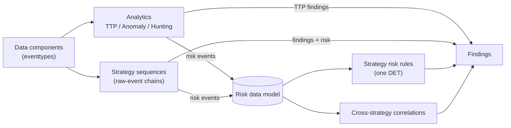
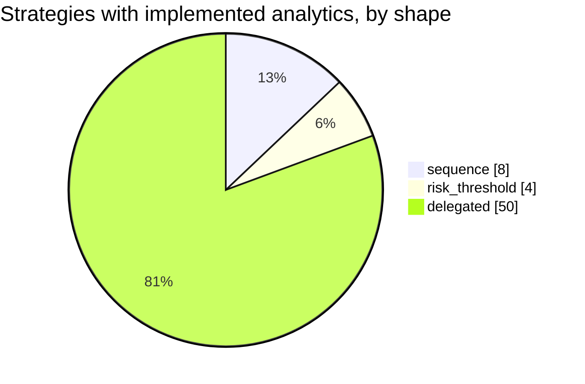

# Detection strategies (ATT&CK v20.1)

In ATT&CK v18+ a detection strategy's analytics are per-platform variants; the multi-event chain is described inside each analytic. So this layer correlates in two places: **sequences** implement, for one strategy, the chain its analytic left out, joining raw events on a key; **risk rules** read the Risk data model, either scoped to one strategy (for example one source hitting many hosts) or across strategies. A strategy with implemented analytics and no file of its own is **delegated**: its analytics' findings and risk events are its output.





## Cross-strategy correlations

| Id | Correlation | Scope | Group by | Window | Condition | Severity |
|---|---|---|---|---|---|---|
| RISK0001 | [Several ATT&CK detection strategies or tactics on one risk object](RISK0001-several-att-ck-detection-strategies-or-tactics-on-one-risk-o.md) | all MITRE content | risk_object | 24h | `distinct_strategies >= 3 OR distinct_tactics >= 3` | high |
| RISK0002 | [High accumulated risk on one risk object](RISK0002-high-accumulated-risk-on-one-risk-object.md) | all MITRE content | risk_object | 24h | `risk_score >= 150` | medium |
| RISK0003 | [Ransomware precursors on one host](RISK0003-ransomware-precursors-on-one-host.md) | AN0933, AN0061, AN1369, AN1472, AN0602 | risk_object | 1h | `distinct_analytics >= 2` | critical |

## Strategies

| Strategy | Technique | Tactics | Shape | Implemented analytics | Detection |
|---|---|---|---|---|---|
| [DET0027](https://attack.mitre.org/detectionstrategies/DET0027) Detection of Web Protocol-Based C2 Over HTTP, HTTPS, or WebSockets | T1071.001 Web Protocols | command-and-control | risk_threshold | [AN0075](../analytics/AN0075-http-to-external-hosts-with-a-non-browser-user-agent.md) (anomaly), [AN0079](../analytics/AN0079-repeated-http-requests-carrying-long-encoded-tokens-in-the-u.md) (anomaly) | [Several hosts sending tool-like or encoded HTTP to the same external host](DET0027-several-hosts-sending-tool-like-or-encoded-http-to-the-same-.md) |
| [DET0140](https://attack.mitre.org/detectionstrategies/DET0140) Behavioral Detection of Malicious File Deletion | T1070.004 File Deletion | stealth | sequence | [AN0392](../analytics/AN0392-secure-deletion-self-deletion-or-interpreter-removing-execut.md) (anomaly) | [Binary or script run from a staging path, then deleted](DET0140-binary-or-script-run-from-a-staging-path-then-deleted.md) |
| [DET0365](https://attack.mitre.org/detectionstrategies/DET0365) Detect Registry and Startup Folder Persistence (Windows) | T1547.001 Registry Run Keys / Startup Folder | persistence, privilege-escalation | sequence | [AN1032](../analytics/AN1032-run-key-value-pointing-to-a-script-or-user-writable-path.md) (anomaly) | [Run key set to a user-writable binary that also executes](DET0365-run-key-set-to-a-user-writable-binary-that-also-executes.md) |
| [DET0294](https://attack.mitre.org/detectionstrategies/DET0294) User Execution – Malicious File via download/open → spawn chain (T1204.002) | T1204.002 Malicious File | execution | sequence | [AN0819](../analytics/AN0819-document-or-mail-application-spawned-an-interpreter-or-lolbi.md) (ttp) | [File written by a document or archive application, then executed](DET0294-file-written-by-a-document-or-archive-application-then-execu.md) |
| [DET0441](https://attack.mitre.org/detectionstrategies/DET0441) Detection of Suspicious Scheduled Task Creation and Execution on Windows | T1053.005 Scheduled Task | execution, persistence, privilege-escalation | sequence | [AN1221](../analytics/AN1221-scheduled-task-registered-with-an-interpreter-or-user-writab.md) (anomaly) | [Suspicious scheduled task created and then run by Task Scheduler](DET0441-suspicious-scheduled-task-created-and-then-run-by-task-sched.md) |
| [DET0364](https://attack.mitre.org/detectionstrategies/DET0364) Behavioral Detection Strategy for WMI Execution Abuse on Windows | T1047 Windows Management Instrumentation | execution | sequence | [AN1031](../analytics/AN1031-wmi-used-to-create-processes-locally-or-on-remote-hosts.md) (anomaly) | [Remote WMI process creation followed by execution on the target](DET0364-remote-wmi-process-creation-followed-by-execution-on-the-tar.md) |
| [DET0363](https://attack.mitre.org/detectionstrategies/DET0363) Detection of Credential Dumping from LSASS Memory via Access and Dump Sequence | T1003.001 LSASS Memory | credential-access | sequence | [AN1030](../analytics/AN1030-lsass-memory-access-by-an-unexpected-process.md) (ttp) | [LSASS memory read followed by a file write from the same process](DET0363-lsass-memory-read-followed-by-a-file-write-from-the-same-pro.md) |
| [DET0327](https://attack.mitre.org/detectionstrategies/DET0327) Multi-event Detection Strategy for RDP-Based Remote Logins and Post-Access Activity | T1021.001 Remote Desktop Protocol | lateral-movement | risk_threshold | [AN0931](../analytics/AN0931-first-seen-rdp-logon-for-a-user-source-and-destination.md) (anomaly) | [One source opening first-seen RDP sessions to several hosts](DET0327-one-source-opening-first-seen-rdp-sessions-to-several-hosts.md) |
| [DET0394](https://attack.mitre.org/detectionstrategies/DET0394) Web Shell Detection via Server Behavior and File Execution Chains | T1505.003 Web Shell | persistence | sequence | [AN1108](../analytics/AN1108-web-server-process-spawned-a-shell-or-script-interpreter.md) (ttp) | [Script file dropped in a web root, then the web server spawned a shell](DET0394-script-file-dropped-in-a-web-root-then-the-web-server-spawne.md) |
| [DET0530](https://attack.mitre.org/detectionstrategies/DET0530) Multi-Event Detection for SMB Admin Share Lateral Movement | T1021.002 SMB/Windows Admin Shares | lateral-movement | risk_threshold | [AN1468](../analytics/AN1468-shell-or-lolbin-executed-inside-a-network-logon-session.md) (anomaly) | [One source executing remotely on several hosts](DET0530-one-source-executing-remotely-on-several-hosts.md) |
| [DET0400](https://attack.mitre.org/detectionstrategies/DET0400) Behavioral Detection of DNS Tunneling and Application Layer Abuse | T1071.004 DNS | command-and-control | risk_threshold | [AN1121](../analytics/AN1121-dns-tunnelling-pattern-from-a-non-browser-process.md) (anomaly), [AN1124](../analytics/AN1124-dns-tunnelling-pattern-from-a-client-network-view.md) (anomaly) | [DNS tunnelling seen from both the endpoint and the network](DET0400-dns-tunnelling-seen-from-both-the-endpoint-and-the-network.md) |
| [DET0085](https://attack.mitre.org/detectionstrategies/DET0085) Credential Dumping from SAM via Registry Dump and Local File Access | T1003.002 Security Account Manager | credential-access | sequence | [AN0235](../analytics/AN0235-sam-system-or-security-hive-dumped-from-the-command-line.md) (ttp) | [SYSTEM hive saved together with SAM or SECURITY](DET0085-system-hive-saved-together-with-sam-or-security.md) |
| [DET0060](https://attack.mitre.org/detectionstrategies/DET0060) Detect Ingress Tool Transfers via Behavioral Chain | T1105 Ingress Tool Transfer | command-and-control | delegated | [AN0165](../analytics/AN0165-lolbin-or-script-process-connected-externally-and-dropped-a-.md) (anomaly) |  |
| [DET0525](https://attack.mitre.org/detectionstrategies/DET0525) System Discovery via Native and Remote Utilities | T1082 System Information Discovery | discovery | delegated | [AN1452](../analytics/AN1452-system-information-discovery-commands.md) (hunting) |  |
| [DET0202](https://attack.mitre.org/detectionstrategies/DET0202) Behavioral Detection of Windows Command Shell Execution | T1059.003 Windows Command Shell | execution | delegated | [AN0578](../analytics/AN0578-cmd-exe-started-by-an-unusual-parent-or-running-a-batch-file.md) (anomaly) |  |
| [DET0370](https://attack.mitre.org/detectionstrategies/DET0370) Recursive Enumeration of Files and Directories Across Privilege Contexts | T1083 File and Directory Discovery | discovery | delegated | [AN1040](../analytics/AN1040-recursive-file-and-directory-enumeration-commands.md) (hunting) |  |
| [DET0275](https://attack.mitre.org/detectionstrategies/DET0275) Detect Adversary Deobfuscation or Decoding of Files and Payloads | T1140 Deobfuscate/Decode Files or Information | stealth | delegated | [AN0767](../analytics/AN0767-built-in-utility-used-to-decode-or-reassemble-a-payload.md) (ttp) |  |
| [DET0034](https://attack.mitre.org/detectionstrategies/DET0034) Detection of Adversarial Process Discovery Behavior | T1057 Process Discovery | discovery | delegated | [AN0095](../analytics/AN0095-process-discovery-commands.md) (hunting) |  |
| [DET0195](https://attack.mitre.org/detectionstrategies/DET0195) Behavioral Detection of System Network Configuration Discovery | T1016 System Network Configuration Discovery | discovery | delegated | [AN0559](../analytics/AN0559-network-configuration-discovery-commands.md) (hunting) |  |
| [DET0455](https://attack.mitre.org/detectionstrategies/DET0455) Abuse of PowerShell for Arbitrary Execution | T1059.001 PowerShell | execution | delegated | [AN1252](../analytics/AN1252-powershell-started-with-encoded-download-or-in-memory-execut.md) (anomaly) |  |
| [DET0087](https://attack.mitre.org/detectionstrategies/DET0087) Encrypted or Encoded File Payload Detection Strategy | T1027.013 Encrypted/Encoded File | stealth | delegated | [AN0237](../analytics/AN0237-binary-written-by-a-decoding-utility-then-executed-or-loaded.md) (ttp) |  |
| [DET0347](https://attack.mitre.org/detectionstrategies/DET0347) Detection Strategy for Masquerading via Legitimate Resource Name or Location | T1036.005 Match Legitimate Resource Name or Location | stealth | delegated | [AN0983](../analytics/AN0983-windows-system-process-name-running-from-an-unexpected-direc.md) (ttp) |  |
| [DET0093](https://attack.mitre.org/detectionstrategies/DET0093) Behavioral Detection of User Discovery via Local and Remote Enumeration | T1033 System Owner/User Discovery | discovery | delegated | [AN0254](../analytics/AN0254-user-and-session-discovery-commands.md) (hunting) |  |
| [DET0380](https://attack.mitre.org/detectionstrategies/DET0380) Detection of Local Data Collection Prior to Exfiltration | T1005 Data from Local System | collection | delegated | [AN1070](../analytics/AN1070-search-for-credential-files-or-sensitive-document-types.md) (anomaly) |  |
| [DET0280](https://attack.mitre.org/detectionstrategies/DET0280) Behavior-Based Registry Modification Detection on Windows | T1112 Modify Registry | defense-impairment, persistence | delegated | [AN0781](../analytics/AN0781-security-relevant-registry-value-modified.md) (ttp) |  |
| [DET0076](https://attack.mitre.org/detectionstrategies/DET0076) Behavioral Detection of Visual Basic Execution (VBS/VBA/VBScript) | T1059.005 Visual Basic | execution | delegated | [AN0209](../analytics/AN0209-script-host-chain-from-office-or-into-a-second-stage-interpr.md) (anomaly) |  |
| [DET0346](https://attack.mitre.org/detectionstrategies/DET0346) Detect Screen Capture via Commands and API Calls | T1113 Screen Capture | collection | delegated | [AN0980](../analytics/AN0980-screenshot-captured-from-a-script-or-command-line-tool.md) (anomaly) |  |
| [DET0378](https://attack.mitre.org/detectionstrategies/DET0378) Behavioral Detection of Obfuscated Files or Information | T1027 Obfuscated Files or Information | stealth | delegated | [AN1064](../analytics/AN1064-script-host-or-lolbin-writing-an-archive-or-encoded-file-to-.md) (anomaly) |  |
| [DET0261](https://attack.mitre.org/detectionstrategies/DET0261) Detection of Local Data Staging Prior to Exfiltration | T1074.001 Local Data Staging | collection | delegated | [AN0724](../analytics/AN0724-many-files-written-into-a-staging-directory-by-one-process.md) (anomaly) |  |
| [DET0497](https://attack.mitre.org/detectionstrategies/DET0497) Detection of Defense Impairment through Disabled or Modified Tools across OS Platforms. | T1685 Disable or Modify Tools | defense-impairment | delegated | [AN1369](../analytics/AN1369-security-tooling-disabled-or-tampered-with.md) (ttp), [AN1374](../analytics/AN1374-firewall-logging-or-monitoring-configuration-changed.md) (ttp) |  |
| [DET0016](https://attack.mitre.org/detectionstrategies/DET0016) Security Software Discovery Across Platforms | T1518.001 Security Software Discovery | discovery | delegated | [AN0048](../analytics/AN0048-security-software-enumeration.md) (anomaly) |  |
| [DET0552](https://attack.mitre.org/detectionstrategies/DET0552) Detection of Windows Service Creation or Modification | T1543.003 Windows Service | persistence, privilege-escalation | delegated | [AN1527](../analytics/AN1527-service-installed-with-an-interpreter-or-user-writable-binar.md) (ttp) |  |
| [DET0201](https://attack.mitre.org/detectionstrategies/DET0201) Detection Strategy for Hijack Execution Flow for DLLs | T1574.001 DLL | stealth, execution | delegated | [AN0577](../analytics/AN0577-unsigned-dll-loaded-from-a-user-writable-path-by-a-trusted-o.md) (anomaly) |  |
| [DET0574](https://attack.mitre.org/detectionstrategies/DET0574) Detection Strategy for Remote System Enumeration Behavior | T1018 Remote System Discovery | discovery | delegated | [AN1583](../analytics/AN1583-burst-of-remote-system-discovery-commands.md) (anomaly) |  |
| [DET0209](https://attack.mitre.org/detectionstrategies/DET0209) Detection of Registry Query for Environmental Discovery | T1012 Query Registry | discovery | delegated | [AN0589](../analytics/AN0589-registry-queries-for-environment-software-and-security-confi.md) (hunting) |  |
| [DET0298](https://attack.mitre.org/detectionstrategies/DET0298) Detect Archiving via Utility (T1560.001) | T1560.001 Archive via Utility | collection | delegated | [AN0831](../analytics/AN0831-archive-created-with-a-password-split-volumes-or-a-built-in-.md) (anomaly) |  |
| [DET0320](https://attack.mitre.org/detectionstrategies/DET0320) Detection of System Network Connections Discovery Across Platforms | T1049 System Network Connections Discovery | discovery | delegated | [AN0903](../analytics/AN0903-network-connection-and-session-discovery-commands.md) (hunting) |  |
| [DET0475](https://attack.mitre.org/detectionstrategies/DET0475) Detection Strategy for T1218.011 Rundll32 Abuse | T1218.011 Rundll32 | stealth | delegated | [AN1308](../analytics/AN1308-rundll32-executing-script-remote-or-user-writable-payloads.md) (ttp) |  |
| [DET0457](https://attack.mitre.org/detectionstrategies/DET0457) Detection of Non-Application Layer Protocols for C2 | T1095 Non-Application Layer Protocol | command-and-control | delegated | [AN1258](../analytics/AN1258-icmp-session-with-unusual-volume-or-duration.md) (anomaly) |  |
| [DET0560](https://attack.mitre.org/detectionstrategies/DET0560) Detection of Valid Account Abuse Across Platforms | T1078 Valid Accounts | stealth, persistence, privilege-escalation, initial-access | delegated | [AN1543](../analytics/AN1543-interactive-or-remote-logon-by-a-service-account.md) (anomaly) |  |
| [DET0117](https://attack.mitre.org/detectionstrategies/DET0117) Detection of Masqueraded Tasks or Services with Suspicious Naming and Execution | T1036.004 Masquerade Task or Service | stealth | delegated | [AN0324](../analytics/AN0324-service-or-task-named-like-system-software-but-running-an-un.md) (anomaly) |  |
| [DET0037](https://attack.mitre.org/detectionstrategies/DET0037) Detect Suspicious Access to Browser Credential Stores | T1555.003 Credentials from Web Browsers | credential-access | delegated | [AN0105](../analytics/AN0105-browser-credential-store-read-by-a-non-browser-process.md) (ttp) |  |
| [DET0376](https://attack.mitre.org/detectionstrategies/DET0376) Behavioral Detection Strategy for Network Service Discovery Across Platforms | T1046 Network Service Discovery | discovery | delegated | [AN1057](../analytics/AN1057-process-connecting-to-many-hosts-or-ports-in-one-minute.md) (anomaly) |  |
| [DET0505](https://attack.mitre.org/detectionstrategies/DET0505) Detection Strategy for Command Obfuscation | T1027.010 Command Obfuscation | stealth | delegated | [AN1394](../analytics/AN1394-command-line-with-obfuscation-markers.md) (anomaly) |  |
| [DET0215](https://attack.mitre.org/detectionstrategies/DET0215) Detection of Multi-Platform File Encryption for Impact | T1486 Data Encrypted for Impact | impact | delegated | [AN0602](../analytics/AN0602-ransom-note-style-file-dropped-across-many-directories.md) (ttp) |  |
| [DET0508](https://attack.mitre.org/detectionstrategies/DET0508) Behavioral Detection of Process Injection Across Platforms | T1055 Process Injection | stealth, privilege-escalation | delegated | [AN1399](../analytics/AN1399-remote-thread-created-in-a-high-value-process.md) (anomaly) |  |
| [DET0445](https://attack.mitre.org/detectionstrategies/DET0445) Detection of Proxy Infrastructure Setup and Traffic Bridging | T1090 Proxy | command-and-control | delegated | [AN1233](../analytics/AN1233-nat-port-forwarding-or-policy-based-forwarding-rule-changed-.md) (anomaly) |  |
| [DET0129](https://attack.mitre.org/detectionstrategies/DET0129) Domain Account Enumeration Across Platforms | T1087.002 Domain Account | discovery | delegated | [AN0363](../analytics/AN0363-domain-account-enumeration-from-a-non-domain-controller.md) (anomaly) |  |
| [DET0227](https://attack.mitre.org/detectionstrategies/DET0227) Detection Strategy for Non-Standard Ports | T1571 Non-Standard Port | command-and-control | delegated | [AN0633](../analytics/AN0633-office-script-or-proxy-execution-process-connecting-out-on-a.md) (anomaly) |  |
| [DET0421](https://attack.mitre.org/detectionstrategies/DET0421) Detection Strategy for System Services Service Execution | T1569.002 Service Execution | execution | delegated | [AN1185](../analytics/AN1185-service-control-manager-started-an-unexpected-binary.md) (anomaly) |  |
| [DET0127](https://attack.mitre.org/detectionstrategies/DET0127) Behavioral Detection of Masquerading Across Platforms via Metadata and Execution Discrepancy | T1036 Masquerading | stealth | delegated | [AN0355](../analytics/AN0355-renamed-system-utility-file-name-does-not-match-pe-original-.md) (ttp) |  |
| [DET0483](https://attack.mitre.org/detectionstrategies/DET0483) Detection of System Service Discovery Commands Across OS Platforms | T1007 System Service Discovery | discovery | delegated | [AN1325](../analytics/AN1325-service-enumeration-commands.md) (hunting) |  |
| [DET0303](https://attack.mitre.org/detectionstrategies/DET0303) Local Account Enumeration Across Host Platforms | T1087.001 Local Account | discovery | delegated | [AN0846](../analytics/AN0846-local-account-and-group-enumeration-commands.md) (hunting) |  |
| [DET0183](https://attack.mitre.org/detectionstrategies/DET0183) Detection Strategy for Lateral Tool Transfer across OS platforms | T1570 Lateral Tool Transfer | lateral-movement | delegated | [AN0516](../analytics/AN0516-file-written-over-smb-then-executed-on-the-target.md) (ttp) |  |
| [DET0128](https://attack.mitre.org/detectionstrategies/DET0128) Detection Strategy for Hidden Windows | T1564.003 Hidden Window | stealth | delegated | [AN0360](../analytics/AN0360-interpreter-started-with-a-hidden-window.md) (anomaly) |  |
| [DET0389](https://attack.mitre.org/detectionstrategies/DET0389) Behavioral Detection of DLL Injection via Windows API | T1055.001 Dynamic-link Library Injection | stealth, privilege-escalation | delegated | [AN1095](../analytics/AN1095-process-handle-opened-for-injection-from-unbacked-memory.md) (anomaly) |  |
| [DET0388](https://attack.mitre.org/detectionstrategies/DET0388) Detection Strategy for T1548.002 – Bypass User Account Control (UAC) | T1548.002 Bypass User Account Control | privilege-escalation | delegated | [AN1094](../analytics/AN1094-uac-bypass-through-auto-elevated-binary-hijack.md) (ttp) |  |
| [DET0570](https://attack.mitre.org/detectionstrategies/DET0570) Detection Strategy for Exfiltration to Cloud Storage | T1567.002 Exfiltration to Cloud Storage | exfiltration | delegated | [AN1571](../analytics/AN1571-large-upload-to-a-cloud-storage-application.md) (anomaly) |  |
| [DET0538](https://attack.mitre.org/detectionstrategies/DET0538) Detection Strategy for Protocol Tunneling accross OS platforms. | T1572 Protocol Tunneling | command-and-control | delegated | [AN1483](../analytics/AN1483-port-forwarding-or-tunnelling-tool-started.md) (ttp) |  |
| [DET0329](https://attack.mitre.org/detectionstrategies/DET0329) Behavioral Detection for T1490 - Inhibit System Recovery | T1490 Inhibit System Recovery | impact | delegated | [AN0933](../analytics/AN0933-shadow-copies-backups-or-boot-recovery-disabled-with-native-.md) (ttp) |  |
| [DET0021](https://attack.mitre.org/detectionstrategies/DET0021) Behavioral Detection for Service Stop across Platforms | T1489 Service Stop | impact | delegated | [AN0061](../analytics/AN0061-burst-of-service-stop-or-disable-commands.md) (anomaly) |  |
| [DET0532](https://attack.mitre.org/detectionstrategies/DET0532) Detection of Event Log Clearing on Windows via Behavioral Chain | T1685.005 Clear Windows Event Logs | defense-impairment | delegated | [AN1472](../analytics/AN1472-windows-event-log-cleared.md) (ttp) |  |

## Authoring

```bash
python -m mitremap new-strategy DET0363   # scaffold content/detection_strategies/DET0363.yml
# curated: shape sequence (hand-written spl joining raw events) or risk_threshold (scope, group_by, window, condition)
make build && make test
```

Cross-strategy correlations live in `content/correlations/RISKxxxx.yml` with the same risk_threshold fields; `scope: all` covers every MITRE analytic and sequence.
