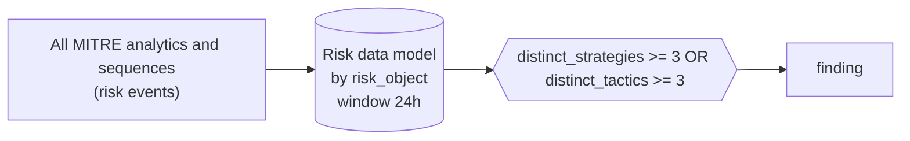

# RISK0001 Several ATT&CK detection strategies or tactics on one risk object

Cross-strategy risk correlation (not an ATT&CK object).

**Shape:** risk rule: over the Risk data model → finding only · **Severity:** high · **Status:** implemented

One host or user accumulates risk from three or more distinct ATT&CK detection strategies, or across three or more tactics, within 24 hours. This is the main risk-based finding: individually weak anomalies that together describe an intrusion.



## Tuning

| Macro | Default | Purpose |
|---|---|---|
| `mitre_risk0001_filter` | `search *` | Exclusions for RISK0001 Several ATT&CK detection strategies or tactics on one risk object. |
| `mitre_risk0001_condition` | `distinct_strategies >= 3 OR distinct_tactics >= 3` | Firing condition for RISK0001. Fields: risk_score, risk_events, distinct_analytics, distinct_strategies, distinct_tactics, distinct_techniques. |

## Splunk

Stanza `[MITRE - RISK0001 - Several ATT&CK detection strategies or tactics on one risk object - Rule]` in `DA-ESS-mitre-attack-detections`. Schedule `29 * * * *`, window `-24h` to `now`. Ships disabled.

Generated from the parameters below; edit the YAML, not the search. Scope: `source IN ("MITRE - AN* - Rule", "MITRE - DET* - Rule")`.

| Parameter | Value |
|---|---|
| group_by | risk_object |
| window | 24h |
| condition | `distinct_strategies >= 3 OR distinct_tactics >= 3` |

```spl
| tstats `mitre_summariesonly` min(_time) as firstTime max(_time) as lastTime sum(All_Risk.calculated_risk_score) as risk_score count as risk_events
    from datamodel=Risk.All_Risk where source IN ("MITRE - AN* - Rule", "MITRE - DET* - Rule")
    by All_Risk.risk_object All_Risk.risk_object_type source
| `drop_dm_object_name(All_Risk)`
| rex field=source "^MITRE - (?<mitre_id>(AN|DET)\d{4}) - "
| lookup mitre_attack_analytics an_id AS mitre_id OUTPUT det_id AS an_det_id tactics AS an_tactics technique_id AS an_technique_id
| lookup mitre_attack_detection_strategies det_id AS mitre_id OUTPUT tactics AS det_tactics technique_id AS det_technique_id
| eval det_id=coalesce(an_det_id, if(match(mitre_id, "^DET"), mitre_id, null())), tactic=split(coalesce(an_tactics, det_tactics), "|"), technique_id=coalesce(an_technique_id, det_technique_id)
| stats min(firstTime) as firstTime max(lastTime) as lastTime sum(risk_score) as risk_score sum(risk_events) as risk_events dc(mitre_id) as distinct_analytics dc(det_id) as distinct_strategies dc(tactic) as distinct_tactics dc(technique_id) as distinct_techniques values(mitre_id) as mitre_ids values(technique_id) as technique_ids values(tactic) as tactics values(source) as source by risk_object risk_object_type
| where `mitre_risk0001_condition`
| `mitre_ctime(firstTime)` | `mitre_ctime(lastTime)`
| `mitre_risk0001_filter`
```

## Sigma

Not expressed in Sigma: Operates on Enterprise Security risk events, which Sigma does not model.

## Known false positives

- Administrators and IT automation that trip several discovery and execution anomalies in a day; tune the underlying analytics first.
