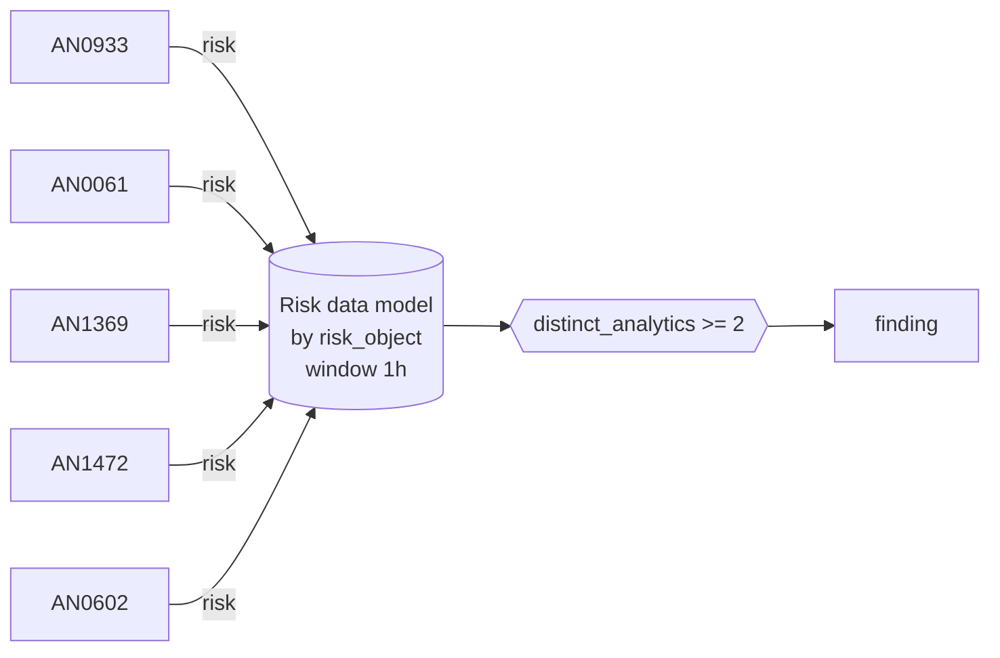

# RISK0003 Ransomware precursors on one host

Cross-strategy risk correlation (not an ATT&CK object).

**Shape:** risk rule: over the Risk data model → finding only · **Severity:** critical · **Status:** implemented

Two or more of the ransomware preparation and execution analytics fire on the same host within an hour: recovery inhibited (AN0933), service stop burst (AN0061), security tooling tampered with (AN1369), event logs cleared (AN1472), ransom notes dropped (AN0602).



## Tuning

| Macro | Default | Purpose |
|---|---|---|
| `mitre_risk0003_filter` | `search *` | Exclusions for RISK0003 Ransomware precursors on one host. |
| `mitre_risk0003_condition` | `distinct_analytics >= 2` | Firing condition for RISK0003. Fields: risk_score, risk_events, distinct_analytics, distinct_strategies, distinct_tactics, distinct_techniques. |

## Splunk

Stanza `[MITRE - RISK0003 - Ransomware precursors on one host - Rule]` in `DA-ESS-mitre-attack-detections`. Schedule `0-59/15 * * * *`, window `-1h` to `now`. Ships disabled.

Generated from the parameters below; edit the YAML, not the search. Scope: `source IN ("MITRE - AN0933 - *", "MITRE - AN0061 - *", "MITRE - AN1369 - *", "MITRE - AN1472 - *", "MITRE - AN0602 - *") All_Risk.risk_object_type IN ("system")`.

| Parameter | Value |
|---|---|
| group_by | risk_object |
| window | 1h |
| condition | `distinct_analytics >= 2` |

```spl
| tstats `mitre_summariesonly` min(_time) as firstTime max(_time) as lastTime sum(All_Risk.calculated_risk_score) as risk_score count as risk_events
    from datamodel=Risk.All_Risk where source IN ("MITRE - AN0933 - *", "MITRE - AN0061 - *", "MITRE - AN1369 - *", "MITRE - AN1472 - *", "MITRE - AN0602 - *") All_Risk.risk_object_type IN ("system")
    by All_Risk.risk_object All_Risk.risk_object_type source
| `drop_dm_object_name(All_Risk)`
| rex field=source "^MITRE - (?<mitre_id>(AN|DET)\d{4}) - "
| lookup mitre_attack_analytics an_id AS mitre_id OUTPUT det_id AS an_det_id tactics AS an_tactics technique_id AS an_technique_id
| lookup mitre_attack_detection_strategies det_id AS mitre_id OUTPUT tactics AS det_tactics technique_id AS det_technique_id
| eval det_id=coalesce(an_det_id, if(match(mitre_id, "^DET"), mitre_id, null())), tactic=split(coalesce(an_tactics, det_tactics), "|"), technique_id=coalesce(an_technique_id, det_technique_id)
| stats min(firstTime) as firstTime max(lastTime) as lastTime sum(risk_score) as risk_score sum(risk_events) as risk_events dc(mitre_id) as distinct_analytics dc(det_id) as distinct_strategies dc(tactic) as distinct_tactics dc(technique_id) as distinct_techniques values(mitre_id) as mitre_ids values(technique_id) as technique_ids values(tactic) as tactics values(source) as source by risk_object risk_object_type
| where `mitre_risk0003_condition`
| `mitre_ctime(firstTime)` | `mitre_ctime(lastTime)`
| `mitre_risk0003_filter`
```

## Sigma

Not expressed in Sigma: Operates on Enterprise Security risk events, which Sigma does not model.

## Known false positives

- Decommissioning or reimaging scripts that stop services and clear logs; exclude the hosts during the change window.
